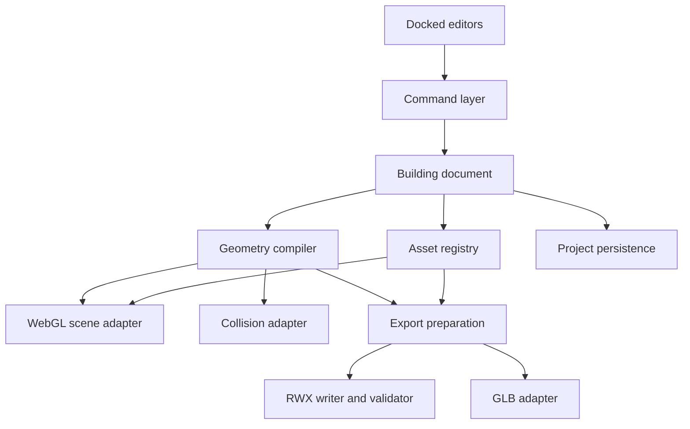
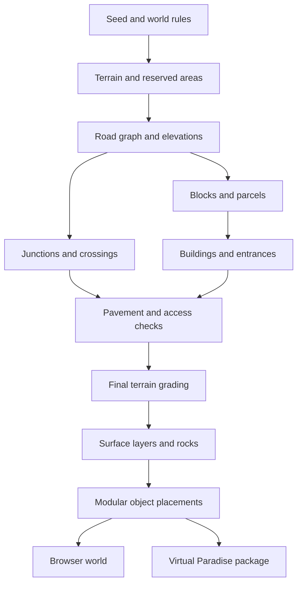

# Modular Building and City Creator — Product and Implementation Plan

**Version:** 1.4 — Virtual Paradise preview, world themes, procedural vegetation, and command-driven water  
**Date:** 11 October 2026  
**Status:** Planning specification; implementation has not started  
**Platform:** Browser application using WebGL 2  
**Primary output:** Editable building/world projects, an AW-style browser preview, and `c3-` RWX/texture/group packages for Virtual Paradise  
**Working product name:** c3 Modular World Studio

**Scope update:** The final import target is Virtual Paradise (VP), with an Active Worlds-style browser building and preview experience. The browser editor will generate and simulate navigable towns/cities assembled from reusable modular objects, with roads, junctions, pavements, bridges, and buildings. All exported object and texture names must begin with `c3-`. Users can import their own textures. Sections 34–63 define world generation, terrain, target preview, themes, vegetation, waterways, and effects; they extend the building system. Record the exact VP client build, renderer, and world settings before claiming target fidelity. Historical AW behavior remains reference material and an optional separately tested compatibility profile.

**Terrain decision:** The selected parcel uses our own detailed, procedural mesh terrain. Native target-world terrain is assumed absent beneath that parcel, as requested. Landforms, rock formations, ground-material distribution, and natural detail are generated from reproducible recipes. Terrain exports as ordinary placed `c3-` RWX objects with textures and groups. Native target-world terrain editing/export is outside this plan; AW-style coordinates remain placement references through the VP adapter. Sections 45–52 define the custom-terrain workflow.

**Preview contract:** Users can inspect and walk through the complete build in the browser before importing it into VP. Provide an editable Authoring view and an Export Preview that reconstructs the emitted RWX, textures, groups, and actions. Supported behavior is simulated; unsupported behavior is identified explicitly. Sections 53–55 make this a required delivery feature.

**Environment decision:** Temperate/modern, desert, jungle, fantasy, and sci-fi theme families are required, with editable combinations and custom packs. Vegetation is generated as actual low-poly plant geometry, including roots, trunks, branches, leaves, fronds, and distinct succulent/alien forms. Creeks, paths, crossings, and waterfalls integrate with the procedural terrain. Implement a bounded VP-first `move`/`rotate` and verified texture-animation runtime for exportable effects; document AW-derived assumptions where VP specifications are incomplete. Sections 56–63 define this scope and supersede earlier blanket deferral of motion or animation.

**Contents**

- [1. Product vision](#1-product-vision)
- [2. Product principles and release scope](#2-product-principles-and-release-scope)
- [3. Core user journeys](#3-core-user-journeys)
- [4. Workspace and pane behavior](#4-workspace-and-pane-behavior)
- [5. Editors, selection, and controls](#5-editors-selection-and-controls)
- [6. Building archetypes and starter content](#6-building-archetypes-and-starter-content)
- [7. Configuration system](#7-configuration-system)
- [8. Modular kit and connection system](#8-modular-kit-and-connection-system)
- [9. Footprints, floors, and walls](#9-footprints-floors-and-walls)
- [10. Windows, glazing, and doors](#10-windows-glazing-and-doors)
- [11. Roofs and exterior detail](#11-roofs-and-exterior-detail)
- [12. Interior generation and editing](#12-interior-generation-and-editing)
- [13. Stairs, connectivity, and walkthrough](#13-stairs-connectivity-and-walkthrough)
- [14. Shopfronts, signs, and billboards](#14-shopfronts-signs-and-billboards)
- [15. Materials and open texture assets](#15-materials-and-open-texture-assets)
- [16. WebGL rendering and lighting](#16-webgl-rendering-and-lighting)
- [17. Low-poly design and performance](#17-low-poly-design-and-performance)
- [18. RWX export: target contract](#18-rwx-export-target-contract)
- [19. RWX export: implementation pipeline](#19-rwx-export-implementation-pipeline)
- [20. Other outputs and project portability](#20-other-outputs-and-project-portability)
- [21. Semantic data model](#21-semantic-data-model)
- [22. Application architecture](#22-application-architecture)
- [23. Persistence, undo, and recovery](#23-persistence-undo-and-recovery)
- [24. Asset loading, browser resilience, and input safety](#24-asset-loading-browser-resilience-and-input-safety)
- [25. Diagnostics and helpful quality tools](#25-diagnostics-and-helpful-quality-tools)
- [26. Verification strategy](#26-verification-strategy)
- [27. Implementation roadmap](#27-implementation-roadmap)
- [28. Milestone deliverables and progress tracking](#28-milestone-deliverables-and-progress-tracking)
- [29. Acceptance checklist](#29-acceptance-checklist)
- [30. Main risks and deliberate mitigations](#30-main-risks-and-deliberate-mitigations)
- [31. Open decisions and safe defaults](#31-open-decisions-and-safe-defaults)
- [32. Suggested first implementation instruction](#32-suggested-first-implementation-instruction)
- [33. Research notes and primary references](#33-research-notes-and-primary-references)
- [34. City scope and AW-style user journey](#34-city-scope-and-aw-style-user-journey)
- [35. Deterministic generation and urban layout](#35-deterministic-generation-and-urban-layout)
- [36. Roads, crossroads, and pavements](#36-roads-crossroads-and-pavements)
- [37. Terrain, bridges, and viaducts](#37-terrain-bridges-and-viaducts)
- [38. World editor, data model, and streaming](#38-world-editor-data-model-and-streaming)
- [39. Reusable RWX objects, materials, and the c3- namespace](#39-reusable-rwx-objects-materials-and-the-c3--namespace)
- [40. Minimal AW-style command support](#40-minimal-aw-style-command-support)
- [41. AWG groups, practical limits, and placement choices](#41-awg-groups-practical-limits-and-placement-choices)
- [42. Complete world package and target reconstruction](#42-complete-world-package-and-target-reconstruction)
- [43. City implementation milestones](#43-city-implementation-milestones)
- [44. Extended acceptance gates and research record](#44-extended-acceptance-gates-and-research-record)
- [45. Owned parcel terrain and landscape scope](#45-owned-parcel-terrain-and-landscape-scope)
- [46. Procedural landforms, erosion, and surface data](#46-procedural-landforms-erosion-and-surface-data)
- [47. Ground materials, texture splatting, and baking](#47-ground-materials-texture-splatting-and-baking)
- [48. Procedural rocks, cliffs, and natural detail](#48-procedural-rocks-cliffs-and-natural-detail)
- [49. Terrain integration with roads, buildings, water, and traversal](#49-terrain-integration-with-roads-buildings-water-and-traversal)
- [50. Terrain optimization, chunk boundaries, and RWX delivery](#50-terrain-optimization-chunk-boundaries-and-rwx-delivery)
- [51. Terrain workspace, inspection, and realistic quality gates](#51-terrain-workspace-inspection-and-realistic-quality-gates)
- [52. Terrain implementation track, acceptance, and sources](#52-terrain-implementation-track-acceptance-and-sources)
- [53. Virtual Paradise target and browser simulation contract](#53-virtual-paradise-target-and-browser-simulation-contract)
- [54. Preview runtime, exported-file reconstruction, and interaction](#54-preview-runtime-exported-file-reconstruction-and-interaction)
- [55. Virtual Paradise validation and implementation priority](#55-virtual-paradise-validation-and-implementation-priority)
- [56. World themes, biomes, and reusable environment packs](#56-world-themes-biomes-and-reusable-environment-packs)
- [57. Procedural plant construction from roots to leaves](#57-procedural-plant-construction-from-roots-to-leaves)
- [58. Vegetation families and believable biome placement](#58-vegetation-families-and-believable-biome-placement)
- [59. Vegetation materials, budgets, collision, and RWX delivery](#59-vegetation-materials-budgets-collision-and-rwx-delivery)
- [60. Procedural creeks, trails, paths, and landscape connections](#60-procedural-creeks-trails-paths-and-landscape-connections)
- [61. Waterfalls and water effects using deliverable geometry](#61-waterfalls-and-water-effects-using-deliverable-geometry)
- [62. VP-first move, rotate, and texture-animation runtime](#62-vp-first-move-rotate-and-texture-animation-runtime)
- [63. Environment delivery milestones, acceptance, and research](#63-environment-delivery-milestones-acceptance-and-research)

## 1. Product vision

Build a capable, enjoyable browser editor for designing reusable, low-poly buildings with real interiors and assembling them into coherent, navigable cities. A user should be able to start with a shop, apartment block, detached house, villa, or reference-based house, change its proportions and layout, furnish it, and walk through it. At world scale, a reproducible seed generates terrain, connected roads, pavements, lots, buildings, and street details. Export preserves reusable assets and their placements for Virtual Paradise; the browser provides an AW-style inspection and walkthrough workflow before import.

The interface should feel like a modern creative IDE: dockable panes, document tabs, a searchable command palette, a scene explorer, property inspectors, and a large central workspace. A floor plan, 3D view, material editor, and export preview should describe the same building, with synchronized selection and edits.

The product must combine fast generation with precise editing. Presets provide a useful starting point; individual walls, windows, rooms, roofs, stairs, and signs remain editable afterward. Low-poly should mean efficient construction and convincing proportions, rather than featureless boxes or fake interiors.

This document specifies the intended features, architecture, data contracts, implementation order, and evidence required for release. Numerical budgets are proposed engineering targets, not measured performance claims. Linked assets are researched candidates; they have not been downloaded or packaged by this planning task.

### 1.1 The essential promise

1. Pick a building type and style.
2. Configure its footprint, floors, facade, roof, windows, and materials.
3. Generate or draw a connected interior.
4. Refine rooms, stairs, furniture, shopfronts, and advertising surfaces.
5. Enter the building and inspect it at human scale.
6. See what the selected RWX target will preserve or simplify.
7. Generate or edit a city around these buildings, retaining manual overrides.
8. Export `c3-` models, textures, world placements, groups, provenance, and a useful validation report.

### 1.2 Scope decisions

| Decision | Initial direction |
| --- | --- |
| Primary experience | Desktop browser authoring, with a usable tablet inspection mode |
| Graphics | WebGL 2; no dependency on WebGPU |
| Application form | Full web application, with local project storage and downloadable files |
| Editing approach | Semantic building model plus procedural mesh generation |
| Building scale | Individual buildings through chunked, generated towns/cities; scene size constrained by measured budgets |
| Ground system | Owned procedural mesh terrain and rock formations within a parcel; native target-world terrain assumed absent there |
| Ground appearance | Procedural material distribution and editable splatting in WebGL, with baked RWX-compatible textures |
| World themes | Temperate/modern, desert, jungle, fantasy, sci-fi, custom packs, and per-region overrides |
| Vegetation | Procedural three-dimensional plants with species-specific structure, materials, placement, and quality budgets |
| Water and paths | Generated beds/banks, creeks, paths, crossings, waterfalls, and deliverable geometry/action effects |
| Interior fidelity | Walkable rooms, wall thickness, stairs, doorways, ceilings, and optional furniture |
| Asset approach | Curated CC0 textures, user texture uploads, and reusable low-poly procedural modules |
| Main export | Text RWX assets, baked textures, and VP-tested placement/group data in an object-path-ready package |
| Preview target | AW-style browser simulation, calibrated against the selected Virtual Paradise client and renderer |
| Export namespace | Mandatory `c3-` prefix on every emitted model, texture, mask, and group asset |
| Scripting scope | Bounded generated creation/activation commands, required move/rotate effects, and profile-verified texture animation; full object scripting deferred |
| RWX compatibility claim | Only for a named, actually tested consumer/version |
| Secondary export | GLB and plan images after the RWX workflow is reliable |
| Initial network requirement | Download the application and chosen asset packs; core editing then uses local data |
| Accounts and collaboration | Optional future capabilities; not prerequisites for creating or exporting |
| Exact “Kennedy house” | A requested named preset whose reference image, plan, or intended example still needs identification |

**Important interpretation:** “Kennedy house” does not identify one universally recognizable architectural type. Reserve the name in the preset backlog, support reference images and custom presets, and build the house system so the correct example can be added without rewriting the editor. Do not silently substitute a colonial house, a particular historic property, or a different asset creator.

## 2. Product principles and release scope

### 2.1 Principles

- **One authoritative building model.** Floor plans, render meshes, collision shapes, measurements, and export files derive from the same semantic document.
- **Geometry must support the experience.** A visible doorway must also be an opening in the wall and collision model. A stair must lead to an actual opening in the upper floor.
- **Proportions before decoration.** Clear silhouettes, believable floor heights, sensible window placement, and readable materials matter more than dense mesh detail.
- **Configurability with constraints.** Show valid ranges, dependencies, and the effects of a change. Do not silently produce self-intersecting walls or unreachable rooms.
- **Repeatable generation.** Identical document, seed, generator version, and settings produce equivalent geometry and exports.
- **Preserve manual work.** Regeneration respects locked elements and overrides, or shows a conflict before replacing them.
- **Export is a product feature.** Validate RWX early and continuously instead of attaching a serializer at the end.
- **Performance is visible.** Show triangle counts, material batches, texture memory estimates, and exported expansion costs during editing.
- **Portable projects.** A complete project package can be reopened without the original provider URLs remaining available.
- **Recoverable editing.** Undo, autosave, safe cancellation, and migration support are part of the first usable editor.

### 2.2 Scope labels used throughout

| Label | Meaning |
| --- | --- |
| Foundation | Required to establish correct geometry, persistence, rendering, and RWX conventions |
| First usable release | A complete shop and detached-house workflow, including interior walkthrough and RWX export |
| Full v1 | Apartments, villas, mixed-use buildings, richer roofs, advanced facade variation, and a polished workspace |
| Complete world/environment release | City and custom terrain tracks, VP Export Preview, five theme families, procedural flora, waterways/paths, and verified effects from sections 34–63 |
| Later | Extensions that do not delay the core requested application |
| Reference pending | A feature whose particular visual target has not been supplied, especially the Kennedy house preset |

### 2.3 Explicit boundaries

The product is a virtual-building and city authoring tool with a navigable world preview. Structural engineering, construction documentation, full BIM/IFC authoring, arbitrary sculpting, multiplayer networking, full economic/traffic simulation, complete Active Worlds object-script emulation, and photorealistic offline rendering remain separate future capabilities. Their absence must not compromise editable interiors, connected streets, useful exports, or a polished browser experience.

## 3. Core user journeys

### 3.1 Create a shop

1. Choose single shop, corner shop, or shop with apartments above.
2. Enter width, depth, floor height, facade bay count, and entrance position.
3. Select a storefront: full-height glazing, masonry piers, recessed entrance, or traditional framed display windows.
4. Define sales area, stockroom, staff room, and an optional restroom.
5. Add a shop sign above the entrance, a projecting sign, or a billboard zone.
6. Upload artwork or create text with a bundled font; adjust crop and safe margins.
7. Add a counter, shelving, and a few low-poly props.
8. Walk from the pavement through the entrance to the back room.
9. Export a self-contained textured RWX package and inspect its compatibility report.

### 3.2 Create a block of flats

1. Set footprint, number of storeys, common entrance, and circulation type.
2. Choose a corridor, gallery-access, or central-core arrangement.
3. Place a stair core and optional lift shaft before generating apartment units.
4. Select apartment templates and their distribution across each floor.
5. Configure balconies, facade rhythm, roof, and ground-floor treatment.
6. Edit one apartment as a linked template or detach it as a unique unit.
7. Validate the entrance-to-unit route and each upper-floor connection.
8. Choose how much interior is included in the exported asset.

### 3.3 Create a villa or custom house

1. Select a rectangle, L-shape, U-shape, courtyard layout, or connected wings.
2. Set overall massing, storeys, roof style, terraces, and garage.
3. Generate a room arrangement or draw a floor plan manually.
4. Place larger windows, sliding doors, porches, pergolas, and balconies.
5. Apply a coherent material palette and refine each elevation.
6. Inspect the building in a cutaway and then at eye level.
7. Save the result as a reusable house preset.

### 3.4 Build a reusable modular kit

1. Design compatible wall, corner, window, door, floor, roof, and stair modules.
2. Define their dimensions, connection sockets, and material slots.
3. Test snapping and joint closure in a kit preview scene.
4. Generate multiple buildings from the kit with independent seeds.
5. Export either a complete building or individual modules with a placement manifest.

## 4. Workspace and pane behavior

### 4.1 Main application regions

| Region | Contents | Behavior |
| --- | --- | --- |
| Top menu | File, Edit, View, Build, Materials, Walk, Export, Help | Always reachable; compact overflow on narrow screens |
| Main toolbar | Select, draw, transform, snap, floor, view mode, Walk, Validate, Export | Contextual tools; primary actions retain labels |
| Activity rail | Buildings, Scene, Modules, Materials, Rooms, Assets, Problems | Switches the main sidebar without altering the document |
| Left sidebar | Project explorer, hierarchy, searchable libraries | Resizable, hideable, and dockable |
| Central workspace | 3D, floor plan, elevation, material preview, export preview | Tabs and split groups; selection synchronized |
| Right inspector | Properties, constraints, finishes, dimensions, instance overrides | Selection-driven with searchable fields |
| Bottom panel | Problems, export output, performance, history, asset processing | Resizable and hideable; does not permanently consume viewport space |
| Status bar | Selection, units, grid, active floor, save state, task progress, quality profile | Compact, readable, and non-blocking |

### 4.2 Docking requirements

- Drag a pane tab to another group or split it left, right, above, or below.
- Show the target docking region before the drop occurs.
- Resize neighboring groups with dividers; honor per-pane minimum dimensions.
- Allow same-browser floating panes with bounds constrained to the visible workspace.
- Maximize a pane, then restore its previous position and dimensions.
- Close and reopen panes from View or the command palette without losing their meaningful state.
- Save named workspace layouts independently from the building document.
- Restore the previous layout after reload, with migration and a Reset Layout action.
- Revalidate saved floating bounds when the browser size, zoom, screen, or orientation changes.
- Keep menus, popovers, color pickers, and tooltips inside the visible browser viewport.
- Offer menu-based Move Pane commands so docking does not require drag-and-drop.
- A panel resize must not reset the camera, re-create the document, or stop a walkthrough unexpectedly.
- Collapsed or inactive 3D views must stop unnecessary rendering and cannot retain pointer lock.

Use the MIT packages of Dockview for the docking foundation. Its current licensing separates core packages from a proprietary enterprise package. Core docking, split resizing, floating groups, layout persistence, and maximize/restore are available in the free offering. Audit the package actually installed; do not accidentally introduce enterprise-only behavior as a dependency. [S3, S4]

Application command menus will provide keyboard-accessible pane movement. Advanced automatic hiding, pinned tab behavior, and spatial keyboard docking are not assumed to be free built-in features; include them only through an explicitly chosen implementation.

### 4.3 Suggested workspace presets

| Preset | Main view | Supporting panes |
| --- | --- | --- |
| Build | Large 3D viewport | Modules, hierarchy, inspector |
| Plan | Floor plan and 3D side by side | Rooms, dimensions, constraints |
| Facade | Elevation and perspective | Bay pattern, windows, materials |
| Interior | Cutaway or floor plan plus 3D | Furniture, room graph, lighting |
| Materials | Selected surface and material preview | Palette, texture channels, UV tools |
| Walkthrough | Large first-person view | Compact minimap and interaction hints |
| Export | RWX approximation preview | Target profile, file list, diagnostics, statistics |

### 4.4 Responsive layout rules

These are initial layout targets to verify with actual content, not fixed CSS assumptions.

| Browser content width | Intended layout |
| --- | --- |
| 1600 px and above | Two sidebars, central split views, optional bottom panel |
| 1200–1599 px | One primary sidebar and inspector; split view remains optional |
| 900–1199 px | One sidebar at a time; inspectors can overlay or use tabs |
| 640–899 px | Tablet inspection and simpler editing; one central view |
| Below 640 px | Project preview, walkthrough controls, and basic property adjustments |

Initial minimums: 240 px for a library, 280 px for a property inspector, and approximately 480 × 320 px for a practical primary editing view. If the window cannot fit these together, collapse auxiliary regions into tabs or drawers. Do not squeeze all panels into unusable slivers.

Acceptance includes 1366 × 768, 1920 × 1080, a large desktop display, tablet portrait/landscape, browser zoom at 125% and 150%, and resizing while a menu or dialog is open.

### 4.5 Visual design

- Neutral dark and light themes with strong contrast and one restrained accent color.
- Quiet panel chrome; the building remains the visual focus.
- Consistent icon sizes, spacing, headings, numeric controls, and selection outlines.
- Distinct colors for selected, hovered, locked, invalid, and generated elements.
- Dirty-state indicator on the project tab and explicit autosave status.
- Tooltips explain units and consequences, not implementation jargon.
- Small contextual help and shortcut hints; avoid permanent tutorial overlays.
- Theme-independent surface colors: switching the UI theme must not recolor building materials.

## 5. Editors, selection, and controls

### 5.1 Editing modes

| Mode | Main operations |
| --- | --- |
| Building | Footprint, floors, massing, preset selection |
| Plan | Draw walls, close rooms, place openings, dimensions, stairs |
| Facade | Bay patterns, window groups, trims, balconies, signs |
| Roof | Roof sections, pitch, ridges, overhangs, roof openings |
| Interior | Room finishes, furniture, doors, fixtures, ceiling settings |
| Material | Assign and edit materials, UV scale, palette replacement |
| Walk | Human-scale inspection and door interactions |
| Export | Target approximation, scope, simplification, packaging |

Every mode operates on the same document. Switching modes must not duplicate the building or discard editable parameters.

### 5.2 Selection and editing behavior

- Select a building, floor, wing, room, wall, wall side, opening, module, prop, or sign.
- Hierarchy selection and viewport selection stay synchronized.
- Support multi-select, box-select in plans, group selection, hide, isolate, and lock.
- Repeated clicks or a modifier can cycle through overlapping objects.
- Selecting a batched or instanced mesh resolves back to the semantic object that owns the hit.
- Numeric inspector edits are exact; transform gizmos support grid snapping.
- Display local/world axes, dimensions, wall-side orientation, and floor elevation where relevant.
- A drag previews continuously but becomes one undo transaction when committed.
- Invalid previews show why they fail and restore the last valid document on cancel.
- Delete previews affected children and references when a destructive cascade is involved.
- Copy/paste regenerates object IDs while preserving internal connections and material references.

### 5.3 Shortcut proposal

| Shortcut | Action |
| --- | --- |
| Ctrl/Cmd+Z | Undo document edit |
| Ctrl/Cmd+Shift+Z | Redo document edit |
| Ctrl/Cmd+S | Save through the available file workflow |
| Ctrl/Cmd+Shift+P | Open command palette where the browser allows interception |
| F | Frame selected object in the active 3D view |
| Escape | Cancel operation; leave pointer lock or exit transient mode |
| Delete/Backspace | Delete selection when no text field is focused |
| W / E / R | Move / rotate / scale in editing mode |
| Ctrl/Cmd+D | Duplicate selection where interception is available |
| Space plus drag | Pan the 2D plan |
| WASD | Walk only while Walk mode owns keyboard input |
| E | Interact with a door only in Walk mode |

All shortcuts are discoverable and remappable. Browser-reserved combinations are not the only way to perform an action. Typing into a text box must never move the camera, delete geometry, or trigger a building tool.

### 5.4 Useful inspection tools

- Ruler, angle measurement, room area, floor area, and bounding-box dimensions.
- North/front marker, axis widget, grid scale, and a human-scale reference figure.
- Perspective and orthographic views; top/front/back/left/right camera bookmarks.
- Section planes, storey isolation, roof hide, wall fade, and exploded-floor preview.
- Wireframe, face orientation, normals, material IDs, UV checker, and collision overlay.
- A Problems item frames the offending wall, opening, room, or material.
- Side-by-side material or export comparison with synchronized cameras.
- Reproducible camera bookmarks for inspection and screenshots.

Cutaways, hidden ceilings, selection outlines, and diagnostic overlays are view state. They do not remove geometry from an export unless an explicit export scope requests that result.

## 6. Building archetypes and starter content

### 6.1 Archetype catalog

| Archetype | Distinctive configuration | Interior expectations | Release |
| --- | --- | --- | --- |
| Small shop | Facade bays, entrance, display glass, sign band | Sales area and back room | First usable |
| Corner shop | Two street elevations, corner entrance options | Connected retail space and service area | Full v1 |
| Shop with flats above | Different ground-floor height, private residential entrance | Separate shop and upper-floor circulation | Full v1 |
| Terraced house | Shared side-wall policy, narrow frontage, repeated bays | Hall, living area, kitchen, upper bedrooms | Full v1 |
| Detached house | Porch, garage option, roof family | Connected rooms and stairs where needed | First usable |
| Semi-detached pair | Mirrored or varied paired units | Independent entrances and interior routes | Full v1 |
| Low-rise flats | Repeated units, stair cores, balconies | Common circulation and apartment templates | Full v1 |
| Mid-rise flats | More repeated storeys, facade grouping, optional lift shaft | Efficiently generated unit layouts | Full v1 |
| Modern villa | Connected volumes, terraces, large glazing | Open living spaces and private rooms | Full v1 |
| Pitched-roof villa | Gable/hip combinations, porches, dormer options | Multiple rooms, stairs, optional attic | Full v1 |
| Courtyard villa | U-shaped or enclosed courtyard massing | Rooms connected around the courtyard | Full v1 |
| Kennedy house | Parameters derived from the supplied reference | Match reference where information exists | Reference pending |
| Office, cafe, workshop | Reuse shop/house systems with appropriate kits | Work areas, service rooms, simple props | Later packs |

The Kennedy preset can remain explicitly pending while the generic house system ships. If it is required for the user's full v1 acceptance, obtain its reference before declaring that requested preset complete.

### 6.2 Style packs

Keep building type independent from visual style. The same floor plan can use a Dutch brick palette, modern white render, timber siding, a modest concrete apartment facade, or a traditional shopfront.

A style pack defines compatible materials, window and door families, trims, roof families, balcony types, proportions, default signage, and optional furnishing choices. It does not silently overwrite the room graph.

Initial style directions:

- Warm brick neighborhood with simple pitched roofs.
- Contemporary plaster/concrete villa with timber accents.
- Practical apartment block with repeated windows and balconies.
- Traditional neighborhood retail with framed display windows and fascia signs.
- Minimal commercial frontage with larger glazing and restrained metalwork.

### 6.3 Initial example projects

| Example | Purpose |
| --- | --- |
| 6 × 10 m neighborhood shop | Storefront, sign, interior doorway, stockroom, export |
| 8 × 10 m two-storey house | Stairs, upper-floor opening, roof, bedroom windows |
| Four-storey apartment building | Linked floors, common stairs, apartment variations, balconies |
| L-shaped two-storey villa | Connected wings, terrace, large windows, material contrast |
| Corner mixed-use building | Distinct commercial and residential entrances |
| Small street assembled from modules | Shared materials, batching, LOD, export expansion |

These dimensions are test fixtures and starting presets; users can change them.

## 7. Configuration system

### 7.1 Configuration layers and precedence

Use a clear precedence order:

1. Application defaults.
2. Chosen style pack.
3. Building preset parameters.
4. Building-wide settings.
5. Wing, floor, facade, or room overrides.
6. Individual element overrides.

The inspector shows whether a value is inherited or locally overridden, where it comes from, and how to reset it. “Apply to all matching windows” and “Make unique” are separate actions.

### 7.2 Main parameter groups

| Group | Configurable properties |
| --- | --- |
| Site | Ground height, placement origin, orientation, plot guide, pavement width |
| Footprint | Width/depth, outline, wings, courtyard, wall baseline choice |
| Floors | Count, elevation, floor-to-floor height, slab thickness, linked templates |
| Walls | Thickness, finish on each side, height, corner behavior, base trim |
| Facade | Bay count/width, margins, alignment, repetition, symmetry, accents |
| Windows | Dimensions, sill, recess, frame, mullions, glazing, opening type |
| Doors | Opening size, frame, threshold, swing/slide, hinges, leaf material |
| Roof | Family, pitch, ridge, eaves, overhang, thickness, material, accessories |
| Interiors | Room types, preferred sizes, circulation, finishes, furnishing density |
| Stairs | Width, rise/run targets, landings, direction, headroom, railing |
| Balconies | Projection, width, floor association, railing, support appearance |
| Signs | Slot size, artwork, crop, text, mounting, illumination, export behavior |
| Materials | Palette, physical tile size, tint, roughness, UV orientation |
| Variation | Seed, locked groups, allowed ranges, variation frequency |
| Optimization | Geometry quality, furnishings, LOD, texture resolution, target budgets |
| Export | Profile, scope, origin, unit conversion, grouping, textures, door pose |

### 7.3 Validation and editing ranges

Hard constraints protect valid geometry: finite coordinates, positive dimensions, valid polygons, openings inside their host wall, supported roof conditions, and valid references. Soft constraints flag design concerns such as cramped passages or an awkward staircase.

Starter ranges are helpful presets, not universal rules. For example, residential floor-to-floor heights might initially offer 2.6–3.6 m, commercial ground floors 3.0–5.0 m, and wall thickness 0.10–0.40 m. Advanced input may exceed a starter range if the geometry remains valid. Clearly distinguish a geometry error from a design suggestion.

### 7.4 Variation and regeneration

- Use independent seed streams for massing, facade, materials, and furnishings.
- Let users lock geometry while randomizing the material palette, or lock room layout while changing windows.
- Preview several bounded variations without committing all of them to the project.
- Preserve selected features and manually edited modules during regeneration.
- Present conflicts when a changed footprint can no longer contain a locked stair or room.
- Store generator version, recipe, seed, and explicit overrides.
- Generator upgrades offer a preview and migration; reopening a project must not silently redesign it.
- Undo restores the previous generated state and its overrides as one transaction.

## 8. Modular kit and connection system

### 8.1 Module families

| Family | Initial modules |
| --- | --- |
| Walls | Solid, window, door, large shop opening, inside/outside corner, end cap |
| Floors | Rectangular slab, polygon slab, stair void edge, terrace, balcony slab |
| Openings | Window assemblies, door assemblies, storefront sections, arches later |
| Roofs | Flat section, parapet, gable section, ridge, hip section, eave, fascia |
| Circulation | Straight stair, landing, L/U stair, corridor connector, ramp |
| Facade details | Sill, lintel, pilaster, belt course, cornice, shutter, awning |
| Exterior details | Porch, railing, pergola, gutter, downpipe, chimney |
| Retail | Fascia sign, projecting sign, billboard frame, display shelf, counter |
| Interior | Partition, internal door, skirting, cabinet, kitchen block, furniture |

### 8.2 Module definition

A module definition contains a stable ID and version, parameter schema, generator, bounds, local origin, connection sockets, material slots, collision recipe, LOD rules, thumbnail recipe, category tags, and export policy.

A socket records its local position and orientation, connection category, supported dimensions, matching rules, and seam policy. Connections distinguish structural alignment from decorative attachment; attaching a sign must not rewrite a wall intersection.

### 8.3 Snapping and seams

- Grid snapping with practical increments such as 0.10, 0.25, 0.50, and 1.00 m.
- Endpoint, midpoint, wall-face, opening-center, floor-elevation, and socket snapping.
- Configurable angle snapping and numeric rotation.
- Visual snap candidates and a temporary snap-disable modifier.
- Shared wall endpoints represented once in topology, rather than as nearly coincident independent values.
- Corner joins generate appropriate caps, miters, or overlap policies.
- Adjacent modules share surface boundaries and UV alignment rules.
- Repeated walls do not add unnecessary hidden end faces at every seam.
- Mirrored modules correctly update normals, winding, hinge side, and artwork orientation.
- Exposed edges get caps; internal joins avoid duplicate coplanar faces.

### 8.4 Reuse and overrides

Editing a module definition can update all linked instances. An instance can override material, dimensions, or an allowed subset of properties. “Make unique” creates an independent definition; it must not turn the entire building into an uneditable mesh.

Provide a reusable assembly level above individual modules: a shopfront, stair core, apartment unit, porch, or balcony row can be saved and placed as a unit.

## 9. Footprints, floors, and walls

### 9.1 Footprint editor

- Rectangle, L-shape, U-shape, courtyard, and free polygon tools.
- Vertex dragging, numeric edges, parallel offsets, alignment, and orthogonal constraints.
- Detect self-intersection, repeated edges, zero-area regions, and invalid courtyard holes.
- Add connected wings and floor setbacks.
- Distinguish external footprint dimensions from internal usable dimensions.
- Start from a background plan image with calibrated scale.
- Keep arbitrary angled footprints as a full v1 extension after orthogonal cases are stable.

### 9.2 Floors and levels

- Named levels with explicit elevations and floor-to-floor heights.
- Floor slabs with real thickness and material slots for top, underside, and edges.
- Linked repeated floors plus unique overrides for ground and top storeys.
- Explicit voids for stairs, atria, double-height rooms, and shafts.
- Balconies and terraces associated with a level, not floating loosely in space.
- Basement and split-level support later, after ordinary multi-storey circulation passes.
- Deleting a floor identifies affected stairs, openings, props, and linked templates.

### 9.3 Wall authoring

Walls are editable segments or chains with height, thickness, alignment baseline, finish per side, opening collection, and joint policy. A shared internal wall is one semantic wall with two finishes, not two overlapping walls generated independently from adjacent rooms.

Start with straight walls and orthogonal intersections. Add angled intersections once the joint solver handles short segments, near-collinear edges, and acute corners robustly. Curved walls are a later feature with explicit segment budgets.

### 9.4 Wall geometry strategy

For ordinary rectangular openings, construct wall surfaces around the opening regions using a 2D wall-local representation. Generate the remaining front/back faces and the reveals, head, sill, and end caps. Avoid running a general-purpose mesh Boolean operation on every wall during a slider drag.

For nonrectangular openings, use validated planar contours and triangulation as a separate extension. Do not introduce unsupported CSG as a hidden fallback that produces unpredictable topology.

Wall geometry must distinguish surfaces visible from inside, outside, and exposed edges. A low-poly interior still needs correctly oriented faces and sufficient thickness at openings.

## 10. Windows, glazing, and doors

### 10.1 Window configuration

- Width, height, sill height, wall offset, recess depth, and reveal material.
- Frame width/depth and different inner/outer colors.
- Pane subdivisions, mullions, transoms, and repeat spacing.
- Fixed, sash-like, casement, and large storefront visual families.
- Rectangular windows first; arched, round, bay, and corner assemblies afterward.
- Optional sills, lintels, shutters, roller boxes, blinds, and curtains.
- Linked window families with per-window overrides.
- Consistent alignment across a facade and between floors.

### 10.2 Real openings

A window is a host-wall opening plus an assembly. Wall faces and collision exclude the opening volume, while the glass or frame can supply the appropriate collision barrier. The window is visible from both the interior and exterior. Moving it updates the hole, reveals, UVs, and collision together.

Decorative facade-only windows are allowed for a deliberately non-enterable export profile. The editor must label them as such and must not generate them inside a space marked as walkable.

### 10.3 Glass profiles

| Profile | Browser appearance | Intended use |
| --- | --- | --- |
| Efficient clear/tinted glass | Simple transparency with restrained environment reflection | Default walkable buildings |
| Opaque facade glazing | Colored/reflection approximation | Distant or exterior-only assets |
| Frosted glass | Blurred-looking material approximation without expensive refraction | Bathrooms and privacy panels |
| Enhanced glass | Optional transmission/refraction effects | High-quality inspection, after profiling |
| RWX approximation | Target-tested opacity/mask/material behavior | Export preview and compatibility |

Do not stack unnecessary transparent sheets. Sort and group glazing deliberately; test windows viewed through other windows, interior lights behind glass, and neighboring transparent surfaces. Clearly disclose approximation in the RWX preview.

### 10.4 Doors

- Single, double, sliding, and storefront door families.
- Frame size, leaf thickness, handle style, threshold, hinge side, and swing angle.
- Door swing arcs in the floor plan and overlap diagnostics.
- Open/closed interaction during walkthrough with collision moving consistently.
- Return to the authored pose when leaving simulation unless the user chooses to save that pose.
- Prevent a closing door from trapping the player inside its collision volume.
- Export a selected static pose for the static foundation profile. The environment runtime supports verified interactive door presets through separate moving parts; their actual actions and collision must agree in Export Preview and VP.

## 11. Roofs and exterior detail

### 11.1 Roof families and progression

| Roof | Parameters | Implementation order |
| --- | --- | --- |
| Flat | Slab thickness, parapet, coping, drain appearance | First usable |
| Shed | Slope direction, pitch, overhang | First usable |
| Gable | Ridge direction, pitch, eaves, gable finish | First usable |
| Hip | Pitch, ridge treatment, corners | Full v1 |
| Joined roof sections | Per-wing roof, intersection/valley rules | Full v1 |
| Mansard/gambrel | Break heights and pitches | Later |
| Complex freeform roof | Explicit constraints or manual section assembly | Later |

A roof solver must declare which footprints and joins it supports. Unsupported combinations produce an actionable message or invite manual roof sections; they must not generate broken geometry while appearing successful.

### 11.2 Roof details

- Eaves, fascia, soffits, ridge caps, parapets, and wall-to-roof closure.
- Optional gutters and downpipes with controlled segment counts.
- Chimneys, rooflights, dormers, and solar-panel placeholders as later modules.
- Separate roof underside or ceiling treatment where visible from inside.
- No accidental open gaps at gables, valleys, wing junctions, or parapet corners.
- Tile detail primarily from textures and normals, with geometry reserved for silhouette edges and optional near detail.
- Hiding the roof for editing does not change the export unless the selected export scope says so.

### 11.3 Balconies, porches, and attachments

Support balcony slabs, solid or open railings, entrance steps, covered porches, terrace decks, simple pergolas, and garages. Their placement follows floors and walls. Railings use efficient repeated geometry, and attachment collision is explicit.

## 12. Interior generation and editing

### 12.1 Interior levels

| Level | Contents | Purpose |
| --- | --- | --- |
| Exterior only | Exterior shell with a deliberate non-enterable policy | Distant scenery |
| Walkable shell | Floors, ceilings, partitions, doors, and circulation | Leanest usable interior |
| Basic furnished | Essential room-specific objects | Default demonstration quality |
| Detailed low-poly | More props and fixtures within a budget | Richer close inspection |

Interior inclusion is independent from distance-based LOD. A nearby walkable room cannot disappear merely because an exterior facade is using a simpler mesh.

### 12.2 Room model

Rooms have IDs, names, types, floor association, boundary references, finish assignments, door connections, preferred furniture zones, and walkable clear space. Types include living room, kitchen, bedroom, bathroom, corridor, stairwell, lobby, shop floor, stockroom, staff room, and garage.

Store the wall/floor topology as authoritative. Derive enclosed room polygons from it and preserve room identity where possible. If a wall edit splits or merges rooms, show how room names, finishes, and furnishings will be reassigned. Do not maintain a second unsynchronized set of room polygons that can disagree with the walls.

### 12.3 Generator strategy

Start with template-based arrangements and a constrained adjacency model, rather than promising arbitrary architectural planning from a single “Generate” button.

The generator should:

1. Reserve entrance, circulation, stairs, and required floor openings.
2. Place major rooms according to area targets and adjacency preferences.
3. Fit wall and doorway modules to the available footprint.
4. Check that each required room is connected to an entrance.
5. Validate passage clearances and stair transitions.
6. Apply finishes and optional furnishings.
7. Return a preview, diagnostics, and any unsatisfied preferences.

Users can lock rooms, move walls, resize spaces, and rerun only the remaining unlocked region. If a requested layout cannot fit, report which requirements conflict rather than silently shrinking everything.

### 12.4 Apartments and repeated interiors

- Apartment templates can repeat across floors and be mirrored deliberately.
- Corridor and stair geometry is shared logically, avoiding duplicate partitions.
- One apartment can be edited independently by detaching its template instance.
- Interior finishes vary through palettes without duplicating texture resources.
- Detailed furnishing can be enabled for selected apartments only.
- Full v1 supports generating every unit, while runtime visibility limits which interiors are rendered.
- Export scope can include all interiors, selected units, or shell only, with a named choice in the manifest.

### 12.5 Furnishing

Initial procedural furniture: sofa, chair, table, bed, wardrobe, kitchen counter, sink block, toilet, shower block, shelf, retail counter, storage unit, and simple ceiling fixture.

Each prop has a footprint, optional clearance area, placement rules, attachment surfaces, material slots, collision category, and LOD. Automatic placement must respect doors, stairs, and circulation. Instancing improves rendering but does not replace editable object identity.

Imported props are a full v1 extension through a curated GLB workflow: inspect bounds, units, triangle counts, materials, texture licenses, and collision before accepting them into a reusable kit.

## 13. Stairs, connectivity, and walkthrough

### 13.1 Stair system

- Straight stairs and landings first; L and U stairs next.
- Configure floor association, total rise, width, target riser height, tread depth, landing size, and direction.
- Derive a whole number of steps and show the resulting dimensions before committing.
- Create matching floor voids, upper landing edges, and railings.
- Check headroom against the actual slab/ceiling geometry.
- Recompute when either connected floor elevation changes.
- Provide simple visual/collision representations independently when that improves movement.
- Spiral stairs and unusual curved stairs remain later features.

The diagnostics describe geometric clearance and navigability. The product does not claim that a suggested staircase has received building-code certification.

### 13.2 Walkthrough behavior

- Enter Walk mode from the current location or a named spawn point.
- Check for a safe grounded spawn; offer a nearby valid point if necessary.
- WASD movement, mouse look, optional sprint, configurable sensitivity, and invert-Y.
- Pointer lock starts only after a user gesture; Escape reliably releases it.
- Touch inspection uses visible movement/look controls instead of requiring pointer lock.
- Eye height and capsule dimensions are configurable; start near 1.65 m eye height and a roughly 0.30 m capsule radius.
- Grounded walking, step handling, slope limits, and stable descent.
- Doors open through an interaction prompt; collisions change at the same time.
- Optional noclip/fly mode is clearly indicated as an inspection tool.
- Return to the editing camera and selection when leaving Walk mode.
- Preserve the last safe grounded position for recovery from invalid geometry.

### 13.3 Collision architecture

Use a kinematic character controller with simplified static collision generated from the building document. Rapier is the proposed controller foundation; its documented character controller includes autostep and snap-to-ground behavior. Tune these features against the actual doorway and stair fixtures. [S5]

Use boxes or simplified meshes for walls, floors, and large fixtures. Repeated decorative trim should not create hundreds of unnecessary colliders. Where a stair ramp proxy is used, it must preserve landings, headroom, and the intended path; compare it with actual step collisions before choosing the default.

Collision rebuilds are transactional. While geometry is rebuilding, retain the previous consistent render/collision pair or pause movement with a clear status. Never swap a new floor mesh into view while leaving an unrelated old collision floor active.

### 13.4 Reachability checks

Use two complementary checks:

- **Semantic connectivity:** doors connect rooms, stairs connect floors, and required rooms have an entrance route.
- **Physical clearance:** the avatar capsule can traverse doorway widths, corridors, turns, landings, and floor transitions without passing through furniture or slabs.

A connected graph alone is not proof of walkability. First usable release validates known template paths and representative capsule sweeps. Full v1 adds broader walkable-space analysis; optional navigation-mesh generation can follow once its value and cost are demonstrated.

## 14. Shopfronts, signs, and billboards

### 14.1 Sign types

- Fascia strip above a shop window.
- Projecting/blade sign perpendicular to the facade.
- Recessed illuminated sign box.
- Wall-mounted billboard or poster frame.
- Freestanding pavement sign.
- Roof sign or larger billboard as a full v1 module.

### 14.2 Sign slots

Treat advertising areas as named facade attachments, not arbitrary textures accidentally painted over a wall. A slot has a host, dimensions, mount offset, orientation, safe content rectangle, material, aspect ratio, and independent content ID.

Slots can be reserved during facade generation so later window changes do not destroy the sign area. Show conflicts between a sign, window, balcony, door, or roof edge.

### 14.3 Artwork tools

- Import PNG, JPEG, or WebP; support sanitized/rasterized SVG through a controlled path.
- Fit, fill, crop, align, and pad artwork without distorting it by default.
- Add text with font, weight, size, line spacing, color, alignment, background, and border.
- Bundle a small font set with redistribution licenses; preserve notices in asset packs.
- Preview legibility at expected viewing distances.
- Show resolution and aspect-ratio warnings for pixelated or stretched artwork.
- Share one sign asset across several instances or make a sign unique.
- Optional emissive appearance in the browser; bake a suitable static appearance for RWX.
- Animated or video signs are later features and do not belong in the baseline static RWX promise.

### 14.4 Export behavior

Rasterize text and vector artwork to an export texture so the receiving viewer does not need the font or the browser's text engine. Use a unique stable texture name per content hash. Preserve independent UVs and enough padding to prevent atlas bleeding.

Distinguish a shop billboard from camera-facing sprite behavior. Architectural signs remain fixed to their mount unless the user explicitly creates another kind of object.

## 15. Materials and open texture assets

### 15.1 Source policy

Use CC0 assets for the bundled starter material library. Poly Haven states that its assets are CC0 and may be redistributed; ambientCG states that its assets are CC0, including downloadable files. Asset permissions and access-service terms are separate concerns. [S6, S7]

The initial implementation will curate, normalize, and serve selected asset files with the application or optional downloadable packs. A building must not depend on hotlinking a provider's preview image. Generate our own thumbnails from the downloaded maps.

If live provider search is added, use documented APIs, caching, restrained request rates, and current provider terms. Poly Haven's current live API terms require application identification and visible provider credit; the API terms distinguish this from the permissions of already downloaded CC0 assets. [S8] Browser code cannot freely set every request header, so verify an allowed browser request path or use an authorized service adapter instead of pretending to set a forbidden User-Agent header.

ambientCG documents an asset API and notes that service reliability is not guaranteed at an enterprise level. Core projects therefore retain their own asset bytes and provenance. [S9]

### 15.2 Verified starting shortlist

These asset pages were checked for this plan. They are candidates for normalization and visual QA, not a claim that the raw downloads already satisfy our rendering and RWX profiles. Each selected asset must still pass the ingestion checks below.

| Candidate | Source | Proposed use | Initial treatment |
| --- | --- | --- | --- |
| Brick Wall 02 | [Poly Haven](https://polyhaven.com/a/brick_wall_02) | Weathered shop/house exterior | 1K working maps; preserve real-world brick scale |
| Bricks 005 | [ambientCG](https://ambientcg.com/view?id=Bricks005) | Cleaner modular brick option | Compare tiling and scale against window bays |
| Plastered Wall 02 | [Poly Haven](https://polyhaven.com/a/plastered_wall_02) | Exterior render and stucco | Restrained normal intensity; tint variants |
| Concrete Floor 02 | [Poly Haven](https://polyhaven.com/a/concrete_floor_02) | Weathered service/exterior surfaces | Keep its weathering out of clean interior defaults |
| Wood Floor | [Poly Haven](https://polyhaven.com/a/wood_floor) | Living areas and bedrooms | Align grain/planks to room orientation |
| Wood Floor Deck | [Poly Haven](https://polyhaven.com/a/wood_floor_deck) | Terraces and decks | World-scale repetition |
| Wood Siding 006 | [ambientCG](https://ambientcg.com/view?id=WoodSiding006) | Weathered cladding accents | Optional aged style; not every villa's default |
| Floor Tiles 06 | [Poly Haven](https://polyhaven.com/a/floor_tiles_06) | Distinctive tiled shop/lobby floor | Checkered palette is optional, not universal |
| Clay Roof Tiles | [Poly Haven](https://polyhaven.com/a/clay_roof_tiles) | Pitched roofs | Texture detail on simple roof geometry |
| Paving Stones 036 | [ambientCG](https://ambientcg.com/view?id=PavingStones036) | Pavement, forecourt, paths | Verify physical repeat scale during ingestion |

Add author-generated flat paint, trim, metal, glass, and plain ceramic materials so the initial palette also supports clean modern buildings. These should use simple parameters or small tileable maps instead of unnecessary scanned textures.

### 15.3 Starter pack coverage

Target roughly 24–32 curated material recipes for full v1, counting genuinely different material recipes rather than every tint as a separate download. Coverage should include red/brown/light brick, smooth/rough render, clean/worn concrete, interior wood, exterior timber, ceramic and stone tile, clay roof, dark roof surface, painted metal, bare metal, glass presets, paving, and simple asphalt.

Only a small default subset is loaded initially. The library may show thumbnails for the rest without decoding every full-resolution map into GPU memory.

### 15.4 Ingestion pipeline

1. Resolve the exact asset page and downloadable files through an allowed source route.
2. Record provider, asset ID, creator where available, source URL, license URL, retrieval date, and content hashes.
3. Identify base color, normal, roughness, metalness, ambient occlusion, and any optional height maps.
4. Verify dimensions, map alignment, repeatability, and the stated or calibrated physical tile size.
5. Normalize color space, channel packing, normal-map convention, orientation, and naming.
6. Generate a 512 px economy set and a 1K standard set; allow selected 2K upgrades.
7. Produce browser assets and a separate RWX-compatible diffuse/mask set.
8. Render our own material thumbnail and a wall/floor test patch.
9. Validate seams, scale, compression artifacts, and export appearance.
10. Add approved entries to the versioned manifest and asset pack.

No asset becomes a trusted bundled material solely because its filename resembles a known provider asset.

### 15.5 Material representation

- Base-color and emissive maps use the appropriate color interpretation; scalar/normal data maps remain linear data.
- Standardize on one tangent-space normal convention; explicitly convert differently oriented source maps.
- Store physical repeat size in meters independently from the image resolution.
- Support face-local UV coordinates with a stable facade origin so repeated walls align.
- Pack occlusion, roughness, and metalness only according to a documented channel layout.
- Preserve original provenance and source checksums even when processing creates new textures.
- Use KTX2/Basis browser variants only where the chosen loader/transcoder works; retain a conventional fallback path.
- Do not expect RWX consumers to decode the browser's compressed GPU formats.

### 15.6 Material editor

The first usable editor provides material assignment, global palette replacement, tint, roughness, normal intensity, scale, rotation, and offset. Users can target one face, one wall side, one room, matching modules, a floor, or the whole building.

Full v1 adds a small layered material stack: base finish, optional trim region, dirt/wear mask, and decal layer. Each layer states whether it can be baked for RWX. Avoid an unrestricted shader graph until the smaller material workflow and export baking are reliable.

Triplanar or procedural previews may be useful for custom props, but every exported surface needs a defined UV/bake strategy. A shader that looks correct in WebGL is not automatically a portable material.

### 15.7 UVs, atlases, and trim sheets

- Use tileable textures for large walls, floors, and roofs.
- Use trim sheets for repeated frames, sills, borders, and railings where practical.
- Use small atlases for props and signs that fit a defined UV range.
- Respect texture orientation: arbitrary rotation is inappropriate for brick bonds, wood grain, and signage.
- Do not place an infinitely repeated wall UV directly into a subrectangle of a conventional atlas.
- If repeat-to-atlas conversion is needed for RWX, bake or split the surface into valid UV regions and report the geometry/texture cost.
- Give atlas islands mip-safe padding and validate distant rendering for edge bleed.
- Split vertices where UV seams, hard edges, or material boundaries require it.

### 15.8 User texture uploads — required feature

Yes: users can supply their own textures for any supported surface, including exterior walls, interior finishes, roofs, roads, pavements, and shop signs. This is part of the first usable material workflow, not restricted to uploading billboard artwork.

| Import mode | Required behavior |
| --- | --- |
| Single image | Drag/drop or choose PNG, JPEG, or WebP; create a reusable base-color material |
| Material map set | Import base color, normal, roughness, metalness, AO, and optional opacity/height maps |
| Multiple selected files | Suggest map roles from filenames and previews; let the user correct every assignment |
| Packed map | Explicitly choose channel mapping such as ORM; never guess packed channels silently |
| Texture pack archive | Full v1: safely unpack supported images and a manifest, with size/path limits |
| Sign artwork | Reuse the artwork tools in section 14 for crop, text, and rasterization |

The import inspector offers name, category, physical tile size, color interpretation, normal-map convention, UV repeat, rotation, offset, tint, and transparency. A 3 × 3 tiling preview reveals visible seams. Uploading a photograph does not automatically make it seamless or recover accurate PBR maps; optional derived maps must be labeled approximations.

Store originals plus reproducible optimized derivatives. Process locally in the browser by default; importing a file does not publish it or send it to a provider. Keep it in the project asset registry and offer an explicit reusable user material pack. Replacement uses a new asset revision and can update selected usages without breaking the old project revision.

Provide a proposed default input ceiling of 8192 pixels per side and 64 megapixels, plus configurable file/archive and project-memory limits. Inspect actual decoded dimensions, not only compressed file size. Default working/export derivatives are 512 px, 1K, or selected 2K according to the target profile; preserve original resolution in the editable project when storage permits.

User assets retain their own declared provenance/permissions and are never relabeled CC0. All exported derivatives, including masks, receive `c3-` names. Include required texture bytes in portable projects and world packages. Resolve base color and supported masks for RWX; warn about omitted/baked PBR channels. For these uploads, `create texture` selects the named exported texture; tiling and orientation still come from model UVs unless a separately verified target feature is used.

**Acceptance:** Import one photo and one PBR map set, apply them to a house and a pavement, save/reload offline, replace one texture, undo the replacement, and export. The package must resolve all `c3-` names and show the expected surfaces in the target preview.

## 16. WebGL rendering and lighting

### 16.1 Rendering baseline

Use Three.js with its WebGLRenderer as the proposed rendering layer. Current documentation specifies WebGL 2 and states that WebGL 1 is no longer supported by that renderer. Detect WebGL 2 availability before starting the editor and display an actionable capability message if it is unavailable. [S2]

Keep the building document independent of Three.js objects. Meshes, materials, cameras, and selection helpers are runtime representations that can be discarded and rebuilt.

### 16.2 Rendering profiles

| Profile | Intended settings |
| --- | --- |
| Economy | Lower render resolution, simple glass, restrained shadows, 512 px maps, fewer props |
| Balanced | Default editor quality, 1K maps, one main shadow light, modest ambient effects |
| High | Selected 2K maps, better shadows and optional effects within measured limits |
| RWX preview | Approximation built from the selected export profile's geometry and materials |
| Diagnostics | Normals, UVs, overdraw indicators, collision, material and LOD overlays |

Quality settings affect presentation and chosen export options separately. Changing viewport quality must not permanently reduce the saved building geometry.

### 16.3 Interior and exterior lighting

- Sun direction, intensity, environment preset, and background controls.
- Simple neutral studio preset for evaluating actual material color.
- A small number of active local interior lights, chosen by proximity and visibility.
- Emissive window or light-fixture appearance without pretending it automatically illuminates a room.
- Reasonable fill lighting for interiors, with a diagnostic view for shadow leaks and darkness.
- Keep shadow-casting lights and shadow resolution within profile budgets.
- Optional ambient occlusion; do not depend on excessive AO to hide geometry defects.
- Optional baked lighting later, with invalidation whenever relevant geometry changes.
- No real-time GI or path tracing dependency for the initial experience.

### 16.4 Viewport lifecycle

The renderer service owns the WebGL context, scene cache, and GPU resources. Docking panels attach view hosts to that service rather than creating a new renderer on every React mount. Camera and simulation state survive panel moves.

Start with one persistent 3D viewport and a separate 2D plan canvas. Full v1 can add multiple 3D views through a shared renderer and scissor rectangles. That extension must handle panel overlap, floating panes, clipping, device-pixel ratio, and pointer-coordinate mapping correctly. Do not allocate a WebGL context for every material thumbnail or pane.

External browser-window popouts are optional for non-3D inspectors. A 3D popout requires a deliberate separate rendering lifecycle and is not included in the initial docking promise.

## 17. Low-poly design and performance

### 17.1 Geometry priorities

Spend polygons on silhouettes, window recesses, readable frames, roof edges, stair routes, balcony outlines, and nearby furniture. Use materials for brick joints, fine wood grain, roof-tile grooves, and minor surface roughness.

Avoid geometry that cannot be seen from any supported interior/exterior view, but distinguish genuinely hidden surfaces from surfaces merely occluded by the current camera. Do not remove a room's inside wall because it is invisible from outside.

### 17.2 Indicative module budgets

These are modeling targets to guide kit design; complex dimensions and openings can require more geometry.

| Module | Indicative triangle range |
| --- | --- |
| Plain wall section with necessary caps | 12–40 |
| Wall section with one rectangular opening and reveals | 32–120 |
| Simple framed window | 32–160 |
| Door plus frame and simplified handle | 40–180 |
| Basic balcony with simple railing | 100–600 |
| Straight stair plus basic railing | 200–1,000 |
| Small furniture item | 40–600 |
| More prominent furniture/kitchen assembly | 300–2,000 |

Always measure aggregate cost. A 100-triangle detail repeated 1,000 times is not free, and instancing saves draw overhead without removing its rendered triangles or its possible expansion in RWX.

### 17.3 Provisional browser scene budgets

| Fixture | Visible triangles | Main color-pass draw calls | Estimated resident texture budget |
| --- | --- | --- | --- |
| Small furnished shop | Up to 60,000 | Up to 80 | Up to 128 MiB |
| Furnished two-storey house | Up to 120,000 | Up to 120 | Up to 192 MiB |
| Apartment building or larger villa | Up to 250,000 | Up to 180 | Up to 256 MiB |
| Small street with visibility/LOD | Up to 600,000 | Up to 300 | Up to 384 MiB |

Report shadow and post-processing passes separately as well as total frame work. Export budgets belong to the target RWX profile and may be much smaller; these browser budgets are not RWX compatibility limits.

Memory estimates must include mipmaps and the actual decoded/transcoded format. For scale, three uncompressed 1024 × 1024 RGBA maps with full mip chains occupy about 16 MiB together. A compressed download size is not a GPU-memory estimate. CPU copies, decoded images, render targets, geometry, and physics also consume memory.

### 17.4 Frame-time and interaction targets

Before measuring, name a reference computer, GPU, browser version, resolution, quality profile, and fixture. Establish a 1920 × 1080, DPR 1 baseline so results are comparable.

- Balanced reference desktop: aim for median frame time at or below 16.7 ms and p95 at or below 25 ms during the standard walkthrough.
- Economy integrated-GPU reference: aim for median at or below 33.3 ms and p95 at or below 50 ms on the agreed smaller fixture.
- Selection feedback should appear within 100 ms under normal scene budgets.
- A typical window or material edit should show useful feedback within 150 ms; more expensive rebuilds show progress and remain cancellable.
- A full medium-building regeneration should target a few seconds, with exact limits set after the geometry spike.
- An idle editor should stop rendering continuously unless simulation, animation, or a deliberate preview needs it.

These targets must be revised from measured evidence, with the reason recorded. Passing on a fast discrete GPU is not proof of acceptable integrated-GPU performance.

### 17.5 Optimization architecture

- Reuse geometry and material resources through explicit reference counting.
- Instance repeated windows, props, and facade elements where their state permits it.
- Batch static surfaces by material and spatial chunk, preserving a semantic selection map.
- Use floors, wings, rooms, or manageable grid cells as culling units; avoid one giant merged building mesh.
- Keep transparent surfaces separate from opaque batches.
- Use frustum and distance culling initially; add room/portal visibility only with conservative correctness checks.
- Keep the current room, visible connected spaces, stairs, and doorway sight lines available during walking.
- Generate geometry, asset processing, and export in workers where feasible.
- Cancel or supersede stale worker jobs rather than queuing every slider value.
- Dispose replaced buffers, textures, render targets, and colliders.
- Cap render scale and device-pixel ratio by quality profile.

### 17.6 LOD rules

LOD 0 preserves nearby structure and interior usability. LOD 1 simplifies minor trim, railings, and props. LOD 2 may use a simplified exterior shell. Each LOD states its allowed viewing context.

Add hysteresis to avoid repeated switching. Never replace the room around the player with a sealed exterior shell. Keep collision independent from visual LOD. When RWX cannot select LODs automatically, export separate named variants and document how they are intended to be used.

## 18. RWX export: target contract

### 18.1 Define the target before claiming compatibility

RWX here means the text RenderWare-style model format, initially aimed at an Active Worlds-compatible workflow. It is not a promise to emit every historical extension or a RenderWare binary asset.

The target viewer is Virtual Paradise. Record its client build, renderer, world settings, hosting conventions, supported material features, and measured limits. AWG loading and RWX support are documented by VP, but our particular files still need target tests. [S20, S22] Create a VP profile in the foundation phase. Sections 39–42 cover package structure and historical AW evidence; sections 53–55 govern the VP target and browser simulation. Keep an optional AW profile separate.

Historical Active Worlds documentation describes a coordinate convention of one model unit representing ten meters, as well as text model/clump structures and texture coordinates. Treat this as an initial Active Worlds profile setting and validate it in the actual target; it is not a universal RWX unit rule. Some historical help URLs no longer resolve reliably. [S1, S10]

### 18.2 Target profile fields

| Field | Meaning |
| --- | --- |
| Profile ID/version | Stable identifier for a tested export contract |
| Consumer/version | Named external viewer and tested version |
| Unit conversion | Model units per meter; initial AW-oriented candidate is 0.1 |
| Basis conversion | Axis directions, handedness, front-face winding |
| UV convention | V orientation, address/repeat policy, seam handling |
| Supported statements | Exact syntax allowlist |
| Material behavior | Color modulation, surface coefficients, opacity, masks |
| Texture rules | Formats, maximum dimensions, case sensitivity, reference naming |
| Geometry limits | Verified per-object/per-clump limits and recommended budgets |
| Packaging | Folder structure, optional compression, texture path resolution |
| Extensions | Disabled by default unless individually tested |
| Evidence | Fixture results, date, tested files, outstanding differences |

### 18.3 Export scopes

- Selected object or assembly.
- Current building with all authored geometry.
- Exterior-only building with the chosen closure policy.
- Walkable shell without loose furniture.
- Full furnished building.
- Individual floors, wings, or apartment units.
- Modular kit with a placement manifest.
- A chosen LOD or a package containing multiple explicit LOD files.

The export dialog shows exactly what is included. Hidden-in-editor objects and simulation poses do not silently change export scope.

### 18.4 Material translation

| Authoring feature | Conservative RWX handling |
| --- | --- |
| Base color texture | Convert/package to a verified target image format |
| Material tint | Supported color modulation or bake into diffuse, according to tested semantics |
| UV scale/rotation/offset | Resolve into exported UV coordinates |
| Normal map | Not assumed supported; optional detail/AO bake or explicit omission |
| Roughness/metalness | Approximate with supported surface settings; do not claim PBR equivalence |
| Ambient occlusion | Optional restrained bake into diffuse; show that it is baked |
| Procedural layers | Bake to exportable textures or block that unsupported material with a clear explanation |
| Glass | Target-tested opacity/mask profile; offer an opaque fallback |
| Emissive sign | Bake readable color; use only tested target behavior for unlit/prelit appearance |
| Real-time shadows/reflections | Not exported as live browser effects |
| Door interaction | Static chosen pose; optional separate assets and metadata |
| Browser collision/controller | Not embedded as a portable physics controller |
| Editor instancing | Expand or use tested prototype syntax; show resulting counts |
| Multiple material/UV schemes | Split or bake to the supported representation |

### 18.5 Compatibility preview

Build the RWX preview from the target-prepared export scene or reloaded output, not from the untouched PBR scene. Match target material simplifications, UV transforms, texture resolution, selected doors, and geometry scope.

Label this as an approximation until compared with the target viewer. Even a correct local re-import cannot prove that an external client handles lighting, sorting, and texture addressing identically.

## 19. RWX export: implementation pipeline

### 19.1 Export stages

1. Freeze an immutable document revision and selected export profile.
2. Resolve linked modules, overrides, geometry scope, and static simulation poses.
3. Generate an engine-neutral export mesh representation.
4. Apply required simplification and retain protected openings, boundaries, and silhouettes.
5. Resolve materials, prepare diffuse/mask textures, and bake supported layers.
6. Split geometry by compatible material, transparency, spatial scope, and target limits.
7. Expand instances or use only verified prototype support.
8. Flatten transforms where the conservative profile requires it.
9. Apply unit and basis conversion, including mirrored-transform winding correction.
10. Triangulate deterministically; remove degenerates and invalid faces.
11. Split vertices at incompatible UVs/hard edges and emit valid local indices.
12. Serialize the allowed RWX subset with stable ordering and numeric formatting.
13. Parse the output with a validator independent from serializer control flow.
14. Resolve every texture name against the actual package.
15. Produce the downloadable package and machine-readable validation report.

Each stage reports progress and can be cancelled. A stale job cannot overwrite the export for a newer document revision.

### 19.2 Conservative syntax policy

Start with the smallest verified model/clump, vertex/UV, triangle, color, surface, and texture statements needed by the target. Add transparency, masks, prelighting, prototypes, tags, and other extensions only after individual fixtures pass.

For the intended classic subset, verify 1-based face indexing and clump-local vertex scope in the target fixtures. Always triangulate concave source faces internally instead of relying on a receiving viewer's polygon triangulation. Make texture changes and material state boundaries explicit.

Do not copy historical sample surface coefficients and assume they match a modern browser material. Establish a small calibrated material table through external-viewer comparison.

### 19.3 Units, orientation, and precision

- Canonical project dimensions are meters.
- A target basis matrix and units multiplier live in the export profile.
- For a confirmed classic AW scale, 10 m becomes 1.0 RWX unit.
- Offer ground-center, building-origin, and explicit custom-origin policies.
- Transform normals appropriately and correct winding when the transform changes handedness.
- Test a labeled asymmetric object with distinguishable front/back/left/right faces and readable text.
- Test UV V orientation separately from geometry axis conversion.
- Use finite, locale-independent decimal output with sufficient precision to preserve joints.
- Remove negative zero and avoid unnecessary numeric noise in stable exports.

### 19.4 Texture and package conventions

Use safe lowercase ASCII identifiers, deduplicated by content hash, with stable collision handling. The export profile determines whether references include extensions and which texture/mask formats are accepted. Never depend on the user's absolute local paths or live provider URLs.

Proposed package contents:

| Path | Contents |
| --- | --- |
| `models/c3-building.rwx` | Illustrative main model name; final filenames use the collision-safe `c3-` naming policy |
| `models/parts/` | Optional separate floors, doors, modules, or LOD variants |
| `textures/` | All referenced target-compatible texture and mask files |
| `manifest.json` | Profile, dimensions, source revision, parts, hashes, and placements |
| `validation.json` | Errors, warnings, statistics, and tested compatibility status |
| `ASSET-SOURCES.md` | Asset origins, licenses, and processing notes |
| `README.txt` | Target-specific installation and viewing instructions |

This outer ZIP is a transport package. It is not assumed to be directly loadable by the target client. If the target uses individually compressed model files, a particular object-path layout, or separate texture archives, the profile must produce and explain that exact layout.

### 19.5 Doors and collision after export

RWX models contain the selected geometry. Supported dynamic effects are represented separately by target object actions and placements, as specified in section 62; they are not embedded browser animation state. The static foundation profile preserves the chosen pose/openings. The environment profile adds verified motion/effects, and the report states which actions and collision behavior were actually tested.

Offer “open doors,” “closed doors,” and “authored pose” options. Optional separate door assets include pivots and placements in the manifest. Do not present this metadata as executable target interaction without an implemented and tested target adapter.

### 19.6 Export validation pack

Required fixtures:

- A calibrated 1 m and 10 m object.
- An asymmetric orientation marker with labeled faces.
- A UV checker and readable sign to reveal flips and mirroring.
- A textured wall with a genuine doorway.
- A recessed window viewed from both sides.
- Several opaque materials and a material-state reset case.
- A glass/mask case, if enabled by the profile.
- A mirrored module and a nonuniformly scaled module.
- A stair and landing with realistic dimensions.
- A small furnished room and the first complete shop.
- A repeated-instance stress case that verifies exported expansion counts.

A release cannot claim external RWX compatibility from serializer unit tests alone. Open the fixtures in the named consumer, record results, and distinguish verified, unsupported, and not-yet-tested features.

## 20. Other outputs and project portability

### 20.1 Editable project package

Use an application-specific ZIP container, for example `.mbuild`, containing versioned project JSON, required asset blobs, asset metadata, custom module definitions, and optional preview thumbnails. This is the lossless editable format; RWX and GLB are delivery formats and do not preserve every authoring relationship.

Offer a lightweight recipe-only JSON export separately, explicitly labeled as requiring its referenced asset packs. A normal portable project should include the assets it needs.

### 20.2 Secondary outputs

- GLB for a modern material-preserving delivery path, after export parity is understood.
- PNG screenshots from a chosen camera and clean-view state.
- SVG/PNG floor plans with dimensions and room labels.
- CSV/JSON statistics: areas, counts, material usage, and module instances.
- Material palette and reusable module/style packs.
- Static preview bundle later, if sharing a walkthrough becomes a requirement.

Importing arbitrary RWX back into a parametric building is not a v1 promise. A limited RWX parser can validate our emitted subset and inspect reference files; it must not imply reconstruction of lost room and module semantics.

## 21. Semantic data model

### 21.1 Main entities

| Entity | Owns or references |
| --- | --- |
| Project | Schema version, buildings, library references, settings, export profiles |
| Building | Origin, footprint, wings, levels, style, generator recipe |
| Level | Elevation, slab, wall topology, rooms, floor links |
| Wall | Endpoints/path, thickness, height, side finishes, openings |
| Opening | Host wall, local position, dimensions, type, assembly instance |
| Room | Derived boundary identity, name/type, finishes, connections, furnishing rules |
| Stair | Connected levels, shape, dimensions, voids, landings, railings |
| Roof section | Footprint region, family, pitch, joins, material, accessories |
| Module definition | Parameters, sockets, mesh/collision recipes, slots, version |
| Module instance | Definition reference, transform, overrides, linkage |
| Material recipe | Surface parameters, maps, scale, layers, export fallback |
| Asset | Blob hash, media type, provenance, license, processing recipe |
| Sign slot/content | Host attachment, geometry, artwork/text, rasterized outputs |
| Export profile | Target capabilities, transformations, limits, package rules |
| Workspace state | Dock layout, views, selections, tool state, preferences |

Workspace state is stored separately from architectural content. Opening the same project in another workspace must not change its geometry or material hashes.

### 21.2 Identity, coordinates, and determinism

- Stable IDs survive ordinary edits, rebuilding, save/load, and selection changes.
- Procedural child IDs derive from persistent semantic positions/keys, not array indices that shift after every insertion.
- Use canonical meters and a defined coordinate frame: Y up, X/Z plan plane, with an explicit front direction.
- Quantize committed dimensional edits to the supported design precision, initially 1 mm; use carefully chosen geometric tolerances internally.
- Do not round every intermediate calculation in a way that accumulates wall gaps.
- Version document schema, generators, materials, and export profiles independently.
- Keep timestamps and user-interface ordering out of deterministic mesh/export hashes where they are irrelevant.
- Preserve references and diagnose dangling overrides when topology changes.
- Record whether determinism is byte-stable within a pinned build or geometrically equivalent across supported runtime environments.

### 21.3 Illustrative document contract

The following is a deliberately abbreviated shape, not a complete schema or ready-to-open project:

```json
{
  "schemaVersion": 1,
  "projectId": "project-example",
  "units": "m",
  "coordinateSystem": "y-up",
  "buildings": [
    {
      "id": "building-example",
      "name": "Neighborhood Shop",
      "presetId": "shop.basic",
      "generatorVersion": "1.0.0",
      "seed": 42871,
      "parameters": { "width": 6, "depth": 10 },
      "levelIds": ["level-ground"],
      "styleId": "style-brick-retail",
      "overrides": {}
    }
  ],
  "entities": {},
  "materials": {},
  "assets": {},
  "exportProfiles": ["rwx-target-profile-pending-validation"]
}
```

The implemented schema must validate all referenced IDs and require the omitted level/wall/material definitions. Unknown future fields should follow an explicit migration/preservation policy, not be silently discarded.

## 22. Application architecture

### 22.1 Proposed stack

| Concern | Proposed choice | Reason or constraint |
| --- | --- | --- |
| UI | React and TypeScript | Structured forms, inspectors, reusable panels |
| Build tooling | Vite | Conventional browser build and worker packaging |
| Docking | MIT Dockview packages | Existing docking behavior and layout persistence |
| Rendering | Three.js WebGLRenderer | WebGL 2 scene rendering with explicit lifecycle ownership |
| Plan view | Canvas 2D with DOM/SVG overlays as useful | Crisp dimensions and efficient interaction |
| Domain model | Plain TypeScript modules and versioned schemas | Independent from renderer/UI |
| State | Transactional document store plus small reactive UI store | Clear undo and derived-state boundaries |
| Schema validation | A single chosen TypeScript-compatible validator | Imports and migrations share a contract |
| Geometry | Dedicated deterministic generator package | Reusable by viewport, tests, and exporters |
| Polygon operations | Audited triangulation/clipping utilities | Test holes, winding, and degeneracy before adoption |
| Physics | Rapier kinematic controller and collision adapters | Grounded walkthrough and door interactions |
| Worker jobs | Browser Web Workers | Geometry, export, and expensive asset processing |
| Storage | IndexedDB; optional OPFS where supported | Documents and blobs with portable download fallback |
| Packaging | ZIP library with worker/streaming support where available | Portable projects and RWX packages |
| Verification | Unit/property tests plus real-browser flows | Geometry correctness and actual user behavior |

Exact package versions are selected and locked during the foundation phase. Verify each dependency's current API, license, worker/WASM loading, and deployment requirements. This plan does not assert a particular untested package version.

### 22.2 Ownership and dependency direction



No UI component directly rewrites generated mesh vertices as the authoritative edit. Commands change the document; generated representations update from the resulting revision. The exporter does not scrape whichever objects happen to be visible in the Three.js scene.

### 22.3 Suggested source organization

| Area | Responsibility |
| --- | --- |
| `src/app/` | Application shell, routes, startup, feature flags |
| `src/workspace/` | Docking, panel registry, layout persistence, keyboard focus |
| `src/editor/` | Tools, selection, gizmos, forms, commands |
| `src/domain/` | Entities, schemas, constraints, migrations |
| `src/generation/` | Buildings, walls, openings, roofs, rooms, module recipes |
| `src/geometry/` | Mesh primitives, topology, UVs, triangulation, bounds |
| `src/rendering/` | Scene adapters, resources, cameras, quality, picking |
| `src/walkthrough/` | Controller, collisions, doors, spawn, route validation |
| `src/materials/` | Recipes, mapping, normalization, palette and baking |
| `src/assets/` | Manifest, provenance, pack loading, cache |
| `src/export/` | Neutral export scene, RWX, GLB, validation, packaging |
| `src/storage/` | IndexedDB, portable containers, recovery, migrations |
| `src/workers/` | Typed worker entrypoints and job protocol |
| `fixtures/` | Small golden documents, geometry cases, RWX fixtures |
| `tests/` | Meaningful correctness, interaction, and performance checks |
| `docs/` | Decisions, target profiles, visual QA, implementation progress |

### 22.4 Worker job protocol

Every job carries project/document revision, generator/profile version, job ID, affected entities, input hash, and cancellation state. Responses include output revision, diagnostics, timings, and transferable arrays where appropriate.

The UI applies output only if it still matches the current requested revision. Workers cannot mutate the live document. Incremental invalidation should rebuild affected walls, floors, or materials rather than the entire building whenever possible.

### 22.5 Resource lifecycle

Maintain explicit ownership of meshes, shared geometries, materials, textures, blob URLs, worker tasks, and physics handles. Replacing one instance must not dispose a texture still used elsewhere. Closing a project releases its runtime resources without deleting saved assets needed by another project.

## 23. Persistence, undo, and recovery

- Commands and inverse operations, or equivalent document patches, drive undo/redo.
- A slider drag is one history item, not hundreds of entries.
- Generation and bulk material changes are atomic transactions.
- Document history and workspace-layout history are separate concerns.
- Debounced autosave writes a consistent document revision and referenced asset metadata.
- Asset blobs are content-addressed; references cannot be saved as complete before the blob write succeeds.
- Keep a last-known-good recovery snapshot and a limited rolling recovery history.
- Detect concurrent tabs editing the same local project; use a lock or explicit conflict flow.
- Show storage quota problems and offer a portable download before data is lost.
- Browser-local storage is not treated as a guaranteed backup; the UI makes Download Project easy.
- Import migrations run on a copy and preserve the original until the new document passes validation.
- Export jobs use immutable snapshots and cannot accidentally mix old geometry with new textures.

## 24. Asset loading, browser resilience, and input safety

### 24.1 Browser resilience

- Display loading progress for app code, project document, and selected asset packs separately.
- Load example geometry quickly while optional high-resolution textures stream in.
- Provide a working material placeholder and actionable retry on missing assets.
- Recover from WebGL context loss using the document and asset registry.
- Support download/upload workflows when direct file-system APIs are unavailable.
- Test WASM MIME type and asset paths on the actual static hosting setup.
- Avoid requiring SharedArrayBuffer/cross-origin isolation unless a measured need justifies it.
- Cached projects remain usable when the asset provider is unavailable.
- A later service worker can cache the app and chosen packs, with explicit version updates.

### 24.2 Imported data

Project files and uploaded artwork are untrusted data. Validate schemas, file sizes, decoded image dimensions, archive entry counts, total expanded size, and paths. Prevent archive path traversal and decompression bombs. Do not execute code embedded in imported presets or material recipes.

Sanitize/rasterize vector artwork through a controlled path, and do not load scripts or arbitrary external resources from it. CORS-tainted canvas input must be detected before promising image or material export. Future remote URL imports require an explicit, constrained implementation rather than an unrestricted fetching proxy.

## 25. Diagnostics and helpful quality tools

### 25.1 Problems panel

Problems have severity, object IDs, a clear explanation, and a suggested action. Distinguish blockers, warnings, and information.

Examples:

- Opening extends beyond its host wall.
- Two windows overlap or leave an invalid wall sliver.
- Stair reaches an upper slab without a floor opening.
- Room has no route from an entrance.
- Door swing overlaps a fixed cabinet.
- Roof family does not support the current footprint.
- UVs are missing or a sign is mirrored.
- A texture is missing, unlicensed for a bundled pack, or exceeds the selected target's dimensions.
- RWX profile cannot reproduce a procedural material without baking.
- Exported instance expansion exceeds the target's recommended budget.

### 25.2 Statistics and optimization tools

- Scene and selected-object triangles, vertices, batches, instances, and material count.
- Visible versus total authored/exported geometry.
- Texture residency estimates and largest textures/material sets.
- Room count, usable floor area, facade area, and number of repeated modules.
- “Select expensive objects,” “Find duplicate materials,” and “Find unused assets.”
- Preview of simplification with protected boundaries.
- Before/after statistics when changing an optimization option.
- Explain estimated versus measured values; do not report unavailable GPU metrics as exact.

### 25.3 Extra features worth including

- Favorites and recently used modules/materials.
- Named variations with thumbnail comparison.
- Global replace for a window family, roof material, or sign design.
- Reusable apartment and shopfront assemblies.
- Object notes and bookmarks for unfinished design decisions.
- Export only selected buildings or a named collection.
- Recipe comparison showing changed parameters between saved variations.
- A small “What changed?” view after regeneration.
- Optional deterministic command macro recording later, without arbitrary script execution.

## 26. Verification strategy

### 26.1 Required evidence categories

| Category | Evidence |
| --- | --- |
| Document correctness | Schema and reference validation; save/load and migration fixtures |
| Geometry | Valid indices, finite values, correct area/volume expectations where applicable, seam and opening checks |
| Editing | Undo, multi-select, regeneration locks, pane lifecycle, keyboard ownership |
| Walkthrough | Actual camera traversal plus collision/clearance checks |
| Materials | UV checker, physical scale, normal direction, export bake comparison |
| RWX | Independent parsing plus named external-consumer results |
| Performance | Recorded fixture, machine, browser, settings, frame timings, and memory estimates |
| Visual quality | Human inspection of defined views at the tested revision |

### 26.2 Geometry tests

Test wall corners and T-junctions; repeated modules; windows at minimum/maximum valid positions; adjacent openings; reversed/mirrored walls; floor holes; roof-to-wall closures; stairs and landings; and geometry near precision tolerances.

Use randomized valid parameter combinations to look for gaps, NaNs, degeneracy, inverted winding, and broken IDs. Keep failing seeds as reproducible fixtures. Do not require the whole building to be one closed manifold: doors and open balconies intentionally create accessible boundaries. Instead validate the expected topology of each component and assembly.

### 26.3 Browser interaction tests

- Move/resize/maximize panes repeatedly without a blank viewport or lost camera.
- Restore a layout after reducing browser width and increasing zoom.
- Edit the floor plan and observe the same change in 3D and collision.
- Type text into a sign while WASD/E shortcuts remain inactive.
- Undo a generation, material replacement, wall move, and floor deletion.
- Import a project, make changes, reload, and recover the correct revision.
- Cancel long generation/export and confirm no stale output replaces current work.
- Simulate missing textures, quota failure, and WebGL context loss.

### 26.4 Visual inspection scenes

| Scene | Required views and checks |
| --- | --- |
| Window test room | Outside, inside, close reveal, oblique glass; no solid wall behind glass |
| Small shop | Street view, sign close-up, entrance, sales floor, stockroom |
| Two-storey house | Roof seams, stairs up/down, landing headroom, bedroom window |
| Apartment block | Facade repetition, balcony attachment, common route, unique apartment override |
| Villa | Wing join, terrace threshold, roof junction, large glazing |
| Street | Repetition variation, LOD transitions, culling, integrated-GPU profile |
| RWX fixtures | Matching camera where possible in browser approximation and target viewer |

Provide an in-app inspection route, fixed seeds, camera bookmarks, and an optional local evidence download containing screenshots and diagnostics. Remote screenshot services or repository screenshot-upload pipelines are not necessary for this workflow. Pixel comparison can assist; human inspection decides whether the building actually looks correct.

### 26.5 Honest completion states

Use “implemented,” “automated checks passed,” “visually inspected,” “externally verified,” and “blocked/pending” as distinct states. A successful build is not visual validation. If the target RWX application or real GPU is unavailable, record the remaining check instead of marking it as passed.

## 27. Implementation roadmap

Build in dependency order and keep each milestone usable. Do not develop every archetype before proving one complete edit-to-export workflow.

### M0 — Resolve risky contracts

**Goal:** Prove the assumptions most likely to force a redesign.

**Work:**

- Identify intended RWX consumer/version or record the exact unresolved target.
- Produce small experimental RWX fixtures for units, orientation, UVs, materials, openings, and transparency.
- Test one wall/window/interior corner with a calibrated texture.
- Spike the MIT docking layout with a persistent WebGL canvas and a 2D plan pane.
- Confirm provider acquisition route and process two starter materials.
- Name reference hardware, browsers, and measurement settings.
- Record what reference is still needed for the Kennedy house.

**Exit gate:** Core architecture decisions documented; docking resize works; texture conversion works; RWX target findings recorded. Work can proceed provisionally without a named viewer, but verified export compatibility remains an open release gate.

### M1 — Application shell and document foundation

**Dependencies:** M0 architecture findings.

**Work:** Docked workspace, themes, command registry, document schema, entity IDs, project open/save, minimal undo, one persistent 3D view, floor-plan placeholder, and Problems panel.

**Exit gate:** A small project survives save/load; panes restore at different sizes; repeated docking does not reset or leak the renderer; undo/redo works on real document changes.

### M2 — Structural editing and a basic building

**Dependencies:** M1.

**Work:** Rectangular/orthogonal footprints, levels, slabs, shared walls, rectangular openings, deterministic mesh generation, selection mapping, numeric properties, and neutral export meshes.

**Exit gate:** A textured room with a door and window has correct inside/outside geometry, dimensions, UVs, and no unintended gaps. Plan and 3D edits agree.

### M3 — First end-to-end shop slice

**Dependencies:** M2 and initial material processing.

**Work:** Simple shop preset, storefront, back room, real doorway, simple sign, basic furniture, minimal collision, Walk mode, and conservative RWX package generation.

**Exit gate:** The user can configure a shop, walk inside, save/reopen it, and export its actual current geometry and textures. Validate the package and inspect it in the target when available. This is the first major product checkpoint.

### M4 — House, stairs, and reliable walkthrough

**Dependencies:** M3.

**Work:** Two-storey house, straight stair/landing, floor void, room graph, door interaction, grounded controller, flat/shed/gable roofs, ceilings, safe spawn, and route diagnostics.

**Exit gate:** Walk from outside to an upper room and back without noclip, missing floors, blocked openings, or headroom collisions. Door state and collisions agree. House exports preserve the chosen static openings and pose.

### M5 — Materials and export hardening

**Dependencies:** M3/M4 geometry fixtures.

**Work:** Asset provenance, complete initial texture set, user image/PBR-map uploads, material editor, physical-scale UVs, standard texture derivatives, repeat-safe atlas policy, target-specific export profile, deterministic serialization, independent validator, and compatibility preview. Enforce `c3-` names across every model/texture reference and include custom assets in portable projects.

**Exit gate:** No missing referenced textures; the project works without provider URLs; external RWX fixtures pass for the claimed profile; unsupported material behavior is clearly reported.

**First usable release:** M1–M5 complete, with a configurable shop and house, real interiors, working docking, portable projects, and a verified export profile or a prominently identified compatibility preview status.

### M6 — Reusable modules and facade systems

**Dependencies:** Stable M2–M5 contracts.

**Work:** Module definitions/instances, sockets, kit validation, linked assemblies, facade bays, window families, repeated floors, overrides, locks, and scoped regeneration.

**Exit gate:** Editing a shared window family updates linked instances while preserving unique overrides. Regeneration does not erase locked manual work. Export statistics reflect actual instance expansion.

### M7 — Apartments and mixed-use buildings

**Dependencies:** M4 circulation and M6 templates.

**Work:** Stair cores, corridor/gallery templates, apartment units, repeated and unique floors, balconies, separate commercial/residential entrances, and selected-interior export scopes.

**Exit gate:** Every included apartment has the required connected route; unit edits propagate only where intended; viewing and export budgets remain within the chosen profiles.

### M8 — Villas and advanced exterior forms

**Dependencies:** M6 and stable roof/wall joining.

**Work:** L/U/courtyard massing, connected wings, hip roofs and supported roof joins, terraces, garages, porches, large glazing, and richer architectural styles.

**Exit gate:** The villa fixtures pass seam, roof, interior route, glass, and export checks. Add the Kennedy reference preset here if the reference has been supplied; otherwise preserve its explicit pending status.

### M9 — Complete retail and interior authoring

**Dependencies:** M5–M8.

**Work:** Sign-slot editor, artwork/text tools, projecting signs and billboards, furniture placement rules, room finish editing, apartment furnishing templates, and expanded material recipes.

**Exit gate:** Text and artwork export without external fonts; signs remain attached after facade changes; furnishing does not block required paths.

### M10 — Performance, LOD, and recovery

**Dependencies:** Representative full-content fixtures.

**Work:** Profile bottlenecks, batching/instancing, spatial chunks, conservative room visibility, LOD, texture residency, worker cancellation, context recovery, quota handling, and repeated-edit leak checks.

**Exit gate:** Agreed reference profiles pass measured budgets; a long edit/walk/export session remains stable; no LOD or culling errors remove the player's current room or route.

### M11 — Full v1 polish and release

**Dependencies:** Previous full-v1 gates.

**Work:** Responsive pane behavior, keyboard alternatives, help, example projects, import migrations, clean exports, secondary GLB/plan outputs where ready, and final visual review.

**Exit gate:** The full acceptance checklist passes, known target limitations are documented, and each advertised archetype has a working example. Unfinished reference-specific or later features remain clearly labeled rather than implied complete.

## 28. Milestone deliverables and progress tracking

At implementation time, maintain these repository documents:

| Document | Purpose |
| --- | --- |
| `docs/BUILDING-CREATOR-PLAN.md` | This specification, versioned as decisions change |
| `docs/IMPLEMENTATION-STATUS.md` | Current milestone, completed gates, evidence, next work |
| `docs/DECISIONS.md` | Chosen architecture and reasons for revisions |
| `docs/RWX-TARGET-PROFILES.md` | Named consumers, tested features, exact limitations |
| `docs/ASSET-PIPELINE.md` | Source acquisition, normalization, manifest, licensing |
| `docs/VISUAL-QA.md` | Scene seeds, camera views, findings, inspection status |
| `docs/PERFORMANCE.md` | Reference machines, measurements, budgets, regressions |

Each milestone completion note should state what works, what changed, which checks were run, where visual evidence exists, and what remains blocked. Link requirements to relevant implementation/tests so the plan remains executable rather than becoming a disconnected wish list.

### 28.1 Initial backlog items

| ID | Task | Milestone |
| --- | --- | --- |
| BC-001 | Identify RWX target and create profile schema | M0 |
| BC-002 | Build scale/orientation/UV RWX compatibility fixtures | M0 |
| BC-003 | Prove docking with a persistent WebGL viewport | M0 |
| BC-004 | Normalize two CC0 textures and record provenance | M0 |
| BC-005 | Define semantic document and command transactions | M1 |
| BC-006 | Implement project save/load and recovery baseline | M1 |
| BC-007 | Generate walls/slabs with genuine openings | M2 |
| BC-008 | Connect floor-plan edits to 3D selection and geometry | M2 |
| BC-009 | Implement shop preset, storefront, and sign slot | M3 |
| BC-010 | Add minimal grounded interior walkthrough | M3 |
| BC-011 | Export packaged RWX with texture resolution checks | M3 |
| BC-012 | Add stairs, upper-floor voids, and door interaction | M4 |
| BC-013 | Complete material library and target preview | M5 |
| BC-014 | Add module definitions, sockets, and overrides | M6 |
| BC-015 | Add apartments and mixed-use templates | M7 |
| BC-016 | Add villa massing and supported roof joins | M8 |
| BC-017 | Resolve and implement Kennedy house reference | M8, reference pending |
| BC-018 | Complete billboard and artwork editor | M9 |
| BC-019 | Meet measured browser and export budgets | M10 |
| BC-020 | Complete visual, responsive, recovery, and release review | M11 |

## 29. Acceptance checklist

### 29.1 Workspace

- [ ] Panes dock, split, resize, maximize, reopen, and restore reliably.
- [ ] No pane, context menu, or dialog becomes unreachable after resizing.
- [ ] 3D camera and project state survive pane changes.
- [ ] Text inputs and walkthrough shortcuts cannot interfere with each other.
- [ ] Keyboard/menu alternatives exist for key mouse operations.

### 29.2 Buildings and interiors

- [ ] Shops, houses, flats, villas, and mixed-use examples are genuinely configurable.
- [ ] The Kennedy preset is either reference-verified or explicitly marked pending.
- [ ] Windows and doors create real openings with correct visible sides.
- [ ] Floors, ceilings, roofs, and joins have no unintended gaps or overlapping faces.
- [ ] Required rooms and upper floors are reachable at human scale.
- [ ] Stairs fit their openings and have usable landings/headroom.
- [ ] Furnishings and signage retain correct attachments and avoid required paths.
- [ ] Preset regeneration preserves locks and local overrides.

### 29.3 Materials

- [ ] Bundled assets have recorded source, license, and hashes.
- [ ] Textures tile at sensible real-world scale and use correct normal/color conventions.
- [ ] Starter projects work with stored assets when providers are unavailable.
- [ ] User-uploaded textures and PBR map sets can be assigned, replaced, saved, reopened, and exported as `c3-` assets.
- [ ] Missing/unsupported materials produce actionable diagnostics.
- [ ] Billboard text is legible and rasterizes consistently for export.

### 29.4 Export

- [ ] Every advertised RWX profile names its tested consumer/version.
- [ ] Units, axes, winding, UV orientation, and texture references pass fixtures.
- [ ] Geometry and materials match the selected export scope and frozen revision.
- [ ] All required textures and masks are included in the package.
- [ ] Static door poses and target interaction limitations are clearly stated.
- [ ] Local re-import and external-viewer inspection both pass for claimed features.
- [ ] Exported instance expansion and target budgets are reported accurately.
- [ ] Portable project export preserves editable semantics and assets.

### 29.5 Quality and resilience

- [ ] Agreed browser/hardware fixtures meet measured performance targets.
- [ ] Extended edit/walk/export sessions do not show accumulating resource leaks.
- [ ] Context loss, interrupted jobs, corrupt imports, and storage limits are handled.
- [ ] Visual inspection is recorded for the release revision.
- [ ] No feature is labeled verified solely because the application builds successfully.

## 30. Main risks and deliberate mitigations

| Risk | Practical mitigation |
| --- | --- |
| Wrong interpretation of RWX | Name target consumer; establish fixtures before expanding exporter scope |
| Browser PBR looks much better than exported material | Target preview, documented translation, optional baking, external comparison |
| Interior is visually present but not walkable | Shared semantic geometry/collision, route checks, real walkthrough fixtures |
| Roof/room generation becomes an unbounded solver project | Start with declared template families; reject unsupported combinations clearly |
| Regeneration destroys edits | Stable IDs, layered overrides, locks, conflict previews, atomic undo |
| Docked views cause renderer resets or blank panes | Renderer-owned lifecycle; resize/docking spike before broad UI work |
| Too many assets overwhelm memory | Small default pack, lazy maps, residency tracking, texture-resolution profiles |
| Instancing hides export complexity | Report expanded RWX geometry and apply profile-specific limits |
| Atlas conversion breaks repeating surfaces | Keep tileables separate or bake/split with measured cost |
| Provider changes or unavailable service | Stored asset bytes, provenance, optional curated packs, versioned ingestion |
| Apparent free dependency contains paid-only features | Audit installed package license and chosen APIs; use explicit alternatives |
| Scope expands before one workflow works | Complete the shop edit/walk/export slice before apartments and complex villas |

## 31. Open decisions and safe defaults

| Decision still needed | Working default | When it matters |
| --- | --- | --- |
| Virtual Paradise target profile | Record client build, renderer, world settings, object-path behavior, and tested group import semantics | M0/C0/T0 export release gate |
| Meaning/reference for Kennedy house | Reserve named preset; support reference image workflow | Before implementing that specific preset |
| Preferred initial visual style | Warm brick retail/house plus clean contemporary villa | Starter content selection |
| User's typical GPU and browser | Establish desktop and integrated-GPU references during M0 | Performance acceptance |
| Final product name | Modular Building Studio as a temporary name | Branding/publishing |
| Hosting/repository destination | Choose when implementation begins | Deployment setup |
| Cloud collaboration or sharing | Local authoring and portable files first | Later product scope |

The Kennedy reference, Virtual Paradise build/renderer/world settings, and eventual deployment destination require user-specific information when those stages are reached. City generation, custom textures, `c3-` naming, themes, procedural vegetation, waterways/paths, and the bounded motion/effect subset are confirmed requirements. Other choices can proceed with documented defaults.

## 32. Suggested first implementation instruction

```text
Implement milestone M0 and then M1 from BUILDING-CREATOR-PLAN.md.

Start by reading the plan and the repository's existing instructions. Establish
the semantic document boundary, the RWX target-profile contract, and a small
Dockview + Three.js WebGL 2 workspace with one persistent 3D viewport and a
floor-plan pane. Prove that dragging/resizing panels preserves the renderer
and camera. Create small scale/orientation/UV/opening export fixtures and
normalize two CC0 materials with provenance.

Include the world, terrain, preview, and environment extensions in sections 34–63. Use the
plan's safe defaults where information is missing. Virtual Paradise is the import
target; the browser provides the AW-style building simulation. For VP,
keep its exact build/world settings and Kennedy house reference unresolved
if absent. All exported model/texture/group names must start with c3-.
Do not invent external-viewer validation, screenshots, or performance results.
Record decisions and evidence in IMPLEMENTATION-STATUS.md. Complete the
milestone's gates before broadening the building catalog.
```

## 33. Research notes and primary references

Sources were checked on 11 October 2026. The feature design, budgets, and roadmap are proposals in this specification. Historical RWX references establish a starting point, not current compatibility certification. Recheck dependency versions, service terms, and consumer behavior during implementation.

| ID | Source | What it supports |
| --- | --- | --- |
| S1 | [Making Active Worlds Building Objects — historical original documentation preserved by Stanford](https://web.stanford.edu/class/history34q/readings/Active_World/MakingActiveWorldsTM.html) | Historical model scale, model/clump structure, face and UV conventions |
| S2 | [Three.js WebGLRenderer documentation](https://threejs.org/docs/pages/WebGLRenderer.html) | WebGL 2 renderer baseline |
| S3 | [Dockview package licensing](https://github.com/dockview/dockview/blob/master/LICENCE.md) | MIT package names and separate enterprise licensing |
| S4 | [Dockview feature and licensing comparison](https://dockview.dev/docs/overview/licence/) | Which docking capabilities are in the free package |
| S5 | [Rapier JavaScript character controller documentation](https://rapier.rs/docs/user_guides/javascript/character_controller/) | Autostep, grounded movement considerations, snap-to-ground |
| S6 | [Poly Haven asset license](https://polyhaven.com/license) | CC0 asset redistribution; distinct website/API terms |
| S7 | [ambientCG license](https://docs.ambientcg.com/license/) | CC0 asset permissions |
| S8 | [Poly Haven live API terms](https://github.com/Poly-Haven/Public-API/blob/master/ToS.md) | Application identification and provider credit for live API use |
| S9 | [ambientCG API overview](https://docs.ambientcg.com/api/) | Supported programmatic asset access and service caveat |
| S10 | [Active Worlds official RWX tutorial, March 2002](https://www.activeworlds.com/newsletter/0302/030202.html) | Historical text RWX statements and material/transform examples |

The exact material candidate pages are linked in section 15.2. Ingestion should retain the license and metadata applicable to the actual downloaded asset version, together with the processed file hashes.

## 34. City scope and AW-style user journey

### 34.1 Expanded product promise

The city is an editable composition of real modular objects. The generator creates a coherent layout, places reusable road and building pieces, assigns materials, and records each object's transform and supported creation actions. The same placement document drives the browser simulation and VP exports. Export Preview then reparses the produced files to check the serialization path.

The first city experience is a navigable virtual environment with terrain, roads, pavements, buildings, lighting, collision, and a deterministic layout. Full Active Worlds networking, every object-script command, and an economic city simulation are not required to achieve that experience.

Core requirements from the scope update:

- Generate a complete, bounded town or city from a random seed and configuration.
- Preserve a hierarchy of world, district, block, parcel, building/road assembly, and modular object.
- Build roads with connected crossroads, T-junctions, bends, pavements, crossings, and sensible entrances.
- Support modular bridges and viaducts with grounded supports and usable approaches.
- Use the existing building generator for shops, flats, houses, and villas on appropriate plots.
- Provide a coherent supporting texture library and custom texture uploads.
- Export small RWX assets separately from their numerous world placements.
- Support a limited, explicit Active Worlds creation-command subset.
- Package every required asset under the `c3-` namespace, along with the data needed to reconstruct the world.
- Split placement groups by validated practical budgets; do not assume that one enormous group is a reliable city format.

### 34.2 Generate a city

1. Create a world with width/depth in meters, origin, orientation, and a seed.
2. Choose a preset: compact town, residential neighborhood, mixed-use center, villa suburb, or canal/river district.
3. Select street style, district mix, density, building-height distribution, green-space ratio, and interior policy.
4. Set terrain roughness and optional river/canal guides; reserve protected/no-build zones.
5. Generate a lightweight layout preview showing roads, intersections, blocks, and lots.
6. Adjust or lock important streets, bridge locations, parks, and buildings.
7. Generate the chosen area into modular geometry, applying its material palette.
8. Walk along a pavement, cross a street, enter a shop, and reach a residential interior.
9. Inspect object counts, cell-density estimates, group partitions, and export compatibility.
10. Download the complete `c3-` package, or a selected district/module kit.

Layout preview and detailed realization are separate stages. A thousand building footprints do not require generating a thousand furnished interiors before the user can assess the street pattern.

### 34.3 World configuration

| Group | Important settings |
| --- | --- |
| Identity | World name, seed, generator version, project revision |
| Bounds | Width, depth, elevation range, import origin, north/front orientation |
| Target | Virtual Paradise client build, renderer, world extent, world/object-path settings |
| Terrain | Procedural landscape/geology preset, landform scale, erosion, water level, material layers, rock formations, chunk and export quality |
| Street pattern | Grid, offset grid, curved neighborhood, constrained mixed pattern |
| Road hierarchy | Main road, local road, lane, pedestrian street, optional cycle route |
| Districts | Commercial/residential/villa/park proportions and allowed building types |
| Plots | Width/depth ranges, setbacks, frontage, driveway and entrance rules |
| Buildings | Height distribution, styles, repetition limits, interior policy |
| Infrastructure | Junction families, bridge spans, approach grades, pavement profile |
| Detail | Street furniture density, vegetation, signs, lights, wear variation |
| Themes and flora | Theme/biome regions, species recipes, uploaded leaf/bark textures, density, age mix, variant/LOD budgets |
| Water and trails | Creek graph, beds/banks, crossings, path network, waterfall recipe, target effect profile |
| Generation | Locked regions, partial regeneration, seed streams, complexity limits |
| Export | `c3-` namespace, modularity profile, AWG mode, partition budget, origin |

World extent is a project choice and a target-world constraint. Validate the intended parcel and placements against VP world settings; do not transfer AW licensing or capacity assumptions to VP.

### 34.4 Simulation levels

| Level | Behavior | Delivery |
| --- | --- | --- |
| Navigable world | Walk/fly, collision, supported door states, day/night preview, world streaming | Required city release |
| AW-style / VP creation preview | Resolve emitted RWX, textures, groups, and the verified command subset | Required; default target is VP |
| Ambient activity | Optional simple vehicles/pedestrians following precomputed paths | Later; browser-only unless an export adapter exists |
| Generated environment effects | Bounded move/rotate, required creation/activation, and verified texture sequences | Required environment release; section 62 |
| Broader script simulation | Arbitrary timers, complex triggers, media, model animation, unneeded commands | Later feature with separate compatibility tests |
| Connected multiplayer world | Real accounts/network protocol and shared world editing | Separate future scope |

Do not imply that a browser-only traffic animation will continue running after a static RWX/AWG export.

## 35. Deterministic generation and urban layout

### 35.1 Generation dependency graph



The road network and parcel access constrain building placement. Randomly scattering complete houses and drawing roads afterward is not the generator's core algorithm.

### 35.2 Seed contract

- Accept a readable text seed or numeric seed and store its canonical representation.
- Use a specified deterministic PRNG/hash implementation, never uncontrolled `Math.random()` during generation.
- Derive independent streams from stable keys such as `terrain`, `roads`, district ID, parcel ID, building ID, and furnishing ID.
- Include generator, kit, material-pack, and configuration versions in the generation fingerprint.
- Sort inputs before generation and make parallel-worker scheduling irrelevant to results.
- Ensure adjacent region edges agree even if regions are generated in a different order.
- Avoid deriving identities from transient mesh indices or current traversal order.
- Store final placements and overrides alongside the seed so a generator update cannot erase a saved world.
- Allow seed locking by subsystem: change furnishings without reshuffling the city.
- Reproduce the same geometry/assets/actions from the same pinned inputs; separate volatile timestamps from deterministic content.

### 35.3 Layout generation stages

| Stage | Work | Main checks |
| --- | --- | --- |
| Terrain guides | Generate owned landforms, geological regions, and water corridors; reserve protected areas | Bounded parcel, stable drainage, predictable surface queries |
| Main connections | Establish major streets and crossings | Connectivity, slope, water crossing policy |
| Local network | Add streets according to a chosen pattern | Junction spacing, short-edge removal, valid bends |
| Vertical design | Resolve at-grade nodes, slopes, bridges, and approaches | Clearance, shared node heights, no accidental junction under a bridge |
| Block extraction | Find enclosed street blocks on each relevant ground network | Valid polygons, sliver detection |
| Parcel subdivision | Split buildable blocks into accessible lots | Frontage, depth, area, no inaccessible leftover plots |
| Building assignment | Select suitable types and fit footprints | Setback, height/density rules, road/pavement clearance |
| Access resolution | Align entrances, driveways, and paths to the street | Walkable route and elevation connection |
| Final ground design | Apply cut/fill, pads, retaining transitions, then finalize drainage and surface masks | No buried doors, blocked waterways, or unsupported terrain edges |
| Natural detail | Generate cliff/outcrop geometry, rock scatter, and ground-material blends | Geological coherence, grounded placement, clearance and density budgets |
| Detail placement | Add trees, lights, bins, signs, and optional parked vehicles | Visibility, circulation, support surfaces |
| Object realization | Compile reusable modules and their placements | Seams, unique assets, material roles, target budgets |

### 35.4 Coherence and realism rules

- District styles vary gradually through weighted palettes and building types.
- Building heights use distributions and local context; avoid unconstrained random heights at every plot.
- Place shops on suitable frontages and corners, and villas on suitable larger plots.
- Repeated facade modules create believable rhythm; controlled variation changes bays, materials, roof shape, and setbacks.
- Front doors connect to pavements, not directly into retaining walls or unwalkable terrain.
- Driveways connect to a road through an intentional dropped-kerb segment.
- Pavements continue around corners and across transitions in road width.
- Water corridors reserve banks and crossing space; a bridge is selected deliberately, not generated at every overlap.
- Parks and open spaces occupy valid accessible land rather than only leftover polygon slivers.
- Terrain around foundations is graded or supported; buildings do not sink into hills or float above them.
- Restrict weathering to plausible distributions: curb edges, splash zones, and service areas; avoid identical stains on every repeated tile.

### 35.5 Manual editing and partial regeneration

Users can draw/move/delete streets, edit lots, paint districts, place a custom bridge, lock a building, and replace a generated material. Each change updates the dependent regions and displays potential conflicts.

Track a dependency graph so moving a road can identify affected junctions, pavements, lots, building entrances, and groups. Regenerate a selected region plus the necessary boundary neighbors. Preserve locked content and present unresolved conflicts. A partial regeneration must not silently move a remote district or generate duplicate boundary objects.

### 35.6 Initial complexity boundaries

Begin with flat or gently varying terrain, grid/offset-grid roads, orthogonal T/X intersections, and simple rectangular parcels. Add curved roads and supported irregular junctions after the modular seams and access rules pass. Complex interchanges, road tunnels, and roundabout traffic rules are later expansions. Detailed procedural ground and rock formations are required for the full requested world release; their staged implementation is specified in sections 45–52.

The first city can be small and fully convincing. Increasing its dimensions is secondary to proving connected streets, sensible lots, correct materials, and a working Virtual Paradise export.

## 36. Roads, crossroads, and pavements

### 36.1 Road network representation

Represent a road as a graph edge with a centerline, vertical profile, cross-section, road class, lane configuration, material roles, and endpoint sockets. Junctions are explicit graph nodes with generated junction geometry. An overpass crossing another road is not a graph junction unless a ramp intentionally connects the two levels.

Road surfaces, lane paths, pavement edges, street furniture placement, and export modules derive from this shared representation. Do not maintain a decorative road mesh independently from the route topology.

### 36.2 Road and pavement kit

| Family | Required pieces |
| --- | --- |
| Straight roads | Short/standard/long segments with lane/material variants |
| Curves | Bend segments with controlled radius and subdivision count |
| Width transitions | Lane count changes, tapers, narrow-to-wide connectors |
| Junctions | T-junction, four-way crossroads, end cap; supported skew variants later |
| Crossings | Zebra-style marking area, stop lines, dropped kerbs, pedestrian continuation |
| Pavements | Straight slabs/strips, inside/outside corners, junction returns, driveway crossing |
| Kerbs | Straight, curved, corner, lowered, transition-to-level segments |
| Medians/islands | Simple splitter island, central median, end cap |
| Parking/service | Parking bay surface, lay-by, access lane, loading-area marking |
| Street details | Drain cover, grate, bollard, lamp, bench, bin, signpost |
| Elevated roads | Deck, parapet, expansion-joint detail, ramp connection |

Most repeated pieces should use standardized dimensions. Generate unique transition pieces only when a junction/curve cannot be represented cleanly by the standard kit.

### 36.3 Editable cross-sections

Controls include lane count, lane width, optional center strip, parking strip, cycle strip, verge, kerb height, pavement width, camber appearance, and surface palette.

Illustrative visual defaults might use 3.0 m traffic lanes, 2.0 m pavements, and a 0.12 m kerb. These are editable virtual-world design presets, not claims about a jurisdiction's road-design requirements. The generator should accommodate narrower historic streets and wider modern roads without forcing a single visual style.

Each cross-section has explicit material roles: asphalt, painted markings, kerb, pavement, verge, and optional barrier. This keeps a texture replacement from repainting the whole road assembly indiscriminately.

### 36.4 Junction geometry

For the first kit, generate known T/X junction families from compatible cross-sections. Cut approaching road segments at defined boundaries and fill the junction region once. Generate matching pavement corners from the same boundaries.

Full v1 adds supported irregular junctions through robust planar operations and constrained triangulation. Remove near-duplicate vertices and tiny sliver faces. Reject ambiguous near-overlapping arms instead of filling the area with intersecting quads.

Every junction must satisfy:

- Matching road-edge and pavement-edge positions at connections.
- Consistent surface elevation on its at-grade intersection region.
- No overlapping coplanar road plates or open corner holes.
- Markings terminate or continue intentionally; no lane stripe runs through an unintended pavement island.
- Pedestrian routes and dropped kerbs align with crossings.
- Collision surfaces agree with the visible intersection.

### 36.5 Curves and slopes

- Sample horizontal curves by an error/angle tolerance, not a needlessly dense constant vertex count.
- Orient modules using a stable local frame and avoid sudden frame flips.
- Use vertical curves or transition segments where a slope joins a level road/deck.
- Resolve road elevations together with junctions; independently draping each tile onto noisy terrain creates steps and cracks.
- Use terrain cut/fill or retaining-wall modules where the road surface cannot simply follow the ground.
- Keep texture scale in meters along/across the road so curves do not stretch the asphalt visibly.
- Align paint-pattern phase across consecutive modules; repeat counts alone do not guarantee continuous dashes.

### 36.6 Surface markings and details

In the browser, use a controlled surface/decal strategy that survives low camera angles. For the VP target, provide repeatable diffuse variants or small non-coplanar/embedded marking meshes with tested transparency. Prefer baking standard markings into modular road textures where it reduces sorting problems and object count.

Support reversible road-direction configurations at the style level. Keep text/arrows readable after rotation or mirroring. Road-sign artwork must be included in the `c3-` texture pack; real traffic simulation and jurisdiction-perfect signage are separate optional content packs.

### 36.7 Street-to-building interfaces

An entrance has a doorway height and a frontage connection point. The parcel solver connects it to the pavement through a short path, step, or ramp as configured. The path and threshold must be physically walkable using the existing controller.

Block-level editing can switch kerb/paving palettes, sidewalk width, and street furniture spacing without replacing buildings. Removing a road identifies dependent entrances and access paths before committing.

## 37. Terrain, bridges, and viaducts

### 37.1 Terrain representation

Use our own multiresolution heightfield for the principal land surface, realized as adaptive mesh chunks. Add procedural three-dimensional cliff, outcrop, and boulder meshes for shapes that a heightfield cannot represent. Store landform recipes, water corridors, road grading, building pads, and material masks as editable operations. Bridges, rock overhangs, retaining walls, and buildings use separate geometry and surface queries. Sections 45–52 define the detailed terrain contract.

The parcel is assumed to have native target-world terrain removed/absent. All required ground geometry, collision surfaces, materials, and placement data come from the generated package. Native target-world terrain is not a dependency or an alternate delivery mode. Export ordinary placed RWX terrain chunks, rocks, and optional water meshes, with baked compatible materials. Record the parcel boundary and placement transform; do not change the target world automatically.

### 37.2 Bridge families

| Family | Initial structure | Progression |
| --- | --- | --- |
| Small pedestrian bridge | Deck, railings, two abutments, short approaches | First bridge slice |
| Simple road bridge | Road deck, side barriers, abutments, optional central support | City release |
| Viaduct | Repeated deck spans, pier/cap modules, approach ramps | City release after simple bridge |
| Arch bridge | Repeated arch and deck modules | Later style pack |
| Suspension/cable-stayed | Specialized towers/cables and deck system | Later; distinct generation problem |

### 37.3 Bridge parameters

Configure start/end connection, crossing type, span count/length, deck width/thickness, elevation, clearance envelope, pier dimensions/spacing, abutments, railing/barrier style, approach grade, and materials.

The user can move supports where a river channel, lower road, pavement, or building must remain clear. The generator marks unsupported span choices or incompatible support placement as design conflicts. It provides plausible virtual geometry, not structural certification.

### 37.4 Vertical feasibility

Check the bridge deck underside against the actual lower route or water surface. Clearance is not simply the difference between two road centerline heights; account for deck thickness, road surface, and local terrain.

Approach length follows the intended grade. For example, a 6 m height change at a 6% grade needs approximately 100 m of horizontal run before adding vertical transition lengths. A short steep ramp cannot be hidden by choosing a larger bridge model.

Where space is insufficient, the generator should lower/relocate the crossing if permitted, choose a longer approach, revise the road network, or report failure. It must not quietly intersect the lower road or create an inaccessible elevated deck.

### 37.5 Support and seam checks

- Pier bases meet actual terrain or an explicitly modeled foundation/water-bed surface.
- Pier tops and caps meet the deck underside.
- Abutments close the gap between embankment and deck.
- Road/pavement widths match the bridge entry sockets.
- Barriers connect without floating ends across span modules.
- Both the upper route and lower route retain the required clearance.
- Large spans are split into practical assets/placement groups while preserving exact endpoint positions.
- Collision represents the deck, approaches, and barriers without sealing off space underneath.
- Textures use stable physical scale; concrete/metal/road materials have separate slots.

## 38. World editor, data model, and streaming

### 38.1 Additional IDE panes

| Pane | Purpose |
| --- | --- |
| World Map | Top-down overview, district painting, roads, parcels, bounds |
| World Hierarchy | Districts, blocks, buildings, infrastructure, object placements |
| Seed and Rules | Seed streams, density/style controls, generator versions |
| Road Inspector | Cross-section, lanes, elevation profile, junction connections |
| Parcel Inspector | Frontage, setbacks, building assignment, access route |
| Infrastructure | Bridges, viaducts, retaining walls, span/clearance controls |
| Terrain and Geology | Landforms, erosion layers, geological regions, outcrops, surface masks |
| Ground Materials | Procedural rules, paint layers, texture scale, splat/bake comparison |
| Object Properties | Model, transform, description, supported actions, effect timing, target compatibility |
| Groups | Partition boundaries, group origin, object count, loading mode |
| Object Path | Exported model/texture/group catalog and dependencies |
| World Diagnostics | Connectivity, overlaps, cell density, streaming, asset budgets |

Add World, Roads, Infrastructure, and Groups workspaces using the existing docking rules. Selecting a building in the map opens the detailed building editor in context; returning to the world restores the map camera and selection.

### 38.2 World entities

| Entity | Main fields |
| --- | --- |
| WorldDocument | Bounds, origin, seed, recipes, versions, region registry, target profile |
| District | Polygon, style/rule overrides, density and use distribution |
| TerrainDomain | Parcel boundary, sampling frame, recipe versions, edge contracts, generated caches |
| GeologicalRegion/RockRecipe | Rock family, layer orientation, fracture controls, weathering, seeded variants |
| TerrainOperation/SurfaceLayer | Ordered landform/grading/paint operation, mask, scope, dependency revision |
| RoadNode/RoadEdge | Topology, horizontal/vertical geometry, cross-section, connection IDs |
| Block/Parcel | Boundary, frontage, access, assigned building, constraints |
| InfrastructureAssembly | Bridge/viaduct type, sockets, supports, clearances, module instances |
| ObjectAsset | Reusable mesh definition/hash, UV/material slots, bounds, export identity |
| ObjectPlacement | Asset reference, world transform, typed creation actions, source semantic ID |
| GroupDefinition | Member placement IDs, origin, bounds, export mode, budget/validation |
| RegionChunk | Spatial membership, generation dependencies, load state, cached outputs |
| WorldOverride | Locked feature or authored replacement plus dependency/conflict metadata |

Build the world on the same command/history/asset infrastructure as the building editor. Do not create an incompatible second material library or duplicate every building's texture data.

### 38.3 Three representations with distinct purposes

1. **Semantic design:** terrain recipes, geology, surface layers, roads, lots, buildings, floors, rooms, and constraints.
2. **Portable placement scene:** reusable object assets plus transforms and supported actions.
3. **Browser render cache:** batched/instanced meshes, LOD, collision neighborhoods, and transient lighting.

The portable placement scene is authoritative for world export and preview comparison. Browser batching must never erase the individual object placements needed by an AWG export. A material variant can create a separate render batch without creating a different geometric RWX asset.

### 38.4 Streaming and interiors

- Keep a lightweight city layout/map available for the whole generated region.
- Realize/render nearby chunks and a coarser distant representation.
- Keep deterministic border data so adjacent chunks join identically.
- Prioritize the player's current chunk, next route segment, and currently entered building.
- Unload detailed furnishings outside their visibility/proximity policy while keeping project data intact.
- Pin the current interior, its exits, and traversal connections until the player leaves safely.
- Keep collision nearby even when a visual detail switches LOD.
- Render at chunk-local coordinates or use a tested floating-origin scheme for large extents; stored world placements remain stable.
- Cancel stale generation jobs and show progress for unfinished regions.

Browser streaming and AWG export partitioning are related spatial concepts, but are not assumed to have identical boundaries or limits. A browser chunk may need to export as several smaller target-tested groups.

### 38.5 Scale and budgets

Start with a small neighborhood fixture, then a district, then a larger city. Suggested test extents are 200 × 200 m, 500 × 500 m, and 1 × 1 km; these are development scenes, not guarantees of supported VP world sizes or simultaneous full-detail rendering.

Track total placements, unique models, material variants, visible triangles, group member counts, serialized property bytes, texture residency, and export size. Increasing world dimensions must not automatically increase fully detailed visible geometry in proportion to city area.

Do not make each brick, paving tile, or railing bar an independent world placement. Use meaningful modular sections. Budget both GPU rendering cost and placement metadata; a low-poly scene can still have an impractically large number of independently placed objects.

## 39. Reusable RWX objects, materials, and the c3- namespace

### 39.1 Asset versus placement

A model asset contains local geometry, UVs, supported material/face assignments, and a local origin. A placement refers to that model and supplies position, orientation, and optional supported creation actions. Fifty placements of the same wall module should normally reference one exported RWX file.

Split reusable object assets at useful edit/material boundaries: a facade panel, window assembly, room partition, pavement strip, junction surface, bridge deck span, or support pier. A whole city is not one mesh, and a wall is not thousands of brick objects.

Provide two explicitly selected export granularities:

- **Modular:** each authored module remains a world object; highest in-world reuse/editability.
- **Optimized assemblies:** selected static modules are combined into a reusable facade/floor/road-section asset where this saves property count; retain the source mapping in the manifest.

The default honors modular placement. Any assembly optimization previews which individual parts will no longer be separately selectable in VP. It must not silently violate the user's requested modular structure.

### 39.2 Deduplication

Hash normalized geometry, dimensions, UVs, material-slot/tag semantics, smoothing, and relevant export-profile settings. Reuse the asset when these match. A placement's transform, seed lineage, or material override does not alone justify duplicating identical geometry.

If default baked texture names are embedded in an RWX, they are part of that exported asset's identity. Geometry-only and material-bound asset hashes should be distinct so deduplication never aliases different appearance unintentionally.

Quantize parameter families deliberately to avoid producing thousands of almost-identical road lengths or window sizes. Permit true custom variants when necessary, with their export cost visible.

### 39.3 Required namespace policy

Every emitted model, texture, mask, group, and corresponding object-path archive basename begins with the exact lowercase prefix `c3-`. All references must use the same resolved name. The prefix is a mandatory project requirement, not an optional text field that can accidentally be cleared.

Illustrative names:

| Asset | Example |
| --- | --- |
| Straight road model | `c3-rd10-a81f92c4.rwx` |
| Pavement strip model | `c3-pv05-8ba42d10.rwx` |
| Wall/window panel | `c3-ww01-01ac7812.rwx` |
| Bridge span | `c3-brsp-146a38bd.rwx` |
| Asphalt texture | `c3-asphalt-59ed87a1.jpg` |
| User brick texture | `c3-brick-9b41a809.jpg` |
| Cutout mask | `c3-leafmask-185a0d3f.bmp` |
| Group | `c3-b07-part02.awg` |
| Hosted group archive | `c3-b07-part02.zip` |

Hashes are illustrative. Choose a collision-safe naming allocator that observes the verified target's length/character limits. Keep originals and long descriptive labels in metadata. If a truncated hash collides, deterministically extend or allocate another short name; never overwrite a different asset.

Use content-derived names or explicit asset revisions to avoid stale-cache surprises when an object path already contains an older `c3-` asset. Exporters should detect package-internal collisions without assuming that a chosen prefix guarantees uniqueness across all earlier packages.

### 39.4 Material assignment approaches

| Approach | Benefits | Use |
| --- | --- | --- |
| Texture references inside RWX | Self-describing default appearance, fewer action bytes | Default for stable multi-material pieces |
| Whole-object `create texture` override | Reuse geometry with different named finishes | Simple single-surface parts |
| Tagged material-region overrides | More flexible multi-material modules | Enable only after RWX tag and command behavior pass target fixtures |
| Separate sub-objects | Independent surfaces without relying on unverified tagging behavior | Fallback for glass/frame/wall or road/kerb combinations |
| Baked material variants | Portable layered appearance | Markings, complex signs, procedural finish layers |

The texture command selects an image; it does not create geometry, cut openings, repair UVs, or automatically preserve distinct multi-material regions. Model UVs must already express the intended repeat/orientation. A whole-object override can repaint more than intended, so the editor shows exactly which surfaces are affected.

### 39.5 Texture pack for infrastructure

Add these researched candidates to the existing materials pipeline:

| Source candidate | Page | Intended role |
| --- | --- | --- |
| Asphalt 02 | [Poly Haven](https://polyhaven.com/a/asphalt_02) | Weathered asphalt road surface |
| Asphalt 012 | [ambientCG](https://ambientcg.com/view?id=Asphalt012) | Additional road-surface candidate |
| Concrete Wall 001 | [Poly Haven](https://polyhaven.com/a/concrete_wall_001) | Bridge/retaining-wall concrete candidate |
| Concrete 034 | [ambientCG](https://ambientcg.com/view?id=Concrete034) | Additional structural-concrete candidate |
| Paving Stones 036 | [ambientCG](https://ambientcg.com/view?id=PavingStones036) | Footpaths, plazas, and pavement strips |

Also provide clean kerb concrete, pavement slabs, brick pavers, road paint, red cycle-surface color, dark/galvanized metal, drain-cover artwork, gravel, soil, and grass. Use author-generated simple finishes where a complex scan adds no value. Road marking and drain artwork must have a known redistributable source or be generated by the project.

All candidates still need visual/tiling/scale checks and actual ingestion. Reuse source assets from the building palette where appropriate; city scope is not a reason to load many nearly identical concrete maps at once. User uploads go through the same normalization, naming, and packaging path.

## 40. Minimal AW-style command support

### 40.1 Scope

Implement only the command subset the generated city actually needs. Store typed action data in the document, then serialize it into the target object Action field using the VP profile. The browser preview interprets this same restricted data model; it does not need to implement the full object-scripting language.

An official Active Worlds landscaping tutorial demonstrates `create texture` with a named texture and optional mask. [S13] The group workflow is covered by separate official AWG documentation. [S11, S12] VP texture commands are documented separately. [S21] Historical AW examples are not the final authority for VP behavior; target-client fixtures and sections 53–55 control compatibility.

### 40.2 Initial support matrix

| Feature | Browser treatment | Export treatment |
| --- | --- | --- |
| Model placement | Asset reference plus explicit transform | Placement/group record |
| `create texture` | Assign resolved local texture to the intended surface scope | Generate the verified named-texture form |
| Mask with texture | Resolve alpha/cutout behavior in the target approximation | Enable target-tested image/mask convention |
| `create group` | Resolve a packaged leaf group into child placements | Hosted group reference on an anchor object |
| `create visible` / `create solid` | Apply independently to the target object's visual/collision proxy | Support as needed for group anchors after behavior tests |
| Static color/opacity | Optional explicit supported properties | Enable only the tested syntax and material semantics |
| `create` / `activate` motion | Evaluate emitted move/rotate actions with profile-specific timing, axes, and transforms | Required environment subset; verify with section 62 fixtures |
| Name and targeting | Resolve identifiers and independent effect instances | Namespace runtime identifiers; preserve `c3-` asset filenames |
| Texture-frame animation | Execute the emitted verified sequence/timing subset | Gated by target grammar, playback, and mask tests |
| Tagged texture assignment | Preserve tagged-region mapping in the neutral scene | Feature flag until actual target fixtures pass |
| Object scale command | Not needed in baseline; export suitably sized assets or bake geometry | Later optional optimization after scale/UV/collision checks |
| Arbitrary actions/triggers | Store as unsupported text if importing; do not execute | Warn/omit unless deliberately exporting untouched user data |
| Arbitrary timers, media, networking, broader scripting | Deferred beyond required generated effects | Do not claim full engine/script emulation |

Unsupported actions must be surfaced visibly. Never pretend a rich imported script has been simulated just because the object mesh is visible.

### 40.3 Simple command examples

On an appropriately UV-mapped single-surface module:

```text
create texture c3-asphalt-59ed87a1
```

On a group anchor, using a verified hosted group archive:

```text
create group c3-b07-part02
```

These are action strings, not RWX model statements. The resolved texture/group names must exist in the exported object path. The package generator controls naming rather than deriving references from arbitrary user filenames.

A group-anchor preset may also hide the anchor's own mesh and disable its own collider, following the target-tested behavior. Implement this carefully in Three.js: setting the visibility of a parent scene node can hide all of its children. Keep the anchor's drawable separate from the group-content transform so hiding the anchor does not accidentally hide the group.

### 40.4 Parser and evaluator contract

- Define a small grammar for the exact emitted subset, with a typed AST.
- Parse commands rather than using JavaScript evaluation or string substitution.
- Centralize quoting, separators, number formatting, and reference validation.
- Map supported commands to explicit material/visibility/collision/group operations and the motion/frame evaluator in section 62.
- Resolve only known packaged assets in the initial world preview.
- Detect unsupported triggers and parameters rather than silently approximating them.
- Keep action state separate from permanent geometry and browser simulation state.
- Validate action-field byte length using the chosen target encoding/profile.
- Check group references for missing files, cycles, and excessive expansion.
- Default to leaf groups with no nested group actions; add nesting only if justified and tested.

### 40.5 Material fallback

Every generated object should have a sensible appearance before optional overrides are applied. When a command/material feature is unsupported, export a pretextured RWX variant or split the relevant surfaces into separate objects. The report must explain the chosen fallback and resulting file/placement counts.

For multi-material parts, use stable RWX material assignments first. Tagged overrides are a useful extension, but a proposed numeric tag convention is not enough: verify exactly which faces the chosen client changes and whether successive overrides preserve previous assignments.

## 41. AWG groups, practical limits, and placement choices

### 41.1 What the available primary sources establish

The official 2008 AWG tutorial documents saved object groups with action fields, editable loading through **Load Object Group**, and hosted display through **`create group`**. Hosted display is controlled through its starter object rather than ordinary individual selection of its members. It also documents an old default selection count of 128 and a configurable selection count of 1,024. Those figures concern that historical selection workflow; they do not establish a universal current AWG file/member limit. [S11]

The official 2012 article describes zipped AWGs in the object path's groups folder and a ground-object use case. It cautions that large always-visible ground assemblies can be costly. [S12]

**No reliable current universal maximum group radius, dimensions, file size, or member count was verified during this research.** The current official wiki pages could not be retrieved. Do not turn the historical selection count into a claimed current engine limit, and do not confuse object visibility distance with a permitted group radius.

For the now-confirmed VP target, verify these workflows against VP-saved fixtures. VP documentation confirms AWG reading and lists a group command, but that does not prove every AW import, pivot, visibility, or archive convention is identical. [S20, S22]

### 41.2 Two export modes

| Mode | Intended result | Trade-off |
| --- | --- | --- |
| Editable placement batches | Load generated AWG batches as ordinary world objects | Individual editing; more persistent property records and import work |
| Hosted group display | Place lightweight anchors referencing prebuilt leaf groups | Convenient repeated assemblies; member editing happens in the source/export workflow |

Offer both. The export inspector explains which is selected and provides the correct placement files for that mode. A hybrid can keep buildings or important street objects editable while using groups for repeated static scenery, but it needs an explicit scope map so nothing is placed twice.

A group packages placements and references; it is not automatically a single merged RWX asset. Group display may reduce top-level world-property records without reducing the contained polygons, textures, material states, collision work, or download cost.

### 41.3 Proposed initial partition policy

Use these as conservative application defaults for the first compatibility test, not advertised AW or VP hard limits:

- Aim for a group footprint within approximately **40 × 40 m**.
- Aim for **128 or fewer member placements** per initial leaf group.
- Subdivide further when texture/geometry bytes, triangle count, target metadata limits, or the selected loading mode require it.
- Prefer semantic boundaries such as building wings, street sections, bridge spans, or parts of a block.
- Center the group's pivot near its content bounds, unless a deliberately named placement socket is more useful.
- Store min/max XYZ, full extent, horizontal radius, vertical extent, member count, and asset dependencies for every group.
- Keep group budget controls configurable and persist them in the target profile.

The 40 m target is our starting partition size. It is not a claim that larger AWGs are forbidden or that every 40 m group will load well. The whole city may span many groups, provided the actual world and client can support the resulting total content.

### 41.4 Compute actual bounds

Transform each member asset's bounds into group-local space and union them. Calculate radius from the chosen pivot to the furthest transformed bound, not merely to the member origins. A very long bridge deck can exceed a group's bounds even if its own origin lies inside the group cell.

Account for collision/visible geometry separately if their bounds differ. Record world-space bounds for placement validation and local bounds for reusable groups.

### 41.5 Partition algorithm

1. Assign each placement one owning export region using a deterministic rule.
2. Start with semantic assemblies and nearby placements.
3. Estimate member count, geometry/texture dependencies, serialized size, and spatial bounds.
4. Split oversized groups along meaningful boundaries or deterministic spatial cuts.
5. Keep individual objects whole where possible; generate designed module splits when one object alone exceeds the profile.
6. Rebase local placements around the selected group pivot.
7. Record the exact world transform needed to reassemble the group.
8. Validate all placements are covered exactly once in the chosen export mode.
9. Compare reassembled geometry to the source world and check boundary seams.

Groups can legitimately overlap in space without duplicating the same object. Do not trim off geometry simply to force it into a rectangular ownership cell. Editing partitions must not alter the road design or building dimensions.

### 41.6 Limits that must be distinguished

| Limit or behavior | Why it matters | Status |
| --- | --- | --- |
| Browser object selection count | Saving/editing manually selected objects | Historical figures known; current build must be checked |
| AWG accepted members/file size | Whether generated group files load completely | Target test required |
| Spatial extent/radius | Large or off-center groups may behave differently | No authoritative current maximum confirmed |
| World boundaries/build permissions | Whether placements are accepted at their coordinates | Target-world setting |
| Per-cell property data | Many objects or long actions may be rejected | Target-world/server setting; estimate and test |
| Action/model/description field lengths | Serializer validity and property storage | Target format/profile required |
| Group origin and rotation | Correct reusable placement and export rebasing | Test editable-load and hosted modes separately |
| Visibility/collision distance | Pop-in or unreachable surfaces despite valid files | Runtime measurement, not a group-file size limit |
| Nested group support | Expansion and compatibility | Disabled initially |
| Ground-object behavior | Special visibility and repetition rules | Historical distinction; not used for the owned parcel terrain |

Historical AW support material describes 10 × 10 m property cells and description/action storage costs. [S14] Keep that evidence in the AW profile. VP documents a different per-cell object-count policy. [S20] Do not enforce historical AW cell-byte/count rules as VP rules. Use target-specific limits and retain density/performance diagnostics even where no count limit is documented.

### 41.7 Compatibility experiment

Create a safe fixture set containing simple labeled modules. Test object counts of 32, 64, 128, 256, 512, and 1,024 only as progressively larger probe cases; none is predeclared supported. Separately vary spatial footprints, for example 20, 40, 80, and 160 m, while keeping object count low. This isolates count from spatial size.

For each case, record client/server build, mode, bounds, origin, object count, uncompressed/compressed size, completion, missing members, visual/collision behavior, and load time. Test noncentral pivots, 90-degree placement rotation, negative coordinates, and meaningful elevation changes. Save a fixture through the actual client to validate our writer's interpretation.

Use the results to set a conservative tested profile. Stop escalating when a case fails or becomes impractical; splitting works without discovering an absolute theoretical maximum. Changing profile values requires new evidence, not an unsupported “unlimited groups” assumption.

### 41.8 Ground groups

For this product, ground objects mean ordinary placed RWX terrain and landscape modules. The special AW world Ground Object mechanism is not used to host the parcel terrain or city. The historical ground-AWG source remains useful context for distinguishing the two mechanisms; it does not change this scope decision.

## 42. Complete world package and target reconstruction

### 42.1 Files are only one part of reconstruction

An object path supplies assets; placement records describe where those assets appear. Uploading models and textures alone does not reconstruct the generated city. The downloadable package must include both, plus instructions for the selected AWG/placement workflow.

The browser's native world project remains the lossless authoring source. The VP delivery formats represent a chosen realization of that project, with the limitations recorded in the export profile.

### 42.2 Package layout

The following is a proposed logical package. Actual compressed/raw conventions follow the verified target profile; do not guess the inner archive filename that the client expects.

| Path | Purpose |
| --- | --- |
| `object-path/models/c3-*.zip` | Target-ready model archives when the verified profile uses zipped models |
| `source-rwx/c3-*.rwx` | Inspectable raw RWX counterparts, one per unique exported model |
| `object-path/textures/c3-*.jpg` | Verified opaque diffuse textures |
| `object-path/textures/c3-*.*` | Required PNG/mask/archive derivatives in supported formats only |
| `object-path/groups/c3-*.zip` | Hosted leaf-group archives for the grouped-display mode |
| `placement/c3-editable-*.awg` | Editable placement batches for the alternative direct-load mode |
| `placement/c3-anchors-*.awg` | Batches of group-anchor placements for hosted display |
| `placement/c3-placements.json` | Canonical placement scene for inspection/rebuilding |
| `placement/c3-groups.json` | Group membership, pivots, world transforms, bounds, and mode |
| `terrain/c3-terrain.json` | Parcel boundary, tile geometry/texture references, border hashes, placement frame, surface and bake revisions |
| `terrain/c3-recipes.json` | Versioned landform, erosion, geology, rock, material, and scatter recipes |
| `environment/c3-themes.json` | Effective theme/biome packs, versions, overrides, and dependencies |
| `environment/c3-plants.json` | Species recipes, seeds, variant banks, selected export qualities, placement provenance |
| `environment/c3-water-paths.json` | Creek/path graphs, bed/bank/fall parameters, crossings, and generated-asset mapping |
| `environment/c3-effects.json` | Effect recipes, command-profile evidence, motion bounds, frame sequences, and asset dependencies |
| `placement/c3-placements.csv` | Human-readable model/position/orientation/action listing |
| `project/c3-world.mbuild` | Editable native project with asset data or explicit pack references |
| `c3-manifest.json` | Dependency closure, hashes, seed, versions, profile, and file inventory |
| `c3-validation.json` | Geometry, texture, prefix, placement, group, and target results |
| `c3-installation.md` | How to host assets and apply the chosen placement mode |
| `c3-asset-sources.md` | Provider/custom-asset provenance and required notices |

Only include both editable and grouped alternatives when clearly separated and labeled. The instructions must state that applying both full-world placement sets duplicates the city.

### 42.3 Placement serializer contract

The canonical placement scene records object IDs, model asset IDs, position in meters, orientation, dimensions/scale realization, description, typed actions, source semantic IDs, and group membership.

AWG and propdump are target formats with version-specific record conventions. Build their adapters from documented or client-saved fixtures. Validate headers, field order, string-length fields, byte encoding, object types, newline handling, and concatenated text where applicable. Do not serialize a JavaScript character count as a byte length without verifying the target convention.

Keep three conversions distinct:

- **Model-local geometry units:** the RWX profile conversion.
- **World-placement coordinate fields:** the placement profile's own numeric units and axis mapping.
- **Orientation fields:** the placement format's angle units and rotation order.

Do not apply the RWX `0.1 model units per meter` candidate to placement records merely because both appear in AW-compatible workflows. Calibrate each with known-distance/asymmetric fixtures. Runtime measurements and source versions determine the final conversion.

### 42.4 AWG and propdump delivery policy

Required first city delivery: raw/hosted assets, canonical placements, and verified AWG batches for at least one selected reconstruction mode. Hosted groups also need a verified way to place their anchors.

A propdump export is a useful advanced option once the target record version and import route are verified. It is not an automatic instruction to replace an existing world's database. Any future importer should support scoped addition, collision/occupancy review, and a reversible placement log, rather than assuming a full-world restore is appropriate.

The plan does not assume that a static browser page can call a native AW or VP SDK directly. A live placement bridge or bot is a later optional local/service component with an explicit deployment and authentication design. No such bridge is needed to download the files.

### 42.5 Hosting and placement workflow

1. Generate and validate the chosen region from a frozen world revision.
2. Download the complete package and retain the editable project.
3. Confirm the intended parcel and the stated precondition that native target-world terrain is absent there; copy the object-path assets to the intended reachable hosting location using the established world workflow.
4. Configure/use that object path in the target world and confirm a few individual `c3-` assets resolve.
5. Load the chosen small AWG test batch at the documented origin.
6. Confirm scale, facing, texture/mask appearance, pivot, and collision.
7. Load the remaining batches or anchor batches, following their placement manifest.
8. Compare the result with the browser's export approximation and retain the validation report.

For the current task, only this plan is being updated. Future implementation should offer package generation without requiring an account, asset upload, or automatic writes to an existing VP world.

### 42.6 Group/world transforms

Represent world-from-group and group-from-object transforms explicitly. For the chosen profile, compose them to recover each object's intended world transform. After quantization to target fields, recompute seam error and report any drift.

For editable AWG loading, do not assume a starter object's rotation rotates the loaded batch. Verify the actual client workflow. If it does not provide the desired transform, pretransform the placement data and document the origin/heading instead. Hosted group placement is tested independently.

### 42.7 Package closure and naming validation

- Every placed model resolves to an emitted or explicitly declared existing object-path asset.
- Default complete exports include all dependencies; partial/external-reference exports are named separately.
- Every referenced texture, mask, and group resolves recursively.
- All emitted object/texture/mask/group basenames and references begin with `c3-`.
- Archive names and inner asset names agree with the target profile.
- Filename case is consistent on case-sensitive hosting.
- No absolute local paths, temporary URLs, or provider hotlinks are required at runtime.
- No duplicate/colliding names refer to different bytes.
- No group cycles or unexpected script statements are emitted.
- Every intended placement appears exactly once for the chosen mode.
- Group/member counts, unique model counts, and package-byte statistics agree with actual files.

### 42.8 Incremental exports

After the full-package workflow works, offer a patch package containing changed assets and a placement-change manifest. Use content/revision identity so unchanged assets keep their names. Record additions, removals, and transform/action changes by stable placement ID.

This manifest is an instruction set for an eventual verified importer; it does not claim that VP or AW natively interprets our JSON patch format. Until such an importer exists, provide regenerated affected AWG batches and clear replacement instructions.

## 43. City implementation milestones

### 43.1 Relationship to the building roadmap

The original M0–M11 milestones remain the building/editor roadmap. City work must begin through a small slice early enough to validate object placement and groups. Do not wait until every villa and interior feature is finished before testing whether a modular street can be reconstructed in VP.

Minimum dependencies:

- C0 extends M0's target compatibility work.
- C1 needs M1/M2 document, geometry, and workspace foundations.
- C2 can use M3's simple shop plus a small temporary house kit; all building archetypes are not prerequisites.
- C3 needs the material/export foundations and the C0 group findings.
- C4–C7 extend the working neighborhood into the full requested city system.

### C0 — Virtual Paradise placement and group spike

**Work:** Record client/server/world details; obtain tiny client-saved AWG fixtures; export a plain RWX, a textured module, two different textures on repeated placements, and a small group. Test editable loading versus hosted `create group`, origin/rotation, archive conventions, masks, and prefix handling. Record unverified limits explicitly.

**Exit gate:** A small known arrangement is reconstructed at correct scale and orientation with complete texture resolution. At least one group/placement path works in the actual client. Failed or inaccessible client tests remain pending, with file generation labeled accordingly.

### C1 — Modular road and pavement kit

**Work:** Shared road graph, straight pieces, T/X junctions, pavement strips/corners, kerbs, markings, elevation agreement, and individual RWX asset export. Add World Map/Road Inspector panes. Enforce `c3-` identities from the first exported asset.

**Exit gate:** Walk around a four-junction fixture without cracks, duplicated crossing plates, abrupt unexplained steps, or stretched materials. The same modular pieces reassemble from a placement manifest.

### C2 — First seeded neighborhood

**Work:** Bounded grid/offset-grid layout, blocks, accessible parcels, a few shop/house templates, pavement-to-door connections, modest street furniture, and seed/lock controls. Include at least one user-uploaded texture.

**Exit gate:** The same seed/versions produce the same placements; a changed seed produces a coherent different neighborhood. Walk from a street corner through a shop entrance into its back room. Regenerating one unlocked block preserves locked buildings elsewhere.

### C3 — Complete c3 package and AWG partitioning

**Work:** Asset/placement deduplication, material defaults/overrides, raw RWX plus target-ready assets, canonical placements, AWG writer/validator, leaf groups, anchor batches, namespace checks, and installation instructions. Integrate the tested group-budget settings.

**Exit gate:** Reconstruct the neighborhood in VP using a selected export mode. No missing dependencies, duplicate placements, texture-name collisions, or incorrect group offsets. Document exactly which group behaviors passed external testing.

### C4 — Terrain, bridges, and viaducts

**Work:** Integrate the custom-terrain track in section 52 with a river/canal corridor, graded approaches, small bridge, road bridge, repeated viaduct spans/supports, and clearance validation. Provide procedural landforms, rock formations, supporting textures, and baked RWX terrain pieces. This is an integration milestone, not a substitute for the detailed terrain track.

**Exit gate:** Upper and lower routes remain physically usable. Supports meet the ground/deck. Approach lengths fit the chosen grades. Span/group boundaries align after export and target-coordinate quantization.

### C5 — Districts, curved streets, and richer city forms

**Work:** Additional road patterns, supported curves and irregular junctions, district-aware building selection, flats/villas from the building roadmap, parks, coherent material palettes, and street signage.

**Exit gate:** No inaccessible generated parcels or accidental at-grade junctions under bridges. Street and facade variation looks intentional from human-scale inspection views. Unsupported geometry combinations produce clear diagnostics.

### C6 — Large-world rendering and export budgets

**Work:** Browser chunk streaming, world map/detail separation, interior pinning, LOD, region worker scheduling, cell-density diagnostics, larger-scene benchmarks, and cancellable/streamed export with size estimates.

**Exit gate:** The agreed district/city fixtures meet measured visible-scene budgets on reference hardware. Export memory does not require multiple uncontrolled copies of the whole city. Group and placement statistics reflect the real package, not merely render-instance counts.

### C7 — World release and usability review

**Work:** End-to-end generation/editing/walking/export workflow; texture-upload polish; reconnecting roads and plots after manual edits; responsive panes; clear export modes; recovery; complete example city; updated compatibility evidence and documentation.

**Exit gate:** The extended city and custom-terrain acceptance checklists pass. Browser-only effects are clearly separated from verified VP output. Native target-world terrain remains outside scope; the exported parcel supplies its own ground.

### 43.2 New backlog items

| ID | Task | Milestone |
| --- | --- | --- |
| CW-001 | Define VP world/placement profile and named limits | C0 |
| CW-002 | Test editable AWG loading and hosted group display | C0 |
| CW-003 | Add uploadable image/PBR material workflow | M5/C2 |
| CW-004 | Build road graph and seam-safe straight/T/X modules | C1 |
| CW-005 | Build pavement/kerb/crossing and entrance connections | C1/C2 |
| CW-006 | Implement deterministic block/parcel/building generation | C2 |
| CW-007 | Separate reusable object assets from placements | C1/C3 |
| CW-008 | Enforce c3 naming and content-safe deduplication | C1/C3 |
| CW-009 | Implement restricted creation-action representation | C0/C3 |
| CW-010 | Implement AWG partition bounds, budgets, rebasing, and validator | C3 |
| CW-011 | Package assets, textures, groups, and placement alternatives | C3 |
| CW-012 | Integrate procedural terrain with bridge/viaduct modules and approach profiles | C4/T0–T5 |
| CW-013 | Add districts, streetscape materials, and controlled variation | C5 |
| CW-014 | Implement world streaming and interior preservation | C6 |
| CW-015 | Complete VP reconstruction and visual QA | C7 |

### 43.3 First city implementation instruction

```text
Implement the first city slice and VP preview from sections 34–55 of the plan,
with the environment extensions in sections 56–63 retained in the backlog.
Begin with C0 and C1 using the existing editor/geometry foundations. Treat
Virtual Paradise as the target, keep all emitted asset names under c3-, and
separate reusable RWX models from their world placements and material actions.

Create straight roads, pavements, a T-junction, a crossroad, and a small
shop/house arrangement. Support one custom uploaded texture. Implement only
the generated command subset and the required environment motion/effect track,
with no general script interpreter.
Use small configurable AWG batches and verify the selected reconstruction
mode in the actual target client before claiming compatibility.

Keep unknown group limits explicit. Do not call historical selection counts
current file-format limits. Record exact files, versions, checks, visual
findings, and remaining blockers in the implementation status documents.
```

## 44. Extended acceptance gates and research record

### 44.1 City generation

- [ ] The same seed and pinned versions reproduce the same semantic layout and placement scene.
- [ ] Chunk generation order does not create mismatched road/terrain boundaries.
- [ ] Streets form the intended connected network; grade-separated crossings are distinct.
- [ ] Every required parcel/building entrance has an actual usable street/pavement route.
- [ ] Crossroads, kerbs, pavements, markings, and driveways join without unintended gaps or overlap.
- [ ] Manual changes and locks survive scoped regeneration, or produce an explicit conflict.
- [ ] Bridges have valid approaches, continuous decks, grounded supports, and usable clearance below.
- [ ] The style/texture distribution looks coherent in human-scale views.

### 44.2 Texture uploads and objects

- [ ] Users can import their own single textures and supported map sets for general surfaces.
- [ ] Imported originals and required optimized derivatives survive project save/reopen.
- [ ] User assets are not silently published, converted to CC0, or lost when a provider is offline.
- [ ] Repeated pieces share appropriate unique RWX assets while placements stay individually represented.
- [ ] Texture changes do not unintentionally repaint glass, trims, kerbs, or other material regions.
- [ ] All emitted model/texture/mask/group filenames and references use the required `c3-` prefix.
- [ ] Filename collision, case sensitivity, archive names, and dependency closure are validated.

### 44.3 Virtual Paradise groups and reconstruction

- [ ] The exact VP build/renderer/profile and tested world settings are recorded.
- [ ] A verified AWG serializer uses the correct record/encoding conventions.
- [ ] World-placement units and rotations are calibrated separately from RWX geometry units.
- [ ] Group bounds include transformed geometry, not just object origins.
- [ ] Groups stay within configured tested budgets and are split deterministically when needed.
- [ ] No current hard maximum radius or count is claimed without supporting evidence.
- [ ] Editable and hosted-group modes have separate, correct placement instructions.
- [ ] Reassembling batches reproduces the intended geometry once, with correct pivots and seams.
- [ ] Group anchors can be visually hidden without hiding their content in the browser approximation.
- [ ] Each emitted command is supported by the browser subset and tested for the target export profile.
- [ ] Actual VP inspection checks texture appearance, collision, load behavior, and group visibility.
- [ ] The package includes placements/groups as well as models and textures.
- [ ] The selected parcel uses the generated RWX ground; native target-world terrain absence is a documented installation precondition.

### 44.4 Required city visual fixtures

| Fixture | Key inspection |
| --- | --- |
| Four-way junction | Four pavement returns, markings, height alignment, low-angle surface view |
| T-junction with corner shop | Correct building setback, sign, entrance, and crossing route |
| Sloping street | Continuous pavement, foundation grading, no floating entrances |
| Road over road | No accidental graph connection; lower-route clearance |
| Canal bridge | Abutments, banks, water/ground relationship, support placement |
| Three-span viaduct | Pier-to-deck joins, rail continuity, modular/group seams |
| Boundary between export groups | Identical road/kerb edge positions after import |
| Reused module with two textures | Same geometry asset; distinct placement appearance |
| Large group with noncentral pivot | Bounds and visibility/loading behavior recorded |
| Full neighborhood in VP | Browser/target comparison from the same named viewpoints |

### 44.5 Sources added for this scope update

| ID | Primary source | Evidence and limits |
| --- | --- | --- |
| S11 | [Active Worlds official newsletter — Making AWG Files, February 2008](https://www.activeworlds.com/newsletter/0208/020801.html) | Historical AWG workflows and selection settings; not a current hard-limit specification |
| S12 | [Active Worlds official newsletter — AWGs for Ground, October 2012](https://www.activeworlds.com/newsletter/1012/awgs-for-ground.html) | Hosted group packaging and a distinct ground-object use case |
| S13 | [Active Worlds official newsletter — Landscaping, January 2009](https://activeworlds.com/newsletter/0109/010909.html) | Example of named texture/mask assignment through a creation action |
| S14 | [Active Worlds official support tip, June 1999](https://activeworlds.com/newsletter/0699/index.html) | Historical property-cell concept and action/description storage cost; old numeric limits are not treated as current |

The road/concrete texture candidate pages are linked in section 39.5; the provider licensing references remain in section 33. Research was performed on 11 October 2026. Historical publication dates are retained deliberately. No Active Worlds client was run, no group capacity benchmark was executed, and no city/RWX package was built during this specification update.

## 45. Owned parcel terrain and landscape scope

### 45.1 Confirmed delivery model

The product generates the ground itself. The target parcel is assumed to have no native target-world terrain beneath it. Our land surface, rocks, embankments, banks, and other ground features become placed `c3-` RWX assets. Terrain is part of the same seed, editing, collision, export, and placement system as the city.

“Procedural” means reproducible generation from seed, parameters, spatial guides, and recorded edits. It does not mean selecting a premade complete landscape. Users may still guide a ridge, paint a material mask, reserve a street corridor, or lock a rock formation. Those instructions become reproducible project data.

The geometry and distribution must be procedural. Surface recipes may use our own procedural patterns, the curated open texture library, or uploaded textures as inputs. Include a procedural-only material option. A photographic texture is never allowed to substitute for required geometric shape or silhouette.

### 45.2 Required landscape families

| Family | Generated forms | Surface and placement characteristics |
| --- | --- | --- |
| Urban plain | Broad low relief, graded blocks, landscaped verges | Soil, grass, compacted gravel, engineered cuts and fill |
| Rolling countryside | Connected hills, valleys, shallow drainage | Continuous vegetation/soil masks and varied rock exposure |
| Rocky hillside | Bedrock slopes, cliffs, ledges, talus fans | Related rock families, fractures, weathering, accumulated debris |
| River or canal parcel | Channel, banks, bed, floodplain or engineered edge | Wet/dry material bands, bank transitions, bridge opportunities |
| Coastal or lakeside parcel | Shoreline, beach/bank, rock outcrops, underwater bed | Water-level-controlled transitions and grounded shoreline rocks |
| Quarry or cut slope | Benches, exposed faces, spoil/debris areas | Controlled strata, fracture planes, access routes |

A preset establishes coherent parameters and material families; it is not a substitute for editable controls. Do not put every landscape type or rock family into every seed. A restrained urban plain should remain restrained.

For the complete requested terrain release, include plains, hills, a channel/bank system, cliffs, outcrops, boulders, debris, and at least one shoreline scene. A universal cave network, planetary curvature, geological time simulation, and live fluid simulation are separate later capabilities. Local rock overhangs belong to the rock geometry system and do not require a planet-wide voxel volume.

### 45.3 Parcel boundary and coordinate contract

- Store a polygonal terrain ownership boundary, placement origin, elevation datum, heading, and optional transition band.
- Keep generation coordinates in stable local meters. The VP placement adapter owns its unit/axis conversion.
- Show local coordinates and optional target-world coordinates together in the status bar and inspector.
- An AW property-cell overlay may remain available for placement diagnostics, independently of terrain tiles. It is not a simulation of AW native terrain cells.
- Keep terrain sampling cells, render chunks, export objects, and AWG batches as separate concepts. Their dimensions need not match.
- For each parcel edge, select a known neighboring elevation profile, a connecting generated parcel, or an intentional finished edge such as a bank or retaining wall.
- No geometry, rock scatter, grading, or border skirt crosses the ownership boundary without an explicit extension in the project.
- If neighboring ground is unknown, show the unresolved connection. Do not claim a seamless join to an unseen external world.

The export installation notes record the native-terrain absence assumption. This authoring workflow does not remove existing world terrain, change world settings, or place objects online.

### 45.4 Realism requirements

Realism must hold from walking height as well as from an aerial view. Large forms establish the landscape; smaller forms explain weathering and material change. Ground roughness must have a plausible scale, roads must sit on engineered grades, and rocks must appear supported.

Keep geology, water routing, exposed surfaces, and debris placement related. Avoid uniform noisy bumps, evenly scattered identical stones, stretched cliff textures, and random grass growing equally on every surface. Use weathering and erosion as controlled processes with limits, rather than adding noise to every available channel.

## 46. Procedural landforms, erosion, and surface data

### 46.1 Terrain representation

Use a hybrid representation:

1. A multiresolution heightfield describes the principal land surface and supports efficient slope, height, and drainage queries.
2. Local three-dimensional meshes describe cliffs with overhangs, protruding outcrops, boulders, and other non-heightfield features.
3. Road, building, bridge, and water surfaces keep their own geometry and collision ownership.

A single height value cannot describe both the top and underside of an overhang. Density-field techniques provide a route to such geometry; the NVIDIA reference illustrates that distinction and triplanar texturing. Its historical DirectX-specific generation pipeline is not a WebGL implementation dependency. [S15]

### 46.2 Ordered generation pipeline

| Stage | Output | Required invariant |
| --- | --- | --- |
| Domain | Bounds, datum, edge contracts, geological regions | Stable coordinate frame and ownership |
| Primary forms | Plains, hills, ridges, valleys, terraces, channel guides | Meaningful meter-scale controls |
| Structural variation | Warped ridges, regional hardness, bedding fields | Coherent forms across chunk boundaries |
| Weathering and erosion | Eroded surface, deposition, flow and exposure masks | Bounded operations and reproducible results |
| Infrastructure fit | Road profiles, pads, cut/fill, retaining decisions | Access and clearance take priority in their authored regions |
| Final ground resolution | Revised drainage, banks, terrain holes and transitions | No buried entrances or unintended channel blockages |
| Rock realization | Cliff sections, outcrops, boulders and debris | Grounding, geology, clearance, and size distribution |
| Material classification | Soil/grass/rock/gravel/wetness weights | Coherent and normalized layers |
| Realization | Meshes, collision, UVs, texture bakes, placement records | Same committed terrain revision throughout |

This makes the ordering explicit: final paint masks and rocks use the resolved infrastructure surface, not an obsolete terrain version. Terrain operations that invalidate roads mark those roads for review. Do not enter an unbounded loop in which roads flatten terrain and terrain regeneration repeatedly moves roads.

### 46.3 Landform controls

Expose region size, base height, elevation range, feature wavelength, ridge direction, valley width, basin position, slope shaping, terrace spacing, domain-warp strength, and detail amplitude. Parameters use meters or explained dimensionless ranges. Changing output resolution must not change a 20 m feature into a 40 m feature.

Build macro forms with bounded noise fields and editable spatial guides. Add intermediate ridges and gullies where the preset calls for them. Sub-meter gravel and grain belong mainly in materials; reserve geometry for changes that affect silhouette, traversal, or shadowing at the chosen quality level.

Provide a height histogram, slope overlay, section view, and a visible reference person/vehicle. Clamp or reject configurations that create an invalid surface rather than producing NaNs, inverted triangles, or thousands of tiny spikes.

### 46.4 Erosion and drainage

Implement a bounded terrain-processing pass in a worker, using explicit flow routing, erosion/deposition controls, and thermal/talus relaxation. Record rainfall proxy, rock/soil resistance, erosion strength, deposition, iteration count, and boundary behavior. These are visual authoring controls; the product is not a hydrological or engineering predictor.

Start on a coarse regional field, then refine local detail. Account for sinks, selected lakes, outlets, and channels that leave the parcel. A depression can remain a lake or dry basin when intentional; do not force every low point into an artificial drainage tunnel.

SideFX documents erosion at controlled physical feature scales and workflows that retain useful masks. Analytical erosion research provides another candidate for generating coherent landforms. These references inform the design; neither Houdini nor a particular research solver is required to run the browser application. [S16, S17, S18]

Preserve flow accumulation, deposition, exposed-bedrock, slope, curvature, and moisture-proxy fields as reusable outputs. Use them to drive materials and scatter. Full-resolution fluid simulation on every frame is not part of this workflow.

### 46.5 Seams and nonlocal operations

Use one canonical sample identity for every shared border. Local filters need a halo at least as large as their support. Drainage and erosion can depend on areas farther away than a narrow halo: compute these on a shared region/catchment or exchange sufficient boundary information before committing tiles.

Generating every chunk with the same seed and a small border is not enough to guarantee consistent erosion. Record region dependencies, deterministic update order, outlets, and committed edge samples. The first implementation can process a bounded parcel as a whole before chunking it for rendering/export.

For cross-parcel generation, share explicit boundary profiles and hydrological constraints. An independently generated adjacent parcel may require a transition operation rather than silently changing an already accepted parcel.

### 46.6 Determinism and editing

Store seed streams separately for landform, weathering, rocks, surface patterns, and scatter. Preserve generator versions, material inputs, authored operations, and baked outputs. Undo restores a recipe revision and its outputs together.

A CPU/WASM worker implementation is the initial authoritative generation path. GPU shader previews may approximate it for responsiveness. Do not promise bit-identical generated assets across browsers from floating-point GPU execution alone; define numeric tolerances, pin implementations, quantize committed output, and preserve final exported bytes in the project/package.

Provide Draft, Refined, and Export generation modes. A draft may use fewer samples or erosion iterations, but it cannot secretly change the seed or the meaning of controls. Show when a preview is approximate and replace it atomically when refinement completes.

## 47. Ground materials, texture splatting, and baking

### 47.1 Surface layer model

Use a common material library for buildings and ground. Terrain layers include grass, soil, sand, mud, gravel, exposed rock, weathered rock, and optional snow or manufactured fill. Each layer can reference a procedural material recipe, open texture set, or user-uploaded map set.

A layer stores physical texture scale, tint range, roughness, normal strength, optional height information, blend rules, priority, and source provenance. Separate material texture height from terrain elevation: a stone-grain height map must not unexpectedly move a road surface or character collider.

### 47.2 Automatic distribution and brush editing

Generate initial weights from slope, elevation, curvature, deposition, moisture proxy, geological region, shoreline distance, and infrastructure masks. For example, exposed rock can favor steep eroded faces while loose debris accumulates below them. These are configurable artistic rules, not universal geological laws.

Allow paint, erase, smooth, replace, lock, and rule-based fill operations. Brushes expose radius in meters, hardness, opacity/strength, spacing, selected layers, and optional slope/height restrictions. Support pressure input when available and equivalent mouse controls. Display the affected region before committing.

Weights must remain nonnegative and normalize to a valid sum. If every layer evaluates to zero, choose the region's explicit fallback. Preserve authored paint separately from generated weights so a changed erosion recipe does not destroy user work.

A material repaint invalidates affected bakes, not unrelated terrain geometry. A geometry edit invalidates surface classification, derived normals, collision, and relevant bakes. The inspector shows these dependencies and pending work.

### 47.3 Browser rendering

Use a terrain shader that blends the selected layers and their shading data. Start with at most four active layers per rendered patch; support a larger authoring palette through per-patch layer selection and precomposition. Treat this as an engineering budget, not a WebGL guarantee for every device/material combination.

Blend color in linear space. Combine and renormalize normals in a consistent space. Provide optional height-aware transitions so small stones or soil clumps influence the boundary. Do not simply add raw normal-map RGB values. Include stable macro color variation and carefully controlled anti-repetition methods that preserve material direction where needed.

Use projection appropriate to the surface: planar/world-aligned mapping for broad ground, and triplanar or suitable local charts for cliffs and rocks. Normal orientation, handedness, and projection transitions need their own fixtures. Keep procedural coordinates anchored to the terrain domain so camera movement and floating-origin adjustments do not make textures swim.

World-space biome weights and reuse of related data for geometry/material decisions have primary implementation examples in GPUOpen. We use the design principle, not a dependency on its DirectX work-graph features. [S19]

### 47.4 RWX-compatible terrain appearance

The baseline RWX profile does not carry our custom multilayer WebGL shader. Export the resolved ground appearance into ordinary texture images assigned to UV-mapped terrain meshes. A splat map alone is not a finished AW terrain texture.

The terrain exporter must:

1. Freeze one geometry/material revision.
2. Assign UV charts to final export surfaces, including cliffs and sides where required.
3. Evaluate the resolved procedural/painted material at those surfaces.
4. Bake compatible base-color textures and supported masks; retain extra PBR maps in the editable project.
5. Add adequate chart padding and seam-consistent filtering/mip treatment.
6. Assign `c3-` names and embed or reference them using the tested RWX profile.
7. Show a preview using those exact baked bytes and export geometry.

A `create texture` command can select one of these finished textures for an appropriate module. It is not a mechanism for transferring the live terrain layer stack. Repainting a tile creates a revised baked asset and updates its reference.

Preserve neutral base color by default. Optional restrained cavity/AO baking must be separately named and previewed; directional sunlight baked into color is not the default, because it conflicts with world lighting. Reflections, PBR roughness, and browser normal-map detail may differ in the target. Show those differences explicitly.

### 47.5 Resolution and package cost

Offer texels-per-meter and maximum-image-size controls, with an estimated result before baking. For example, a 1024-pixel image spanning 32 m provides approximately 3.1 cm per texel before padding and chart inefficiency. It cannot preserve millimeter detail over that area.

A 1024 × 1024 RGBA8 image is 4 MiB uncompressed before mipmaps, approximately 5.33 MiB with a complete mip chain. Texture memory is not the JPEG download size. Show unique textures, estimated resident memory, total bake pixels, disk bytes, and near-view quality together.

Use repeatable textures for homogeneous ground where suitable, unique bakes for required blends, and atlas/patch reuse where it preserves quality. Avoid an enormous single texture for the whole city and avoid generating a unique high-resolution material for every tiny stone.

Procedural triplanar materials must be baked through suitable three-dimensional surface charts; a top-down image cannot correctly texture a vertical or overhanging rock face. Export quality may require separate cliff objects or additional charts rather than higher top-down resolution.

## 48. Procedural rocks, cliffs, and natural detail

### 48.1 Geological families

Generate rock assets from named recipes with shared regional parameters. A formation should have a consistent structural character while individual pieces vary.

| Recipe family | Primary form controls | Required visual character |
| --- | --- | --- |
| Fractured bedrock | Block proportions, joint directions, fracture spacing, edge damage | Broad planes, unequal fractures, believable mass |
| Stratified rock | Bedding orientation, layer thickness, resistance bands, ledge depth | Related layers extending through a formation |
| Weathered boulder | Base proportions, coarse deformation, edge rounding, cavity scale | Asymmetric silhouette without uniformly swollen noise |
| Angular scree/debris | Fragment size distribution, sharpness, source direction | Smaller pieces associated with a source slope/face |
| Rounded river stones | Size range, flattening, abrasion, local alignment | Context-appropriate rounding and grouped deposition |
| Columnar formation | Column width, joint spacing, breakage, cluster arrangement | Optional coherent structural preset, not random cylinders |

These are visual recipe families rather than scientific classifications. The first complete terrain release needs fractured bedrock, a stratified formation, boulders, and debris. Additional families extend the same interface.

### 48.2 Mesh generation pipeline

Create a coarse structural mass using a controlled primitive/cage, clipped planes, or a bounded density field. Apply fracture, layering, and weathering operations in a defined order. Add medium-scale relief without erasing major planes. Preserve thin-feature limits and reject degenerate geometry.

For simple stones, a deformed low-resolution cage is sufficient. For connected overhangs or more complex outcrops, use a local density-field mesher or another verified solid-mesh method. Bound the working volume and processing cost per formation; the entire parcel does not become a dense voxel grid.

Simplify after shape generation with constraints on silhouette, support contact, sharp geological planes, UV seams, and material boundaries. Choose flat versus smooth normals by feature, avoiding both fully faceted terrain everywhere and indiscriminately smooth rock faces. Generate stable UV charts and a corresponding collision representation.

Large formation pieces need valid joins or intentional hidden overlap within solid ground. Floating components, visible internal caps, zero-thickness shelves, and repeated intersecting shells are defects, not acceptable procedural variation.

### 48.3 Formation assembly and scatter

Build a formation as a composition of a few main masses, secondary pieces, and limited debris. Use seeded candidate sampling with spacing and exclusion rules. Candidate acceptance evaluates geology, slope, support, water, roads, doorways, paths, bridge clearance, and parcel bounds.

- Allow clusters and empty areas instead of uniform coverage.
- Use a skewed size distribution with fewer large masses and more small fragments.
- Anchor strata and fracture direction to the geological region.
- Associate scree with nearby source faces; do not distribute it equally across lawns.
- Fit rocks using several contact probes and a bounded orientation search.
- Partially embed suitable rocks where that hides a natural contact, without burying most of their useful shape.
- Reject unstable-looking placements and visible ground gaps rather than correcting them only with a shadow.
- Treat a bridge deck, retaining wall top, shoreline bed, and ordinary soil as different support surfaces.

Keep a finite reusable variant bank per recipe/quality tier. Generate distinct variants procedurally and reuse them through placements. Unique landmark formations are allowed with explicit cost. Do not export every placement as a new mesh just because its orientation differs.

### 48.4 Rock surface detail

Generate cracks, strata tint, mineral variation, weathering, dirt accumulation, and optional moss/lichen distribution from the same recipe and spatial fields as the geometry. Distinguish shape-changing fractures from shallow material marks. Preserve geometric silhouette in the diffuse-only target preview.

Use coherent grain size and weathering across related pieces. The base can reference procedural patterns or licensed/uploaded maps, but every combination must be reproducible and bakeable. Contact discoloration is subtle and independent of camera-dependent ambient effects.

### 48.5 Vegetation and small ground cover

Provide the procedural vegetation system in sections 57–59, including actual trunks, roots, branches, leaves, grasses, shrubs, and biome-specific plants. Use density masks and reusable generated variants. Coverage follows soil and moisture rules, leaves clearance around paths, and does not hide unresolved terrain seams. Complete plants are a required environment feature, extending the earlier ground-detail layer.

Far grass and tiny gravel should mostly be material detail. Nearby tufts, stones, and shrubs have strict instance/triangle budgets. Baseline vegetation uses static geometry or tested cutouts; optional rigid ambient motion follows the verified command profile. Browser vertex wind is an authoring-only enhancement unless a target adapter exists. A full scientific ecosystem simulation is unnecessary.

## 49. Terrain integration with roads, buildings, water, and traversal

### 49.1 Roads, pads, and retaining structures

Road centerlines and junction elevations define engineered profiles. Apply terrain grading through an explicit footprint and transition band. Keep pavements and entrances within walkable slope/step tolerances. Resolve competing road, pad, and boundary constraints deterministically, with a diagnostic when no valid combination fits.

For each building, derive a pad or stepped foundation strategy from its footprint, threshold elevations, and surrounding ground. A hillside villa can use supported terraces or a plinth; it should not require flattening an entire hill into an unexplained square platform.

Generate cut/fill slopes, retaining-wall assemblies, drainage shoulders, and foundation transitions when needed. These use the existing modular infrastructure system. Recalculate affected support points, material exposure, and rock/vegetation exclusions after grading.

Do not leave coplanar terrain under a road surface where it creates flicker. Either trim covered terrain safely or keep a deliberate concealed separation appropriate to the collision design. Terrain holes, road meshes, and junctions must jointly provide a continuous traversable surface.

### 49.2 Riverbeds, banks, and water

Water is an independently generated surface over a modeled bed. Generate channels from a guide or a resolved drainage path, with width, depth, cross-section, bank slope, and level/profile controls. Lakes use a selected level; moving river appearance can follow a separate flow field.

Keep exposed shore material tied to the actual water level. Model banks and bed geometry so a transparent or omitted water surface does not reveal missing ground. Procedural bank rocks must contact the bank/bed. Bridge clearance is checked against both the water surface and intended navigation/traversal envelope.

Water uses generated beds/banks and textured geometry, with the deliverable move/rotate and verified texture-animation effects in sections 60–62. An optional authoring water shader may add visual detail, but Export Preview shows the packaged target implementation. Do not promise real-time refraction, custom flowing shaders, or identical transparency sorting after export. Water traversal/collision is an explicit project policy reflected by delivered geometry and solidity.

### 49.3 Terrain holes and exposed sides

Support intentional cutouts for building basements, retaining structures, pits, and authored local rock passages where included. A heightfield hole is an absence of surface, not a complete tunnel. Any visible walls or undersides need actual geometry and a valid collision surface.

At parcel edges, finish exposed thickness with a bank, rock side, retaining wall, or an explicit transition to known neighboring ground. A hidden LOD skirt is a rendering aid; it does not finish an externally visible parcel edge or close a traversable gap.

### 49.4 Collision and surface queries

Use heightfield collision where its shape is sufficient and mesh collision for cliffs, overhangs, roads, stairs, bridges, and large rocks. A single height query is inadequate for a road beneath a viaduct or a rock shelf. Surface queries include object/region identity, normal, material, support type, and height along the query direction.

Keep collision stable while visual LOD changes. Pin the current ground and a surrounding movement buffer before unloading chunks. Atomically replace updated terrain/collision revisions; while a generation job is incomplete, keep the last valid surface. Recover to a nearby safe point if an accepted terrain edit invalidates the current standing position.

Provide checks for walking slopes, step height, headroom, exposed holes, seam crossings, water policy, and reachable entrances. Exported RWX geometry and solidity must pass separate target checks; browser collision proxies are not assumed to be a portable physics format.

### 49.5 Dependency-aware regeneration

A changed seed, ridge, road, building pad, water level, or paint mask reports the affected regions before recomputation. Preserve locked buildings and landscape landmarks. Conflicts appear in the Problems panel with a location and repair option, such as adjusting an approach, enlarging a transition, moving a rock, or retaining the previous geometry.

Do not silently erase manual terrain painting, flatten a protected formation, or regenerate an occupied interior's supporting ground while the user is walking through it. Use the same undo transaction and frozen-revision export rules as other authoring operations.

## 50. Terrain optimization, chunk boundaries, and RWX delivery

### 50.1 Geometry and texture budgets

Expose terrain sample spacing, geometric error tolerance, chunk dimensions, normal smoothing, rock variant count, visible detail distance, texture density, and package budget as separate settings. Increasing one must not silently maximize all others.

For orientation, a 32 × 32 m grid at 0.5 m spacing has 64 × 64 quads, or 8,192 triangles before simplification and added sides. This is an illustrative near-field input, not a default requirement or AW limit. Flat areas should simplify substantially; road contacts, banks, parcel borders, and silhouettes retain necessary detail.

| Content | Main budget driver | Preferred response when over budget |
| --- | --- | --- |
| Broad ground | Geometric error and visible area | Adaptive simplification and chunk LOD |
| Cliff/outcrop | Silhouette, overhang, contact geometry | Preserve major structure; bake minor detail |
| Repeated rocks | Unique variants plus visible instances | Reuse bounded variants and reduce distant scatter |
| Ground materials | Active layers, sampling cost, texture memory | Local palettes, precomposition, bake/resolution controls |
| RWX package | Unique geometry, images, placements, groups | Explain trade-offs; combine selected static details explicitly |

Low-poly optimization preserves intended shape. It must not turn a rounded bank into a staircase, remove a rock shelf supporting the player, or create a cliff through a road.

### 50.2 Border and LOD contract

Render LOD meshes use matching boundary samples or explicit stitching between neighboring levels. Constrain neighboring LOD differences and apply hysteresis to prevent rapid switching. Optional geomorphing can reduce visible popping if it preserves contact constraints.

Share or consistently compute border normals. Generate texture padding from the same surface evaluator on both sides. Bake colors and mip transitions need to match as well as vertices. Check joins from grazing angles and under directional lighting.

At export, choose a static geometry quality or an explicitly verified target LOD mechanism. Exporting several RWX files does not automatically make AW switch between them. The baseline package places one selected representation per intended surface and never stacks all LODs in the world.

### 50.3 Final terrain asset compilation

Compile the frozen terrain revision into ordinary reusable or region-specific RWX assets. Terrain chunks may legitimately be unique because their heights and blended appearance differ. Rock variants and homogeneous material patches should reuse assets where possible.

For each chunk/formation, record stable identity, local origin, bounds, seam edges, material references, collision intent, placement transform, source recipe revision, and quality settings. Preserve a mapping back to the editable terrain operations.

Illustrative exported assets include `c3-terrain-<hash>.rwx`, `c3-cliff-<hash>.rwx`, `c3-rock-<hash>.rwx`, `c3-ground-<hash>.jpg`, and `c3-water-<hash>.rwx`. The existing target-aware naming allocator chooses valid lengths and collision-safe names. Masks and archives also use `c3-`.

Baking, charting, chunking, or appearance differences can reduce mesh/material reuse. Report that cost honestly. A single-surface `create texture` override works only where its UVs and surface scope make sense.

### 50.4 Placement, groups, and package closure

Partition terrain and rocks according to the same tested group budgets as the city, using transformed geometry bounds. A terrain chunk larger than the configured spatial budget must be split or explicitly accepted under a tested profile; grouping does not shrink it.

Preserve ownership at borders so each surface is placed exactly once. Avoid placing a ground chunk both as a building assembly child and again in a terrain batch. Nearby terrain and its bridges/buildings may belong to different AWGs, but their composed world coordinates must match after target quantization.

Include terrain/rock assets, all baked textures, placements/groups, recipes, parcel boundary, edge profiles, quality settings, and validation results in the complete package. Browser splat masks and raw procedural inputs belong in the editable project even when the target only needs baked images.

### 50.5 Export inspection and recovery

Use a dedicated export preview based on the emitted geometry and decoded image bytes. Compare walking-height views of a grass/soil blend, cliff, bank, road cut, foundation, and tile boundary against the browser authoring view.

Show which differences come from selected polygon/texture budgets and which come from unsupported target shading. Export cancellation preserves the previous package and project. A completed package references only successfully produced assets from one frozen revision, with no temporary cache URLs.

## 51. Terrain workspace, inspection, and realistic quality gates

### 51.1 IDE-style terrain workspace

Extend the existing dockable shell with a Terrain workspace. Keep the 3D viewport central, the world/parcel map available in a tab or split, recipe layers on the left, selected parameters on the right, and diagnostics/jobs below. Panels can move, resize, collapse, tab, and restore like the other workspaces.

| Pane or editor | Required controls |
| --- | --- |
| Terrain Layers | Landforms, erosion passes, grading, overrides; enable, reorder when valid, scope, lock |
| Geology | Regional rock family, bedding, fractures, resistance, weathering |
| Material Layers | Rule weights, painted overrides, preview, texture inputs, scale, blend settings |
| Rock Generator | Single variant preview, seed, structural controls, silhouette, triangles, export bake |
| Scatter | Candidate density, size distribution, spacing, exclusions, grounding diagnostics |
| Section View | Ground, road, foundation, bridge, bed, and water elevations along a line |
| Terrain Jobs | Draft/refine/bake status, progress, cancellation, affected regions, memory estimate |
| Export Comparison | Authored shading versus emitted RWX approximation, synchronized cameras |

Start with an understandable ordered operation stack and grouped controls. A node-graph editor may be added after the terrain workflow is usable; it is not a prerequisite for procedural generation. Node or stack edits must share the same underlying recipe document.

### 51.2 Authoring tools and feedback

Provide landform guides; raise/lower/smooth/flatten brushes; protected-area masks; erosion amount; material painting; rock formation placement; procedural scatter; and road/pad fitting previews. Show brush extent in world meters and prevent accidental edits behind the visible surface.

Include selection isolation, wireframe, material-only, neutral diffuse, normals, slope, curvature, flow, deposition, geology, collision, tile/LOD, UV density, and exported group overlays. Allow saving camera bookmarks and a walking route through the same test scene after regeneration.

Every control needs a clear affected scope, reset/default action, unit, and preview. Offer local regeneration and a locked comparison snapshot. A cancel action must actually stop queued work and retain a coherent last-good revision.

### 51.3 Visual fixtures

| Fixture | Required observations |
| --- | --- |
| Flat urban edge | Restrained relief, realistic grass/soil scale, clean pavement transition |
| Rolling terrain | Connected landforms at aerial, medium, and walking distances |
| Stratified cliff | Coherent bedding, irregular but readable silhouette, unstretched face textures |
| Fractured outcrop | Broad structural planes, grounded mass, believable secondary debris |
| Boulder field | Unequal sizes and spacing; no floating pieces or obvious repeated rotation pattern |
| Riverbank/shore | Continuous bank and bed, correct water contact, wet/dry material transition |
| Road cut and villa pad | Real grading, finished cut/fill edge, supported foundation, accessible entrance |
| Bridge over channel | Bank/deck/pier contact and usable upper/lower routes |
| Terrain tile boundary | Geometry, normals, color, and mip continuity from low viewing angles |
| Parcel boundary | Finished visible edge or agreement with the declared neighbor profile |
| Rock overhang | Visible underside, correct collision/headroom, no fake heightfield fill |
| RWX baked appearance | Blends preserved at the selected density, no reliance on live splat shaders |

Inspect in neutral daylight first, with additional low-angle light and a low-light view where relevant. Fog, bloom, heavy ambient occlusion, or darkness must not be the only reason seams and repeated patterns are hard to see.

Use properly licensed/reference imagery of the chosen landscape types to guide proportion, fracture scale, layering, and surface distribution. References support visual review; the generated geometry remains procedural. Record original asset licenses separately from visual-reference rights.

### 51.4 Measurable correctness versus visual judgment

Automated checks can verify determinism, finite geometry, shared edges, mask normalization, UV validity, texture closure, support distances, placement uniqueness, budgets, and required clearances. They cannot establish that a rock formation looks realistic merely because it has enough triangles or a noisy texture.

Each fixture needs image inspection from named views, a walkthrough where appropriate, and target-client review for the final export. Record findings and remaining defects. Do not mark terrain complete based solely on successful shader compilation, file generation, or a distant screenshot.

## 52. Terrain implementation track, acceptance, and sources

### 52.1 Milestones and integration

The terrain track extends the building M-series and city C-series. T0 begins with C0; a basic T1 ground serves C2. C3 supplies shared asset/group infrastructure, initially tested with a small terrain fixture. C4 integrates T2–T4 landscape features. T5 completes terrain export through that infrastructure; C7 requires T7. This ordering brings export risk forward without waiting for every landscape feature.

| Milestone | Deliverable | Exit evidence |
| --- | --- | --- |
| T0 — Contract and export probe | Parcel/coordinate model, absent-native-terrain assumption, two joined terrain pieces, simple blended bake, one rock | Browser geometry and a small target-client export agree; unresolved target behavior is recorded |
| T1 — Landforms and editable ground | Stable sample frame, seeded plains/hills/channel, ordered operations, shared borders, basic collision | Reproducible parcel; safe walking and continuous joins; generation cancellation works |
| T2 — Geology and rock geometry | Fractured and stratified recipes, boulders, grounded scatter, local overhang fixture | Varied procedural forms pass silhouette/contact review and collision checks |
| T3 — Surface generation and splatting | Procedural layers, licensed/uploaded inputs, automatic masks, paint tools, preview quality modes | Surface edits persist, normalize, undo, regenerate, and remain visually coherent |
| T4 — Landscape/city interfaces | Road/pad grading, retaining edges, water/banks, bridge supports, final drainage masks | Connected walking route across city and natural terrain, with no unresolved seam or support defects |
| T5 — Complete terrain export | UV charting, blended texture bakes, c3 assets, AWG batches, terrain manifest, target preview | Actual RWX package reconstructs the parcel with complete dependencies and usable ground |
| T6 — Budgets and streaming | Adaptive simplification, render LOD, stable collision streaming, bounded variant/material caches | Measured performance/memory on reference scenes; no terrain holes or abrupt LOD failures along the route |
| T7 — Visual acceptance and recovery | All fixtures, target inspection, portable project, recovery and usability pass | Recorded evidence meets terrain and city acceptance; pending features remain explicitly pending |

The current document is a plan. These milestones are not implemented, benchmarked, or visually validated by writing the specification.

### 52.2 Required acceptance checklist

- [ ] The package supplies its own complete parcel ground; native target-world terrain is not used for shape, textures, or collision.
- [ ] Terrain and rock geometry are generated from recorded recipes, seeds, and edits.
- [ ] A procedural-only surface preset works without downloaded texture maps; open/uploaded textures also work as optional inputs.
- [ ] Landforms use meaningful scale and preserve coherent features across render/export boundaries.
- [ ] Erosion and drainage handle shared regional dependencies rather than producing independent tile artifacts.
- [ ] Rock families produce distinct structural forms with convincing silhouettes and grounded placements.
- [ ] Strata, weathering, surface exposure, and debris are coherent within a geological region.
- [ ] Roads, pavements, foundations, retaining structures, banks, and bridges fit the resolved terrain.
- [ ] Ground painting and locked landmarks survive regeneration and undo.
- [ ] Browser splatting and procedural materials have a complete baked RWX delivery path.
- [ ] Cliff and overhang bakes use valid surface UVs, not a stretched top-down projection.
- [ ] Every exported model, texture, mask, and group uses the required `c3-` namespace.
- [ ] Export preserves all intended ground surfaces exactly once, including visible sides and required undersides.
- [ ] Terrain seams remain acceptable after target unit/coordinate quantization and texture filtering.
- [ ] Visual LOD changes do not destabilize collision or remove the player's ground.
- [ ] Each target placement has the intended collision/solidity behavior in the actual VP client.
- [ ] Exported materials preserve the intended blend within the documented target shading limitations.
- [ ] Parcel edges follow their declared contracts and stay within owned bounds.
- [ ] Texture memory, draw cost, unique variants, object count, group extent, and package size are measured separately.
- [ ] All required fixtures pass human-scale visual review as well as structural checks.
- [ ] The editable project reopens with recipes, uploaded textures, paint operations, and committed outputs intact.

### 52.3 Initial terrain implementation instruction

```text
Implement the T0/T1 terrain slice for c3 Modular World Studio.
The parcel has no native target-world terrain beneath it. Generate our own
seeded mesh ground and place it through the existing RWX/world export system.
Keep target placement coordinates separate from terrain sampling and chunk grids.

Begin with one bounded parcel: gentle hills, a reserved road corridor, two
joined export tiles, and one procedural rock. Add stable collision, editable
landform parameters, two blended ground materials, and a bake of that blend
into c3-prefixed textures. Preview the actual exported mesh and image bytes.

Prove shared geometry/normal/material borders, deterministic generation,
correct world placement, and target collision before expanding to erosion,
cliffs, outcrops, banks, geological scatter, and the full T2–T7 feature set.
Record visual evidence and actual client results. File generation alone is
not proof of compatibility or realism. Preserve the full requested terrain
scope in the backlog while delivering this first testable slice.
```

### 52.4 Primary technical references

These sources inform specific techniques. They do not prove performance, browser compatibility, target rendering fidelity, or a license to redistribute associated code/assets. Evaluate any actual third-party implementation and its license when choosing dependencies.

| ID | Primary source | Relevance and boundary |
| --- | --- | --- |
| S15 | [NVIDIA GPU Gems 3 — Generating Complex Procedural Terrains Using the GPU](https://developer.nvidia.com/gpugems/gpugems3/part-i-geometry/chapter-1-generating-complex-procedural-terrains-using-gpu) | Density-field geometry, non-heightfield forms, and triplanar surface mapping; historical native GPU pipeline is not prescribed for WebGL |
| S16 | [SideFX — Erosion workflow](https://www.sidefx.com/docs/houdini/heightfields/erosion.html) | Controlled erosion passes and mask-driven authoring; reference workflow, not a runtime dependency |
| S17 | [SideFX — HeightField Erode](https://www.sidefx.com/docs/houdini/nodes/sop/heightfield_erode.html) | Physical feature scale and erosion/deposition controls; no claim to reproduce Houdini's implementation |
| S18 | [Tzathas et al., 2024 — Physically-based analytical erosion for fast terrain generation](https://www-sop.inria.fr/reves/Basilic/2024/TGSC24/) | Research candidate for coherent procedural landforms; implementation/performance evaluation remains future work |
| S19 | [AMD GPUOpen — Procedural generation](https://gpuopen.com/learn/work_graphs_mesh_nodes/work_graphs_mesh_nodes-procedural_generation/) | Region/biome weights and related geometry/material decisions; native work graphs are not required |

Terrain scope was revised on 11 October 2026 following the explicit decision to replace native target-world terrain within the parcel with our own procedural landscape. No target-world terrain was altered and no terrain generator or RWX terrain package was implemented during this planning update.

## 53. Virtual Paradise target and browser simulation contract

### 53.1 Confirmed intent

The user must be able to build, inspect, and walk through the complete environment in a browser before importing it into Virtual Paradise. The browser reproduces the relevant AW-style building model and the verified behavior of the selected VP target. It is an interactive local preview of the delivered scene, not just a screenshot or an orbiting model viewer.

Virtual Paradise is the primary import and runtime comparison target. Active Worlds remains a source of format history and a possible separately tested export profile. Do not use the two product names interchangeably in compatibility reports.

The procedural terrain decision is unchanged: the generated package supplies the ground within the selected parcel, where native target-world terrain is assumed absent. RWX models, textures, masks, groups, and archives retain the mandatory `c3-` naming policy.

### 53.2 Documented foundation and limits

VP's platform documentation lists RWX models and commands relevant to this project, including texture, group, solid, visible, and opacity. [S20] Its texture reference describes whole-object and tagged assignments, masks, normal maps, and specular maps. [S21] Its changelog explicitly records AWG-reading fixes in version 0.4.9, including long text and newline handling. [S22]

These sources establish a sound basis for our chosen workflow, not a guarantee that every AW feature or every generated file works identically. Record the actual VP version, renderer, world settings, and fixture outcomes. The published VP site listed 0.4.14 when researched; the user's installed version remains unspecified. [S25]

Keep the simple diffuse-texture profile as a portable baseline. A tested VP enhanced profile can additionally preserve normal/specular maps where supported. Metallic/roughness PBR data is not automatically interchangeable with a specular-map material model. Any conversion is explicit and visually checked.

### 53.3 Two required browser views

| View | Data it displays | Purpose |
| --- | --- | --- |
| Authoring | Live procedural geometry, editable materials, building/terrain controls | Fast design and high-quality inspection |
| Export Preview — Virtual Paradise | Parsed exported RWX, decoded packaged textures, group/placement records, serialized actions, selected VP profile | Inspect what the downloadable package actually contains and how supported behavior is expected to work |

Both views support first-person walking, flying, orbit inspection, camera bookmarks, measurement, selection, and diagnostics. Keep cameras synchronized when comparing them. Target Preview uses baked terrain materials and the chosen target geometry quality, not hidden source-only detail.

Optional enhanced authoring lighting, live splatting, water effects, and other editor features must not quietly remain enabled in Export Preview when they are absent from the delivery profile. Show the reason for each known difference.

### 53.4 Coverage and confidence

Track each supported behavior with one of four statuses: documented, implemented in browser, package-validated, and VP-client-verified. These are distinct evidence fields, not a single optimistic compatibility checkbox.

| Behavior | Required browser preview scope | Target verification |
| --- | --- | --- |
| RWX geometry | Emitted syntax, winding, UVs, normals, transforms, material scope | Asymmetric geometry and material-stack fixtures |
| Object placement | Origins, rotations, scale realization, group-relative/world transforms | Known distances, elevations, headings, and pivots |
| Materials | Texture assignment, repeat, masks, opacity, selected shading model | Glass/frame, cutout, repeated road, and rock fixtures |
| Visibility and solidity | Independent visual/collision state | Hidden-solid and visible-nonsolid fixtures |
| Groups | Chosen editable or hosted-group mode, member transforms, asset resolution | Import and hosted display checked separately |
| Navigation | Walk/fly, eye height, gravity, slopes, steps, collision, safe spawn | Compare traversal through the same reference route |
| World appearance | Configurable sky/background, ambient/sun, fog, view distance | Approximation calibrated with matching VP settings |
| Supported interactions | Only the command/trigger subset explicitly enabled by the profile | Same initial state, action sequence, and observed result |

Full networking, accounts, chat, arbitrary scripts, every VP object type, and identical native rendering are not prerequisites for a useful build preview. The coverage report must make omissions clear. No unsupported command may be treated as successfully simulated merely because its object is visible.

## 54. Preview runtime, exported-file reconstruction, and interaction

### 54.1 Reconstruct the export in the browser

The compatibility preview has its own package-loading path:

1. Freeze a source project revision and selected target profile.
2. Generate the RWX models, textures, groups, and placement package in memory or local storage.
3. Open that package through a virtual object path backed by the actual emitted files.
4. Parse the RWX and selected group format; decode the delivered image formats.
5. Resolve names, actions, material scope, group membership, and transforms.
6. Build preview drawables and collision data from the parsed output.
7. Compare counts, bounds, dependencies, material identities, and reference views against the source scene.

Do not reconstruct Export Preview directly from the original Three.js mesh cache. That would bypass serializer defects, missing assets, unit errors, and altered UVs. A browser reader needs only the emitted RWX subset initially; unsupported external RWX constructs are diagnosed rather than silently misread.

Use independently sourced/client-saved fixtures as well as exporter round trips. A writer and reader sharing the same mistaken convention can agree with each other while both disagree with VP.

### 54.2 Virtual object path and groups

Map `models`, `textures`, and `groups` through the package manifest. Exercise exact exported names, capitalization, archive contents, and lookup rules. The local preview works without publishing assets. A user-selected hosted object-path test can be added separately; remote requests remain subject to browser access rules and are not necessary for offline inspection.

AWG is the initial group interchange candidate because VP documents reading it. Its exact field/encoding/import behavior still requires VP-saved and imported fixtures. VP's changelog also mentions a native VPPTSV group representation; adding that writer is optional and requires its own schema evidence. [S22] Do not infer a native format solely from a filename extension or relabel our canonical JSON as a VP group.

Hosted `create group` resolution and editable group import are separate behaviors. Test archive naming, origin, rotation, nesting policy, anchor visibility, member collision, and material overrides in VP. Until a behavior is verified, mark it pending. Resolve only acyclic, bounded group dependencies in the browser.

### 54.3 Command execution model

Reuse the typed action representation in section 40, with a bounded parser for serialized Action strings. The static foundation executes texture assignment and supported masks/tags, group resolution, visible/solid state, and explicitly enabled material properties. The complete environment release additionally executes the required move/rotate and profile-verified texture-animation subset from section 62.

Run initialization when an object instance becomes ready under the chosen profile. Make reloading deterministic and avoid repeatedly accumulating transforms or resources. Reset Preview restores the committed starting state. Keep emitted data immutable; simulation state belongs to runtime instances.

VP treats visibility and solidity independently. [S23, S24] An invisible anchor should not automatically make its contents disappear in Three.js, and zero visual opacity must not silently disable collision.

Add the bounded `activate` interaction subset after the static export proof, including generated doors/switches and effect controls where enabled. Object-name targeting and move/rotate require explicit scope, timing, transform composition, and VP fixtures. This is a required environment runtime track, not an indefinite motion deferral. The editor's own door animation is not proof that an equivalent action was exported.

A closed static door cannot be opened only in Target Preview while remaining impassable in the delivered world. Choose and report one tested behavior: a genuinely interactive exported door, an exported open pose, or a closed static obstacle.

Provide pause/reset, time inspection, and a runtime event log for implemented interactions. Unsupported arbitrary timers, media, network propagation, particle systems, command-driven spline paths, or complex triggers remain visible in the compatibility report. Landscape footpaths are geometry and are included independently. Do not execute action text as JavaScript.

### 54.4 Navigation and coordinate inspection

Offer AW-style first-person movement with configurable eye height, walk/run speed, mouse look, gravity, step/slope behavior, and allowed flight. Keep a visible coordinate readout, go-to-coordinate control, and saved start points. Calibrate VP movement parameters against observed fixtures rather than copying raw setting numbers into browser meters per second.

Allow overlays for target property cells, parcel bounds, object origins, group pivots, collision, and view distance. Their coordinates come from the target adapter; they do not constrain procedural terrain sampling resolution. Test negative coordinates, rotated parcels, and nonzero elevation.

Collision in Export Preview is derived from exported surfaces and supported solidity commands. The editor may offer forgiving navigation as an authoring aid, but the target view should expose blocked doors, missing ground, excessive steps, and insufficient headroom. Native VP collision differences remain measurable approximation errors until resolved.

### 54.5 Appearance and loading inspection

Keep target lighting and material interpretation configurable by named profile. Match exposure/color space, ambient/directional lighting, face culling, smoothing, texture filtering, transparency, and fog as closely as documented behavior and measured comparisons allow. Avoid relying on post-processing to conceal export defects.

Show missing or failed assets distinctly. Provide a loading report, optional simulated view-distance limits, object/texture budgets, and a way to inspect large off-center models. Browser resource streaming is an implementation choice; do not claim it exactly reproduces VP cell loading, cache timing, or native GPU performance.

## 55. Virtual Paradise validation and implementation priority

### 55.1 First browser-to-VP proof

Extend C0/T0 with one compact reference scene: two joined terrain chunks, a road strip, a textured wall/window assembly, a rock, an invisible-solid test object, and a visible-nonsolid test object. Add a pair of repeated models with different creation textures and one small group.

Use known positions, a noncentral pivot, a rotated placement, and varied elevations. Include filenames with the `c3-` prefix, an action containing spaces, and dedicated non-ASCII/newline/long-text parser fixtures. Long-text fixtures test encoding and limits; they do not establish a permissive default for production data.

Require three observable stages:

- The scene works in Authoring view.
- The browser reconstructs and walks the scene from the actual exported package.
- The same package is imported/displayed and inspected in the selected VP client.

Record exact client/renderer settings, files, tested modes, visual differences, collision differences, and unresolved fields. A successful browser round trip is valuable evidence but does not replace the final VP check.

### 55.2 Runtime backlog

| ID | Task | Priority/dependency |
| --- | --- | --- |
| VP-001 | Add explicit VP target profile and keep AW evidence/profile separate | M0/C0/T0 |
| VP-002 | Implement exported RWX reader and local package/object-path resolver | First export proof |
| VP-003 | Implement and validate AWG/group reconstruction against fixtures | C0/C3 |
| VP-004 | Execute the emitted creation-command subset with diagnostics | C0/C3 |
| VP-005 | Provide target walk/fly navigation, coordinates, and collision overlays | M4/C2/T1 |
| VP-006 | Add synchronized Authoring/Export Preview and compatibility status | First usable world editor |
| VP-007 | Calibrate appearance against a named VP renderer and settings | Before compatibility release |
| VP-008 | Add verified interactive door/switch behavior when required | After static parity |
| VP-009 | Add optional VP normal/specular material profile | After baseline material parity |
| VP-010 | Complete repeatable native-client comparison and package acceptance | C7/T7 release gate |
| VP-011 | Implement required move/rotate runtime, name scope, clocks, bounds, and command fixtures | E0/E5 environment release |
| VP-012 | Implement texture-animation adapter and enable only verified sequence/mask behavior | E0 investigation; E5 verified capability |

### 55.3 Acceptance additions

- [ ] Virtual Paradise is identified as the primary import target throughout the UI, export manifest, and installation instructions.
- [ ] Users can inspect and walk through the full generated build before import.
- [ ] Export Preview reconstructs emitted files rather than displaying the source mesh cache.
- [ ] The preview uses the packaged terrain bakes and target material profile.
- [ ] All emitted commands have a supported preview path or a clearly reported gap.
- [ ] Visibility, solidity, group anchors, and member content remain correctly separated.
- [ ] Preview-only door behavior is not presented as delivered target behavior.
- [ ] Target coordinate and rotation conversions agree with reference fixtures.
- [ ] Historical AW group/cell assumptions are not silently imposed on VP.
- [ ] Texture and group dependencies resolve through the required `c3-` names.
- [ ] Known appearance/physics differences are shown before package download.
- [ ] A named VP build/renderer has been used for the claimed compatibility level.

### 55.4 Primary Virtual Paradise references

| ID | Source | Evidence and limits |
| --- | --- | --- |
| S20 | [VP Wiki — Features](https://wiki.virtualparadise.org/Features) | Documented RWX, image formats, command support, and per-cell object-count policy; test actual profile behavior |
| S21 | [VP Wiki — Texture](https://wiki.virtualparadise.org/Texture) | Texture, mask, tagged-region, normal-map, and specular-map command concepts |
| S22 | [VP Wiki — Changelog](https://wiki.virtualparadise.org/Changelog) | AWG reader fixes in 0.4.9, group-related changes, and VPPTSV history; not a complete format specification |
| S23 | [VP Wiki — Visible](https://wiki.virtualparadise.org/Visible) | Visual visibility behavior and its separation from solidity |
| S24 | [VP Wiki — Solid](https://wiki.virtualparadise.org/Solid) | Object collision state control |
| S25 | [Virtual Paradise official website](https://virtualparadise.org/) | Product identity and published release information at research time |

The VP target and browser-preview requirements were clarified on 11 October 2026. No VP client session, native import, rendering comparison, or runtime implementation was performed during this plan update.

## 56. World themes, biomes, and reusable environment packs

### 56.1 Required scope and terminology

Themes are a required world-generation feature. Supply temperate/modern, desert, jungle, fantasy, and sci-fi starter families, with editable combinations. A theme influences architecture, infrastructure, geology, vegetation, water appearance, signs, and surface wear. It is more than a color preset. The user can build a desert settlement, a jungle city, a fantasy village, or a science-fiction colony using the same modular authoring tools.

Keep three concepts separate in the data model:

- **World theme:** architectural and artistic rules, construction materials, object families, signage, and a coordinated palette.
- **Biome:** environmental conditions and placement rules, including moisture, temperature proxy, elevation, soil, exposure, canopy cover, and water proximity.
- **UI theme:** the editor's light/dark appearance and accessibility settings; it never changes world content.

Theme and biome combinations are permitted. A sci-fi colony can occupy a dry desert, a humid jungle, or an intentionally alien ecosystem. A fantasy theme can use convincing temperate vegetation or explicitly fictional plants. Climate values are artistic generation controls, not a weather forecast or a scientific ecosystem simulator.

The expanded environment release requires procedural plants, creeks, paths, and waterfalls. These extend the earlier building/city/terrain milestones; their inclusion is not satisfied by a generic vegetation scatter button or a browser-only water shader. Complete arbitrary object scripting remains outside scope. The bounded motion/effect subset in section 62 is now required.

### 56.2 Starter theme matrix

| Family | Buildings and infrastructure | Landscape and vegetation | Water and detail language |
| --- | --- | --- | --- |
| Temperate modern | Shops, flats, villas, paved streets, concrete/steel bridges | Broadleaf trees, conifers, hedges, lawn, rocky streams | Drainage channels, park creeks, wet stone, restrained advertising |
| Desert | Courtyard houses, shaded shopfronts, light plaster, stone, dusty roads | Dunes or rocky desert, sparse shrubs, dry grasses, acacia-like crowns, regional succulents | Dry washes, seasonal channels, rare oasis water, windblown deposits |
| Jungle | Humid settlement kit, shaded verandas, raised walks, mossy bridges | Layered canopy, buttress roots, broad leaves, palms, ferns, host-bound vines | Creeks, cascades, plunge pools, wet banks, dense but traversable margins |
| Fantasy | Timber/stone villages, arches, towers, courtyard villas, rustic bridges | Old branching trees, gnarled roots, oversized ferns, optional giant fungi | Woodland streams, stone-lined channels, mill races, waterfalls, carved signs |
| Sci-fi | Modular habitats, shops, flats, service roads, gantries, panelized bridges | Native biome plants plus optional invented branching, fan, spiral, and fungal forms | Engineered canals, cooling channels, restrained luminous patterns, display panels |

Do not treat every desert as a cactus landscape. Provide separate dry scrub, succulent desert, rocky desert, and oasis recipes; species combinations are editable and may deliberately be fictional. Jungle, fantasy, and sci-fi presets retain scale cues, readable support, and believable plant attachment even when their silhouettes are unusual.

Alpine, coastal, autumn, arid canyon, snowy, ruined/overgrown, and industrial variants are natural follow-on packs. The pack system must support them without a new generator architecture. Seasonal changes may alter leaves and ground litter; replacing all leaves with a color tint alone does not represent a leafless season.

### 56.3 Theme-pack contract

Each versioned pack includes a stable ID, display name, preview, author/license/provenance, generator compatibility range, and these editable components:

| Component | Required data |
| --- | --- |
| Architecture | Allowed building/roof/window/shopfront kits, dimensions, facade rhythms, material roles |
| Streets and paths | Road/pavement families, edge treatments, path surfaces, bridge and retaining-wall styles |
| Ground | Geology/landform recipes, ground layers, color/value ranges, weathering rules |
| Flora | Species recipes, growth stages, density rules, variant banks, exclusions, leaf/bark materials |
| Water | Bed/bank style, surface/foam palettes, waterfall geometry recipes, supported effect presets |
| Props | Signs, billboards, benches, lights, fences, ruins, stones, litter, and optional landmarks |
| Environment | Suggested sky, sun/ambient, fog, visibility, and preview settings with target support flags |
| Budgets | Density, geometry, texture, placement, and animated-object limits per quality profile |
| Dependencies | All referenced recipes, source images, derived images, model variants, and notices |

Material roles such as `bark`, `leaf-front`, `leaf-back`, `dry-soil`, `wet-rock`, `path-edge`, and `water-foam` are semantic slots. The pack maps them to generated or imported materials. It does not hardcode a provider URL into every plant or force a single atlas on unrelated species.

Pack import is data-only. A shared theme cannot inject executable JavaScript. Validate dimensions, density limits, asset sizes, recipe recursion, and dependencies through the same project validation path. Save custom theme presets and include their effective settings in the portable project.

### 56.4 Distribution, transitions, and deterministic overrides

Assign a default theme to the world and overrides to districts, lots, landscape regions, and individual objects. Resolve configuration in that order, then apply explicit user locks. Changing a district theme should not delete a custom interior or an uploaded shop sign.

Biome painting uses weighted masks with an inspectable dominant biome. Blend materials, species probabilities, and density across boundaries; do not interpolate unrelated building kits into invalid geometry. Use an explicit transition kit for road surfaces or architectural boundaries where a hard change is intended.

Seed streams are independent for layout, species selection, plant skeletons, foliage, bark, water detail, and prop scatter. Stable entity IDs and recipe versions keep unrelated regions unchanged when one species is edited. Store explicit overrides and the prior generator version so a software update does not silently regrow the whole world.

Offer preview, apply-to-selection, apply-to-unlocked-region, and revert. Show changed asset counts and estimated regeneration cost before a large replacement. A temporary low-density preview must be identified as such and must not overwrite the intended full-density settings.

### 56.5 Workspace additions

Add dockable **Themes**, **Biome Painter**, **Plant Studio**, **Water and Paths**, and **Effects** panels. They share the existing selection, undo, Properties, and Problems systems. Users can open a tree recipe beside its isolated 3D preview, compare its silhouette with foliage hidden, and place the result in the world without leaving the project.

The theme browser shows thumbnails and material/plant coverage, required asset downloads, local availability, and target compatibility. Filter by climate, architectural family, vegetation density, and package cost. Include a material contact sheet and a human-scale preview figure in Plant Studio. Preserve panel layouts and allow reset-to-default through the command palette.

## 57. Procedural plant construction from roots to leaves

### 57.1 Generated structure, not a collection of tree billboards

Generate real three-dimensional plant geometry from editable recipes. Ordinary trees have a skeleton, tapered trunk, connected branches, root flare, attached foliage, and species-specific crowns. Close inspection from a path, balcony, or bridge must reveal a coherent plant from multiple angles. Camera-facing tree images can be an optional distant representation after target verification; they are not the primary plant model.

Use different construction algorithms for woody trees, palms, ferns, grasses, succulents, vines, and fungi. A cactus is not a leafless oak, and a palm is not an oak with a different leaf texture. Distinct growth families are essential to recognizable low-poly silhouettes.

The botanical research provides useful algorithmic foundations. Space colonization grows branching structure toward a distribution of crown targets, making it useful for controlling broadleaf silhouettes and open crown space. It is one candidate for our branch skeleton, not a complete leaf, mesh, export, or ecological system. [S30] Procedural leaf-vein research separately informs optional venation texture recipes. [S31] The mesh, budgets, authoring controls, and delivery rules below are product design requirements.

### 57.2 Plant recipe and generation stages

| Stage | Inputs and controls | Output and checks |
| --- | --- | --- |
| Identity | Recipe/version, variant seed, species family, age class, target dimensions | Stable identity and reproducible settings |
| Site adaptation | Ground normal, rooting patch, obstacles, light/exposure proxy, water distance | Bounded lean, root contact, growth exclusions |
| Skeleton | Main leader, branch hierarchy, fork rules, crown envelope, pruning constraints | Connected branch graph with attachment locations and radii |
| Wood/body mesh | Taper, curvature, segment/ring resolution, bark scale, joint style | Trunk, branches, roots, stems, or succulent body |
| Foliage | Bud sites, leaf/frond recipe, orientation, density, crown gaps | Attached leaves/needles/fronds and optional flowers/fruit |
| Surface generation | Bark/leaf masks, color variation, weathering, atlas settings | Exportable images and UV assignments |
| Simplification | Profile budgets, silhouette priorities, collision policy | Chosen mesh quality, variant bank, optional browser LODs |
| Validation | Attachment, intersections, winding, UVs, support, bounds, budgets | Diagnostics and delivery-ready model references |

Store the skeleton and attachment metadata in the authoring recipe/cache so users can prune or regenerate foliage independently. Export only the geometry and target-supported behavior needed in the world; VP does not need to execute our plant generator.

### 57.3 Skeleton and crown controls

Support two woody-tree approaches under the same recipe interface: rule-based recursive branching for strongly structured forms, and an attraction-based crown-growth mode for irregular broadleaf forms. Put hard limits on branch depth, nodes, attempts, and generation time. The choice of algorithm and its version are stored in the recipe.

Expose height, trunk diameter, taper, branch-free lower height, crown width/depth, crown asymmetry, leader count, fork height, branching angle, branch length decay, upward/downward tendency, curvature, and directional exposure. Include presets for upright, spreading, columnar, drooping, wind-shaped, pruned, and damaged forms.

Use correlated variation along a branch and across nearby branches. Independent random directions at every segment create chaotic shapes and visible kinks. Preserve readable major limbs and open spaces between foliage clusters. Age changes the trunk-to-crown relationship, branching complexity, scars, and deadwood within a bounded family of forms; it does not merely scale the same sapling.

Users can draw a crown envelope, move a trunk guide, set exclusion volumes, prune selected limbs, and pin a landmark branch. Regeneration honors those constraints. If a building or path moves into the crown, report the conflict and offer pruning, relocation, or a new variant rather than clipping branches without recording the edit.

### 57.4 Trunks, branches, roots, and joints

Sweep low-sided rings along branch centerlines with smoothly transported frames, so curved limbs do not twist their UVs unexpectedly. Allocate ring samples according to curvature and silhouette importance. Taper toward tips, vary cross-sections subtly, and keep small branch radii positive. Use fewer sides for thin branches than for a nearby trunk.

At forks, provide either a welded junction or a deliberately overlapping, concealed collar construction. A branch must appear to emerge from its parent; a visible floating cylinder or large open seam fails the quality gate. Weld where needed for close landmarks, and use economical hidden intersections for distant branches. Do not spend geometry on completely buried surfaces unless they are required by the chosen collision/export behavior.

Root systems include a trunk flare and a small number of visible roots that follow actual ground/rock contact. Exposed roots may curve over a rock and re-enter soil, but cannot bridge empty air accidentally. Jungle buttresses are broad supported fins integrated with the lower trunk. Keep underground root volume minimal; do not generate an unseen full root network.

Support broken branch ends, stumps, bark scars, and fallen logs as seeded variants. End caps have suitable wood/ring textures and correct winding. Texture seams sit on less prominent surfaces where practical; bark grain follows the limb length. Rotated or nonuniformly scaled variants must retain sensible bark texel density.

### 57.5 Leaves, leaf clusters, fronds, and needles

Define each leaf from a parametric outline: length, width profile, tip, base, lobes/serration, midrib, fold, curl, and twist. A leaf attaches through a petiole or an explicit cluster anchor. Optional front/back materials produce a modest underside difference. Color variation is correlated by branch, age, and exposure, with limits that preserve the species palette.

Offer three foliage representations, all derived from the same leaf recipe:

1. **Individual low-poly leaves:** a few triangles with a central fold for nearby, large, or distinctive leaves.
2. **Small three-dimensional clusters:** several attached leaves on short stems, optionally using tightly cropped masked polygons to reduce cost.
3. **Simplified crown clusters:** reduced internal detail while preserving crown outline and gaps; optional distant impostors remain profile-specific.

Generate leaf textures from outline and vein parameters, with controlled pigment variation and damage. Fine vein relief belongs in diffuse/optional normal detail, not thousands of mesh edges. Leaf holes and serrations may use masks where tested. Keep transparent margins small to reduce overdraw.

Palms generate a stem, crown attachment points, curved frond ribs, and pinned leaflets or fan segments. Ferns use nested frond/leaflet arrangements. Conifers use branch whorls and needle-bearing shoots, represented economically at the selected distance. Grass grows from rooted tufts with length, bend, and clump variation. These families do not share one generic crossed-plane canopy.

For double-sided foliage, use a tested material mode or an explicit economical reverse face where required. Measure the cost; do not assume an authoring renderer's double-sided flag is preserved in RWX. Ensure backface handling, masks, and normals look correct from above and below.

### 57.6 Controlled realism and editing

Realism comes from recognizable structure, scale, placement, and materials. Prioritize a convincing trunk taper, branch hierarchy, crown outline, leaf attachment, and ground contact before adding tiny twigs. Avoid identical spherical canopies, uniformly green leaf blobs, straight poles with detached foliage, and random surface noise without structural purpose.

Plant Studio provides skeleton-only, wood-only, foliage-only, wireframe, mask, UV, collision, and final views. Display height, width, estimated age class, triangles, draw batches, mask coverage, texture memory, and generated-object count. Offer a seed strip of several variants for visual selection, with locked geometry retained when changing materials.

The plant remains a recipe plus overrides until deliberately baked. Undo pruning, reseeding, leaf replacement, and site adaptation as coherent actions. An exported model can be static while its source remains fully procedural and editable.

## 58. Vegetation families and believable biome placement

### 58.1 Minimum starter recipes

The complete environment release must include the following functional recipe families. Counts refer to distinct construction recipes, not recolors. Each recipe supports multiple deterministic variants and at least young/mature forms where meaningful.

| Environment | Required starter families | Defining structure |
| --- | --- | --- |
| Temperate | Broadleaf tree, conifer, shrub/hedge, grass tuft, fern, fallen log/stump | Branch hierarchy, recognizable crown profiles, layered ground cover |
| Desert | Spreading dry-climate tree, sparse shrub, dry grass, columnar cactus, pad cactus, rosette succulent, oasis palm | Sparse crowns, segmented fleshy bodies, radial leaves, correctly attached fronds |
| Jungle | Tall canopy tree, buttress-root tree, palm, broadleaf understory plant, fern, vine/liana | Distinct canopy layers, large leaves, host-bound climbing growth |
| Fantasy | Gnarled ancient tree, drooping woodland tree, giant fern, mushroom cluster, optional large fungal landmark | Controlled exaggeration, coherent roots/limbs, believable structural attachment |
| Sci-fi | Branching alien tree, radial/fan plant, spiral or segmented stem plant, low ground growth, optional fungal colony | Repeatable invented anatomy, clear growth axes, coordinated surfaces |

Fungi are their own geometry family, not botanically classified as trees. Their caps, gills/undersides, stems, and ground attachment are procedurally modeled. Bioluminescent or alien vegetation may use a tested lighting/material feature, but must also have a designed diffuse appearance when that feature is unavailable.

### 58.2 Desert and arid variants

Generate dry-climate trees with a readable trunk and branch network, open crowns, and limited leaf mass. Desert shrubs use a few rooted stems with sparse branching. Dry grass remains patchy and clusters near plausible soil pockets; a blanket of evenly distributed tufts fails the preset's quality target.

Columnar cacti have tapered ribbed bodies, branch arms connected through curved joins, and optional blossoms. Pad cacti form attached flattened segments with constrained orientations. Rosette succulents grow overlapping fleshy leaves from a central base. Fine spines belong in texture detail or a small close-view feature budget; do not export thousands of independent spike objects.

Oasis palms and denser vegetation follow an explicit wet-zone mask. Dry creek channels can be seasonally empty while retaining banks, sediment, stones, and sparse riparian growth. A dry preset should not automatically fill every depression with blue water.

### 58.3 Jungle layering and vines

Place emergent/canopy trees first, then understory plants, ferns, and ground cover according to available space and simplified shade/moisture fields. Canopy competition influences placement density and crown overlap. Preserve intentional walkable corridors and sightlines around entrances, paths, bridges, and landmarks.

Vines require a support path on a selected trunk, branch, wall, or rock surface. Use a bounded curve with attachment points and gravity-influenced hanging sections. Avoid unsupported vines crossing roads or hanging from empty space. Leaves attach along the vine's local frame; the vine itself remains a small tube/ribbon mesh with an explicit thickness budget.

Buttress roots and large leaves are concentrated near viewpoints and paths where their geometry matters. Dense distant jungle uses selected reusable variants and reduced internal canopy detail. Do not hide a vast number of fully detailed trees behind a visually opaque front row.

### 58.4 Fantasy and sci-fi constraints

Provide exaggeration controls for scale, asymmetry, spiral growth, unusual leaf shapes, bark plates, fungal shelves, and color. Keep each invented species governed by a consistent growth rule. Randomizing every feature independently makes a collection of unrelated props rather than a convincing ecosystem.

Fantasy landmarks may have hollow trunks, arching roots, or large fungal caps. Traversable hollows are true geometry with an accessible opening and valid collision. Sci-fi plants may use segmented stems, radial canopies, or luminous veins; luminous patterns can be baked into diffuse textures without promising actual light emission in every target.

Decorative mechanical plants are a separate optional family. Their hinges and motion follow the same exported-command rules as other machinery. Organic branch bending is not represented as faithfully simulated wind merely because a whole tree rotates rigidly.

### 58.5 Placement fields and exclusion rules

Use deterministic, spatially stable candidate sampling with variable spacing. Species suitability combines soil/material region, moisture, slope, elevation band, sun/shade proxy, distance to water, and local theme. Then apply hard exclusions for building volumes, roads, doorways, path width/headroom, billboard sightlines, bridge clearance, utilities where modeled, and parcel bounds.

Assign roots to the actual terrain or a permitted planter/roof surface. Check the full mature crown and collision envelope where the recipe requires it. A trunk outside a road is not sufficient if its branches obstruct a doorway or its roots cover a staircase.

Use clusters with gaps, mixed sizes, and limited species dominance. Support street-tree rows and formal hedges as deliberate patterns, separate from natural scatter. Place moisture-loving plants along creeks and dry-tolerant plants on exposed slopes according to the chosen artistic recipe. Surface masks should also influence litter, moss, bare soil, and rock exposure.

Users can paint density, species mix, age, exclusion, and recovery areas; pin individual plants; regenerate only unlocked candidates; and inspect why a location accepted or rejected a species. Changing path width or grading terrain invalidates the appropriate scatter region without reseeding the whole city.

## 59. Vegetation materials, budgets, collision, and RWX delivery

### 59.1 Procedural and uploaded surface inputs

Provide procedural bark, leaf, frond, grass, cactus skin, and fungus texture generators. Their seeds, physical scale, palette, vein/rib patterns, and output resolution are saved. They produce ordinary image files and optional masks; the target world does not need a procedural texture engine.

Users may replace or layer these inputs with their own uploaded bark photographs, leaf cutouts, painted alien patterns, masks, and material maps. Include crop, background/alpha handling, edge cleanup, tiling, orientation, scale, color adjustment, and a preview on the actual plant. Preserve the original image and derivative recipe. Imported artwork does not change the requirement that the plant's geometry is procedurally generated.

Curated open assets use the licensing/provenance workflow in section 15. Prefer material ingredients that permit redistribution in the downloadable package. Theme packs include sufficient locally resolved surfaces for bark, leaves, ground, paths, wet/dry rocks, banks, water, and foam; a collection of links is not a working texture pack.

Diffuse plus a tested transparency/mask convention is the baseline. Optional VP normal/specular maps follow the selected profile. Bake or omit unsupported channels explicitly. Generated texture bytes, hashes, resolution, color interpretation, and references are preserved in the project/export manifest.

### 59.2 Atlases and canopy rendering

Atlas related leaf variants when this saves material batches without inflating unused texture area. Pad edges with suitable color dilation and gutters to avoid dark halos under filtering. Keep opacity masks aligned with diffuse images. Test minified foliage against bright sky and dark backgrounds, not only against a neutral preview color.

Use separate wood and foliage batches where their rendering modes differ. Opaque bark should not enter a transparent sorting pass because it shares an atlas with leaves. Account for duplicate backside geometry, masked pixel coverage, and overlapping foliage layers; triangle count alone does not predict canopy cost.

Prefer cutouts for most foliage where the target profile supports them. Soft transparency is reserved for cases that justify sorting and overdraw costs. Distribute clusters in depth so the crown remains readable without many invisible internal layers.

### 59.3 Initial geometry budgets

These are starting design budgets, not measured engine limits or FPS promises. Count all rendered triangles, including required reverse faces. Reconcile them with the whole-scene budgets in section 17 and adjust after the first representative city/forest test.

| Generated asset | Proposed ordinary export range | Budget priority |
| --- | --- | --- |
| Grass tuft or small ground plant | 8–64 triangles | Root contact, silhouette, low overlap |
| Fern, succulent, or small shrub | 80–600 triangles | Recognizable leaf/frond/body arrangement |
| Large shrub or sapling | 250–1,200 triangles | Branch hierarchy and crown outline |
| Typical street/landscape tree | 1,000–4,000 triangles | Trunk, primary limbs, efficient attached foliage |
| Palm | 600–2,500 triangles | Curved fronds, stem profile, crown attachment |
| Landmark tree | 4,000–10,000 triangles | Deliberate close-view detail and explicit count cap |
| Distant reduced tree | 100–600 triangles | Stable silhouette and canopy mass |

Provide Low, Balanced, and Landmark quality presets with visible numeric settings. An ordinary tree should usually use one wood material and one foliage material; flowers/fruit or special surfaces are explicit additions. Texture resolution follows viewed size and reuse, with 512/1024-pixel atlases as initial candidates and higher resolutions only when the scene warrants them.

Use a modest variant bank per species/age class, such as 8–24 reusable shapes for initial testing, plus permitted orientation/scale variation. The bank size is configurable and budgeted. Avoid creating a unique texture and model for every tree unless the user explicitly chooses a landmark workflow.

### 59.4 Simplification and export representation

Derive reduced versions from the same skeleton: remove tiny twigs, reduce ring counts, merge or thin leaf clusters, preserve major forks, and retain root/trunk/crown proportions. Coordinate LOD transitions in the browser to limit popping. Keep original seed and attachment provenance so a reduced variant is traceable to its source.

The baseline RWX export selects one quality per placed asset. Native target LOD switching is a separate verified capability; merely exporting three RWX models must not place three trees or imply automatic switching. Distant camera-facing representations need their own target tests and are optional.

One normal tree is a manageable model or a small logical assembly, not thousands of target objects for individual leaves. Separate wood/foliage meshes only where material, solidity, or effect requirements justify them. Small ground plants may be batched into spatially bounded patches with retained source IDs; large batches must not cause unnecessary drawing of an entire forest.

All model, diffuse, mask, atlas, and archive names begin with `c3-`. Examples are `c3-tree-<hash>.rwx`, `c3-palm-<hash>.rwx`, `c3-leaf-<hash>.png`, and `c3-bark-<hash>.jpg`; actual extensions and archive rules come from the target profile. Deduplicate identical assets across themes and groups.

### 59.5 Collision and optional wind

Trunks, substantial roots, and selected large branches can block movement. Leaves, fine twigs, grass, and mist should normally be nonsolid. Browser authoring may use simplified collision, but Export Preview must represent the delivered solid geometry and commands. A separate browser collider does not automatically become a VP collider.

If the verified target cannot apply the required solid/nonsolid distinction within one model, export a small wood/foliage assembly or choose an explicit simpler policy. Invisible solid proxies are allowed only after collision and visibility fixtures pass; disclose their approximation and include them in placement counts.

Static vegetation is the dependable baseline. Optional motion can animate a limited number of separate fronds, hanging vines, or rigid leaf clusters through verified commands. Label this as limited ambient motion. Whole-trunk wobble, browser vertex shaders, and skeletal bending are not interchangeable with a delivered RWX effect. Do not require per-leaf action scripts, SEQ support, or a full wind simulator for the environment release.

## 60. Procedural creeks, trails, paths, and landscape connections

### 60.1 Shared land and water graph

Represent waterways as an editable directed graph: sources, reaches, confluences, pools, falls, outlets, and optional dry reaches. Store centerline, bed profile, water-surface profile, width/depth ranges, bank style, flow direction, and visual flow strength. The graph guides terrain carving and appearance; this is a controlled landscape model, not a claim of real-time fluid simulation.

Generate drainage-aware candidate routes from the owned terrain, then allow user guides and locks. Enforce downstream elevation behavior, or insert an explicit pool/drop/engineered structure where the route requires it. Report impossible uphill reaches instead of hiding them with a flat blue plane. At a confluence, connect beds and surface geometry continuously and make the downstream size respond to the chosen tributary weights.

Recompute local bed, banks, wet masks, rocks, and vegetation after the user edits the route or water level. Re-evaluate after road/building grading, since grading can obstruct a previously valid creek. Preserve locked landmarks and report conflicts with a repair preview.

### 60.2 Bed, banks, pools, and shore detail

Generate a variable-width bed with a plausible cross-section, sediment/stone patches, local shallows, and deeper pools. Banks may be muddy, grassy, gravelly, rocky, engineered, or arid. Cross-sections vary smoothly; avoid identical V-shaped channels along the entire route.

Build the actual underwater ground even when water looks opaque. A low-opacity preview, removed water mesh, or bank inspection must not reveal missing terrain. Integrate banks with neighboring terrain without gaps. Use the same height/contact queries for rocks, reeds, roots, and bridge supports.

Wetness bands follow the water surface and selected splash range. Place larger stones with exposed and submerged portions, limited sediment accumulation, and vegetation exclusions. Keep a continuous visible channel through the rock arrangement unless the user deliberately generates a dam or dry reach. Creeks should contain variation without becoming an evenly spaced obstacle course.

Expose water level, width/depth, meander amount, bank slope, rock frequency, pool spacing, fall thresholds, wetness extent, and seasonal dryness. Provide presets for woodland brook, jungle creek, desert wash, rocky cascade, urban drainage channel, and engineered sci-fi watercourse.

### 60.3 Walkable path generation

Paths are physical pedestrian routes with width, profile, surface, edges, slope, and clearance. They are unrelated to VP's command named `path`; supporting a landscape trail does not require implementing that animation command.

Generate routes between entrances, roads, bridges, landmarks, water viewpoints, and user waypoints. The route cost considers distance, slope, obstacles, desired scenery, existing paths, and construction cost. Respect parcel boundaries and protected regions. Smooth the route while preserving valid grades and endpoints; recheck it after smoothing.

Support dirt, gravel, sand, cobble, stone slabs, timber boardwalk, concrete, and modular sci-fi walkway presets. Surface detail follows use: a worn center, irregular edges, limited exposed roots/stones, and puddles only where the terrain allows them. Minor detail cannot make the required walking route impassable.

Generate junctions, forks, stairs where requested, ramps, edge retaining structures, and entrance connections. Clear plants to the full walkable width plus an editable shoulder and headroom envelope. Terrain-conforming paths may use baked ground layers; raised walks use actual meshes and supports. Avoid coplanar overlays that produce persistent z-fighting.

### 60.4 Water crossings and traversal policy

Offer footbridges, boardwalks, stepping stones, shallow fords, and culverts. A bridge connects valid approaches, has an actual deck and required support, clears the intended water corridor, and meets path width/headroom rules. The generator should not place a bridge floating above inaccessible banks.

For fords and stepping stones, expose maximum accepted water depth, step separation, and walking policy. Test the chosen avatar route; decorative stones are not automatically a navigable crossing. Under-bridge areas must still contain banks and bed geometry.

Choose a water traversal policy explicitly: decorative nonsolid surface, shallow wading approximation, or inaccessible water area with a documented barrier/route design. Swimming, buoyancy, drowning, and fluid forces are separate future behavior. A visible water plane must not accidentally become a solid invisible floor in VP because the exporter left solidity unspecified.

### 60.5 Creek and path authoring tools

Provide a top-down spline editor, elevation profile, cross-section preview, flow arrows, bank/bed isolation, and route connectivity overlay. Users can add/move a fall, lock a pool, adjust a path entrance, paint wetness, and regenerate only a selected reach.

Problems include uphill flow, a disconnected outlet, water above a doorway, a bridge pier blocking the channel, a path steeper than its profile, disconnected junctions, plants in the walking envelope, missing bed, and invalid parcel-edge termination. Every diagnostic links to a location and relevant control.

## 61. Waterfalls and water effects using deliverable geometry

### 61.1 Rendering contract

The portable water system uses ordinary textured geometry, masks/opacity where verified, and supported object actions. It does not depend on a custom VP water shader. An optional enhanced WebGL water appearance belongs in Authoring view and must be visibly distinguished from Export Preview.

Provide three named effect qualities: Static, Moving Geometry, and Texture Animation. Each preset states which target capabilities it requires and its model, placement, frame-image, and overdraw cost. The environment release requires at least a verified Moving Geometry waterfall/creek effect. Texture Animation remains disabled for a target profile until its grammar and playback fixtures pass; its planned implementation is specified in section 62.

Every water preset has a designed still appearance: a bed, shaped surface, plausible color, and supported banks. A compatibility fallback must be reported before download. Do not silently label an entirely static export as the animated preset the user selected.

### 61.2 Waterfall geometry recipe

Generate a waterfall from the upstream water reach, lip curve, drop profile, width, breakup level, impact point, and receiving pool. Sample the main sheet into a low-poly curved ribbon or several narrow ribbons. The geometry follows the intended descent and spreads or narrows deliberately. Expose lip overhang, sheet thickness impression, ledges, side strands, and tier count.

The complete assembly contains:

- An upstream connection and lip that hide transitions into the falling sheet.
- A static or animated-texture sheet/ribbon with believable width and vertical structure.
- Optional thin moving streak/foam meshes in front of the sheet.
- A receiving pool with a continuous bed and bank connection.
- A small impact-foam patch and optional bounded spray/mist geometry.
- Wet rock and splash-band material variation around contact areas.

Avoid thick opaque blue slabs, unsupported water suspended above the pool, and a fall that passes through solid rock. Keep side and rear views plausible where the user can walk behind the fall. If a walk-behind cavity is enabled, generate its ground, opening, ceiling/rock support, and route explicitly.

### 61.3 Moving-geometry technique

Use `move` for a limited set of nonsolid streaks or foam motifs travelling downward, or short distances along creek reaches. The persistent water sheet stays in place; moving the whole river or waterfall out of its bed is not a flow effect.

For a downward streak, select a visible travel length, travel time, hidden start/end zones, and repeated motif spacing. Use the target's verified repeating reset behavior for one-direction travel. A return leg would visibly carry water uphill and is inappropriate for this preset. Extend or tile the pattern and conceal reset boundaries behind the lip, pool foam, or other geometry.

Validate the entire swept volume: a long moving strip may protrude below a pool or beside a bend even if its origin follows the right line. Use bounded strips and visibility-conscious placement. If a continuous-looking cycle cannot be achieved within the geometry budget, choose a simpler moving accent or the verified texture-frame route.

Stagger repeated motifs through verified timing offsets or explicit phase-specific placements. Do not assume an offset parameter changes unsynchronized behavior. Keep a stable base transform and derive motion from the simulation clock so restarting or dropping frames does not accumulate drift.

For winding creeks, divide moving accents into short approximately straight reaches, with concealed or naturally foamy transitions at bends and rocks. A straight `move` cannot follow an arbitrary curved spline. Do not invent a `flow` or `uvscroll` command to make the preview look correct when the target has no such verified feature.

### 61.4 Texture sequences, ripples, foam, and mist

Generate loopable water/foam images offline in the procedural material stage. Use a deterministic periodic recipe so the last-to-first transition has matching motion and brightness. Keep frame count, resolution, and update rate modest and configurable; an initial experiment might use 8–16 images at 8–12 updates per second, subject to target timing support and visual tests.

Map frames to a stationary sheet or pool mesh through the verified texture-animation adapter. All frame and mask filenames begin with `c3-`, including numbered members of a sequence. The manifest records logical frame order, actual image files, masks, timing, and dependency hashes. Animated GIF playback is not assumed to provide this behavior; VP's documented image support describes only its first frame. [S20]

Foam near rocks and at an impact point can combine a static base patch with small moving or frame-animated details. Mist uses a few carefully placed nonsolid cards/meshes or is omitted under a low budget. Do not imply a full particle engine, refraction, caustics, screen-space reflections, or depth-based shader blending is delivered in RWX.

Limit overlapping translucent surfaces and test sorting from both banks, above, below, and behind the fall. Give users an opaque/cutout approximation when transparency quality is inadequate. Water lighting should be consistent with nearby rock and terrain, without turning every white streak into an unlit glowing rectangle.

### 61.5 Rotation-driven details

Use verified `rotate` behavior for suitable rigid objects: a waterwheel, turbine, decorative mill mechanism, or restrained pool-surface motif. Give each rotating part a deliberate local origin/pivot and keep the static support separate. A rotating circular texture plane is an optional stylized effect, not a general solution for flowing water.

Doors, shop fans, sci-fi machinery, and selected ambient vegetation can reuse the same command runtime after the relevant fixtures pass. Do not silently equate action-command rotation values with the axis-angle `Rotate` statement inside an RWX model; they are different interfaces.

### 61.6 Effect bounds, grouping, and delivery

Store each effect's static bounds, motion bounds, local origin, collidability, material dependencies, and lifecycle settings. Use motion bounds for grouping, parcel checks, view-distance diagnostics, and streaming decisions. Keep an effect assembly logically together when partitioning placement groups, or preserve all references and phases across the split.

A reused effect model may be shared across many placements, but each independent effect's control names must be allocated safely. Group instancing does not automatically create a private script-name namespace. Account for duplicated actions and animated objects in the performance report.

Deliver water models, moving detail models, frame textures/masks if used, initial placements, serialized actions, and support geometry in the same `c3-` package. The effect must run from the parsed package in Export Preview. Recipe metadata helps editing but is not a substitute for target-executable geometry and actions.

## 62. VP-first move, rotate, and texture-animation runtime

### 62.1 Scope and evidence hierarchy

Implement `move` and `rotate` as required bounded capabilities, plus the texture-animation subset needed by supported water/effect presets. Add the specific `create`/`activate`, naming, texture, visibility, and solidity behavior those presets need. Full Active Worlds scripting, arbitrary timers, networking, model animation systems, and every trigger remain separate scope.

Resolve behavior using this order:

1. Current official VP documentation and release notes for the selected client version.
2. Repeatable measurements in that VP client, including native saved/imported fixtures.
3. Official or original AW documentation where VP documentation is missing, recorded explicitly as an AW-derived assumption.
4. An unresolved compatibility item when neither sufficient documentation nor measurement is available.

Do not silently label AW-derived behavior as VP-verified. Preserve source URL, retrieval date, client build, renderer, tested syntax, result, and known gaps per capability. This plan specifies work to implement and verify; it does not claim those client tests have occurred.

### 62.2 What is established and what still needs proof

| Capability | Evidence available during planning | Implementation decision |
| --- | --- | --- |
| VP `move` | Official page documents distances, axes, timing, repeat/reset, synchronization, and targeting | Implement documented positive-duration subset first; fixtures cover edge cases |
| VP `rotate` | Official page confirms the command but has an incorrect usage label and incomplete argument descriptions | Required feature; resolve units/defaults/order/pivot with VP tests and AW references before certified output |
| Naming | VP documents alphanumeric/underscore identifiers and shared-name targeting | Allocate names per independent effect/group instance |
| VP texture animation | Feature/changelog evidence exists; the linked Animate page was unavailable during this research | Build a separately gated adapter using original AW references and VP fixtures |
| Additional motion behavior | Exact smoothing curve, interruption rules, loading lifecycle, and several composition details are unspecified in inspected pages | Track individual unknowns; do not invent undocumented precision |

The VP `rotate` page's example is not sufficient to establish whether numeric values are angular speeds or angles. Its usage line incorrectly names `move`. [S27] VP release history includes rotation/pivot fixes, making the selected build material to testing. [S22] A historical account by the AW command's developer recalls RPM semantics, but qualifies that recollection; it is a candidate to test, not a VP specification. [S32]

### 62.3 Documented VP move behavior

VP describes displacement in meters, along world axes unless `ltm` selects object axes. `time` is a half-cycle duration; `wait` pauses at an endpoint. Defaults are nonlooping, unsynchronized, and an animated return. `reset` instead snaps to the start. `sync` uses universe time; `offset` shifts that synchronized clock. `smooth` changes acceleration, without specifying its mathematical curve. Naming can target other objects; `global` concerns trigger propagation to other viewers. [S26]

Use this initial fixture candidate, derived from the documented grammar:

```text
create move 0 -2 0 time=1 loop reset
```

It is a test for repeated downward travel over a two-meter displacement, not a complete waterfall. Keep it nonsolid through a separately verified state command and provide geometry that hides its reset. Test visible start/end states and placement orientation in VP before enabling the corresponding effect preset.

The inspected page's positive-duration argument range conflicts with a later zero-duration example. Exclude zero duration from generated production commands until that edge case is measured. Do not use huge waits as an improvised permanent transform. [S26]

### 62.4 Rotation and texture-animation adapter requirements

The rotation adapter must explicitly define single-value versus three-axis grammar, units, signs, coordinate axes, pivot interpretation, composition with initial placement, continuous versus timed behavior, repeat/reset/wait defaults, synchronization, and interruption. Resolve each field with a fixture; command presence alone is insufficient.

If an AW-derived profile uses revolutions per minute, its conversion is `degrees per second = 6 × RPM`. That is a conditional mathematical conversion, not a declaration that VP's unresolved fields match it. Use a marked asymmetric object and timed quarter/half/full-turn observations to identify the actual convention. Do not ship a guessed `rotate 90` action as a ninety-degree door opening.

The historical original AW manual distinguishes image count, playback frame count/order, and delay in milliseconds for texture animation; it also describes start/stop/frame controls. [S1] Later official AW notes document changes involving masks. [S33] Treat this as historical fallback evidence, not a current VP command grammar.

Before emitting texture animation, verify frame naming/indexing, file formats, frame order, delay units, loop behavior, target scope, masks, tag/material effects, and start/reset behavior in VP. Implement only the controls needed by the generated preset. Avoid conflating texture `animate` with model/skeletal `animation`, `framerate`, or SEQ features.

Prefer self-targeted effects where possible. If naming is needed, allocate runtime identifiers such as `c3_<instance>_<role>` using VP's documented identifier characters. [S28] These are script identifiers, not asset filenames: every exported model, texture, mask, frame image, group, and archive retains the mandatory hyphenated `c3-` prefix. Never rename an exported texture to `c3_` to satisfy a different command's identifier rule.

### 62.5 Runtime architecture and deterministic clocks

Extend the typed Action AST with trigger, operation, target selector, numeric operands, timing, repeat/reset/sync settings, and explicit source/profile metadata. Preserve the original serialized string for diagnostics. Parse actions from exported placement/group records in Export Preview; do not substitute a private authoring animation when a target command fails to parse.

Keep these runtime concerns separate:

| Concern | Responsibility |
| --- | --- |
| Package parser | Syntax, references, number validity, supported parameter combinations |
| Target adapter | Units, axes, defaults, transform order, material scope, measured version differences |
| Instance state | Base transform, active actions, current frame, target names, lifecycle |
| Simulation clock | Local start time, emulated universe time, pause/reset, deterministic seeking |
| Evaluator | State at a requested time, including waits/returns/resets and event boundaries |
| Scene binding | Drawable transform/material updates, collision state, bounds and diagnostics |

Evaluate motion from a stable starting state and elapsed time. Avoid incrementally adding translation/rotation every frame, which drifts after frame drops or seeking. Use analytical phase evaluation for simple linear cycles. A smoothing approximation must be identified as such until its curve matches the target fixture.

Specify and test how move and rotate combine on one object, how local axes are evaluated, what a new action replaces, and what happens after a group/object unloads and reloads. Reject nonfinite values, unsupported combinations, and unreasonable expansion/resource costs with a useful error. Do not silently clamp a command into a different behavior.

Preview pause/scrub is an editor inspection feature. The exported client is not expected to expose the same controls. Keep simulation time independent from generation seeds and application wall-clock rendering frames.

### 62.6 Triggers, names, groups, and local simulation limits

Support creation events and click activation needed by the emitted presets. Resolve targets against the measured VP scope and avoid accidental cross-control between repeated group instances. Group naming/visibility does not imply automatic name isolation. Deliberately shared names require an explicit user-visible relation.

Maintain a deterministic event log for commands, target resolution, state changes, unsupported parameters, and rejected actions. Provide inspect-current-state, restart-object, restart-scene, pause, speed, and seek controls. If an effect cannot be meaningfully sought without replaying events, state the replay policy and cost.

The browser can emulate a chosen universe-clock phase for visual comparison. It does not connect to VP's universe clock merely by reading the browser's time. Likewise, `global` can be parsed and its local consequence previewed, but multi-user propagation remains unverified without multiple native clients. Display those distinctions in the compatibility report instead of claiming full networking.

Motion collision needs its own fixtures. Decorative water/foam is nonsolid. For doors and other moving obstacles, determine whether native collision follows the animated geometry and reproduce the observed behavior as closely as practical. An editor-only moving collider is not evidence of equivalent target physics.

### 62.7 Required command fixtures

| Fixture | What to compare in Export Preview and VP |
| --- | --- |
| MOVE-01 | Positive/negative world-axis displacement, known meter distances, nonzero initial elevation |
| MOVE-02 | Local-axis displacement on a pre-rotated placement and within a rotated group |
| MOVE-03 | All loop/reset combinations, waits, start/end states, exact transition timestamps |
| MOVE-04 | Synchronized offsets, late loading, reset/reload behavior, local versus universe phase |
| MOVE-05 | Smooth motion sample positions and repeated activation/replacement |
| ROT-01 | Single-value and explicit-axis forms, signed units, continuous/timed speed |
| ROT-02 | Off-center geometry, declared pivot, pre-rotation, rotated group, transform order |
| ROT-03 | Wait/return/reset/repeat behavior, sync, replacement, combined move and rotate |
| TEX-01 | A numbered/color-coded frame sequence, delay, frame order, loop and nonloop ending |
| TEX-02 | Masked frames, texture/tag scope, named target, stop/start/frame controls if emitted |
| GROUP-01 | Two copies of one effect assembly, independent names, shared assets, correct phase |
| COLL-01 | Animated door/obstacle, nonsolid water, invisible support/anchor behavior |
| LIFE-01 | Leaving/re-entering view, package reload, paused browser, low frame rate, long elapsed time |

Compare multiple timestamps and starting orientations, not only a screenshot at time zero. Browser evaluation at the same time should agree at 30, 60, and 144 render updates per second within defined numeric tolerances. VP video or measured observations establish native behavior; a browser-only test cannot certify the external engine.

Record unsupported parameters and choose a deliberate export response: block the selected animated preset, offer its named static alternative, or use a separately verified implementation. A gap in one optional frame-animation feature need not prevent validated move-driven water from shipping.

## 63. Environment delivery milestones, acceptance, and research

### 63.1 Implementation order

Integrate this track with M/C/T/VP milestones rather than replacing them. Establish a small complete export example before scaling vegetation density or building a large theme catalog.

| Milestone | Deliverables | Exit evidence |
| --- | --- | --- |
| E0 — Target effects proof | Motion AST, VP move fixtures, rotate semantics investigation, one frame-sequence test, texture/mask proof | Documented capability results and one parsed-package effect compared in VP |
| E1 — Plant foundation | Skeleton/mesh/leaf pipeline, trunk/branch/root attachment, one broadleaf tree, material generation, Plant Studio | A reproducible tree inspected from all sides and exported through RWX |
| E2 — Distinct plant families | Conifer, palm, fern, shrub, grass, succulents/cacti, vine, fungi, alien forms | Recognizable silhouettes, complete attachments, quality/budget controls |
| E3 — Themes and distribution | Five starter theme families, biome masks, suitability/exclusions, variant banks, uploaded plant textures | Repeatable mixed-theme parcel with editable density and preserved locks |
| E4 — Creeks and paths | Directed water graph, beds/banks, trails/junctions, crossings, moisture and vegetation integration | Walkable connected route and continuous supported waterways |
| E5 — Waterfalls and effects | Fall geometry, pool/foam, verified move/rotate presets, gated texture sequences, effect inspector | Same delivered effect shown in browser Export Preview and selected VP client |
| E6 — Optimization and package | Selected export qualities, atlases, collision policy, group/motion bounds, dependency closure | Budget report, no missing files, no duplicated LODs, no unprefixed assets |
| E7 — Environment release | Theme examples, final compatibility report, complete native comparison and download workflow | Acceptance checklist below passes for supported profiles |

E0 may begin alongside the static C0/VP proof. The full environment release is not complete if the required `move`/`rotate` subset remains an unimplemented later item. If texture-animation details remain unverified, expose that capability as unavailable and deliver the verified moving-geometry preset with its documented limitations.

### 63.2 Representative scenes

Create five compact, comparable scene recipes, sized by the existing scene budgets rather than a fixed promise of unlimited acreage:

1. **Temperate town park:** shop/apartments, street trees, a villa garden, path fork, footbridge, creek, and a small fall.
2. **Desert settlement:** shaded shops, sandy/rocky ground, dry wash, scattered shrubs/succulents, and a separate oasis pocket.
3. **Jungle valley:** canopy/understory, buttress roots, supported vines, boardwalk/bridge, rocky creek, and a tiered waterfall.
4. **Fantasy village:** timber/stone buildings, gnarled trees, fungi, woodland path, waterwheel, and a walkable stream crossing.
5. **Sci-fi colony:** modular habitats/shops, engineered walkway/channel, alien plant variants, rotating machinery, and restrained luminous surface patterns.

Each scene has a saved seed, generator versions, human-scale camera route, target profile, budgets, source assets, export package, and comparison record. Include buildings/interiors in these scenes so a vegetation showcase cannot hide broken city integration.

### 63.3 Acceptance checklist

- [ ] World themes and UI themes are separate, and all five required world families are available.
- [ ] A theme changes coordinated content and rules, including plants, materials, paths, and architecture.
- [ ] Users can create custom themes and upload bark, leaf, ground, foam, sign, and other textures.
- [ ] Plant geometry is procedural and reproducible from saved recipes and versions.
- [ ] Trunks, roots, branches, petioles, leaves, fronds, and succulent segments connect coherently.
- [ ] Tree silhouettes remain convincing from the ground, above, and with foliage hidden.
- [ ] Desert, jungle, fantasy, and sci-fi recipes use distinct construction rules where appropriate.
- [ ] Scatter responds to ground, moisture, obstacles, path clearance, and biome masks.
- [ ] Manual pruning, pinned plants, uploaded materials, and locked regions survive regeneration.
- [ ] Bark UV scale, foliage masks, mip edges, backside rendering, and atlas dependencies pass inspection.
- [ ] Plant budgets include triangles, materials, overdraw, texture memory, placements, and collision cost.
- [ ] Export does not create an object for every leaf or place all available LODs simultaneously.
- [ ] Creeks have continuous beds/banks, valid direction, sensible pools, and connected crossings.
- [ ] Paths reach their destinations and preserve walking width, slope, steps, and headroom.
- [ ] Waterfalls meet their lip/pool, have complete surrounding terrain, and conceal motion resets.
- [ ] Moving water is achievable with delivered geometry/actions and does not require an authoring-only shader.
- [ ] `move` and `rotate` use a documented/tested VP profile; AW-derived assumptions are labeled individually.
- [ ] Texture animation is enabled only for a verified grammar, image sequence, timing, and mask convention.
- [ ] Runtime names cannot accidentally control an unrelated copy of a grouped effect.
- [ ] Motion bounds, nonsolid detail, and moving-obstacle collision are represented honestly.
- [ ] The same exported actions drive Export Preview; unsupported behavior is visible before download.
- [ ] Every emitted model, texture, mask, animation frame, group, and archive uses the `c3-` prefix.
- [ ] The complete offline package includes required textures, actions, placements, recipes, and provenance.
- [ ] Seeded reference scenes have been imported and compared in the named VP client for each claimed capability.

### 63.4 New research references and limits

| ID | Primary source | Use and limits |
| --- | --- | --- |
| S26 | [VP Wiki — Move](https://wiki.virtualparadise.org/Move) | VP distances, timing, axes, repeat/reset, targeting, and synchronization; edge cases still require fixtures |
| S27 | [VP Wiki — Rotate](https://wiki.virtualparadise.org/Rotate) | Command existence; inspected usage/argument descriptions are incomplete and internally inconsistent |
| S28 | [VP Wiki — Name](https://wiki.virtualparadise.org/Name) | Identifier characters and targeting concept; group/name scope needs native comparison |
| S29 | [Active Worlds official newsletter — Commands and Features, 2008](https://www.activeworlds.com/newsletter/0508/050808.html) | Historical local-axis and smoothing context; not a complete current VP specification |
| S30 | [Runions, Lane, and Prusinkiewicz — Modeling Trees with a Space Colonization Algorithm, 2007](https://www.algorithmicbotany.org/papers/colonization.egwnp2007.html) | Primary procedural branching research; our complete plant/export pipeline remains a proposed implementation |
| S31 | [Runions and colleagues — Modeling and Visualization of Leaf Venation Patterns, 2005](https://www.algorithmicbotany.org/papers/venation.sig2005.html) | Primary research for optional procedural vein patterns |
| S32 | [Shamus Young — Coding a Parser](https://www.shamusyoung.com/twentysidedtale/?p=18188) | Firsthand historical AW rotate-command account; indexed text qualifies RPM recollection, live page fetch was blocked |
| S33 | [Active Worlds official newsletter — November 2000](https://www.activeworlds.com/newsletter/1100/11001.html) | Historical animate-mask changes, illustrating why old syntax cannot be assumed unchanged |

Also use S1 for the original historical texture-animation description, S20/S22 for VP command/image/release evidence, and S6/S7 for curated texture licensing. S29 provides historical context only; it does not close the rotate-unit or texture-animation gaps. The linked VP Animate page was unavailable during research, and current AW wiki command pages could not be retrieved. Those gaps are recorded explicitly instead of being filled with invented specifications.

This environment extension was researched and planned on 11 October 2026. No procedural generator, water effect, command runtime, downloadable texture pack, or native VP comparison has been implemented or executed by this document update. The required behavior, production gates, and supporting research are now part of the plan.
